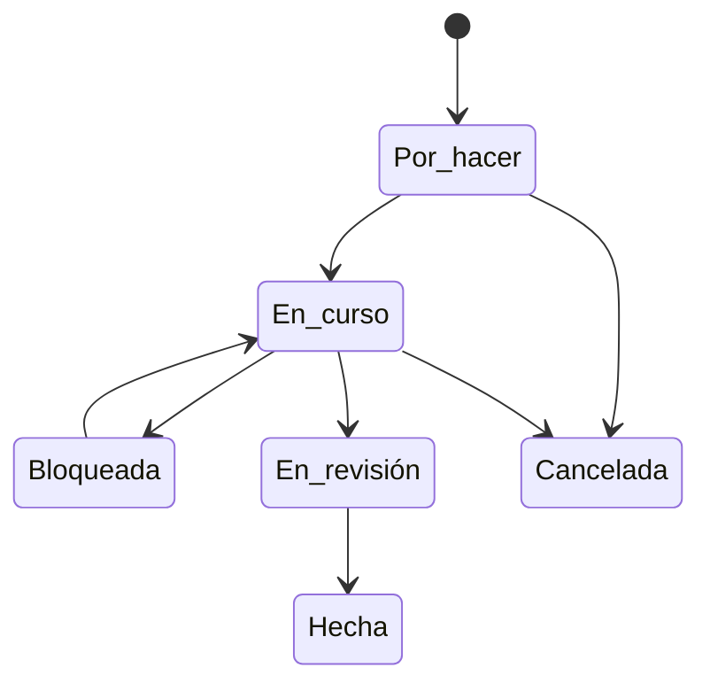

# Tareas

Las [tareas](../glosario.md#tarea) son el trabajo concreto que hay que hacer para cumplir: implantar un
control, cerrar una brecha, completar una evaluación o resolver un incidente. Fluxion las genera desde
el resto de módulos y permite también crearlas a mano, organizarlas en lista, tablero o calendario y
medir su cumplimiento.

## Propósito

Que todas las acciones derivadas del cumplimiento tengan responsable, fecha y seguimiento en un mismo
lugar, conectadas con el riesgo o la obligación que las origina. Forma parte del [Core](../glosario.md#core).

## Problema que resuelve

Las decisiones de gobierno se quedan en papel si no se convierten en trabajo asignado y seguido. Llevar
ese trabajo en una herramienta aparte rompe el vínculo con el riesgo que lo justifica y obliga a
duplicar información. Fluxion:

- **Conecta las tareas con su origen:** brechas, evaluaciones, modos de fallo, acciones del plan de
  tratamiento, [señales de riesgo](../glosario.md#señal-de-riesgo) críticas e incidentes.
- **Colabora:** comentarios con menciones, adjuntos, listas de comprobación, seguidores e historial de
  actividad.
- **Repite lo periódico:** tareas recurrentes y plantillas.
- **Mide:** total, completadas, vencidas, cumplimiento de plazos y tendencia semanal.

## Roles

| Rol | Responsabilidad |
|---|---|
| Cualquier miembro | Crea tareas, las asigna y trabaja en las suyas |
| Responsable asignado | Ejecuta la tarea y actualiza su estado |
| Seguidores | Reciben avisos de los cambios de las tareas que siguen |
| Responsable del SGAI, Directivo | Siguen el avance con las métricas |

## Flujo de trabajo

1. **Origen.** Una tarea nace a mano o desde otro módulo:
   - una acción del plan de tratamiento, salvo las aceptadas (ver TODO);
   - una brecha o un grupo de brechas;
   - un modo de fallo delegado;
   - una señal de riesgo crítica;
   - una acción correctora de un incidente.

   La tarea muestra siempre su origen y el sistema al que pertenece.

2. **Asignación.** Cada tarea tiene responsable, prioridad (baja, media, alta o crítica) y fecha
   límite. El responsable recibe un aviso al asignársela.

   > TODO: confirmar el aviso de asignación en las tareas que crean otros módulos. Hoy solo lo reciben
   > las tareas creadas a mano.
3. **Trabajo.**
   - La tarea avanza por sus estados: por hacer, en curso, bloqueada, en revisión, hecha y cancelada.
   - Admite comentarios con menciones, adjuntos de hasta 25 MB, una lista de comprobación y seguidores.
   - Todo cambio queda en su historial de actividad.
   - Cuando se completa una tarea nacida de una acción del plan de tratamiento, la acción se actualiza.

   > TODO: confirmar qué otros orígenes, además del plan de tratamiento, se actualizan al completar la
   > tarea.
4. **Organización.** Las tareas se ven de cinco formas:
   - **Lista**, con vistas guardadas personales o compartidas.

     > TODO: confirmar las vistas guardadas. Hoy no llegan a guardarse.
   - **Tablero Kanban**, con límites de trabajo en curso por columna.
   - **Calendario.**
   - **Métricas:** por estado, prioridad, origen y sistema, y tendencia de las últimas 8 semanas.
   - **Edición en bloque.**
5. **Plantillas y recurrencias.**
   - Las plantillas pueden ser personales, compartidas o predefinidas por Fluxion.
   - Las tareas recurrentes se generan solas con frecuencia diaria, semanal, quincenal, mensual,
     trimestral o anual, y también se pueden lanzar a mano.
6. **Integración.** Al completarse una tarea, Fluxion puede notificarlo a un sistema externo mediante
   una [integración saliente](../glosario.md#integración-saliente-webhook).

> TODO: confirmar el criterio de la métrica «SLA cumplimiento».

> **Pendiente de implementar.** Que las tareas completadas desde el tablero Kanban o en bloque también
> envíen el evento de tarea completada a las integraciones salientes; hoy solo lo envían las que se
> completan desde su ficha.

## Relación normativa

| Norma | Referencia | Qué cubre |
|---|---|---|
| ISO/IEC 42001 | §6.1.3 y §8.3 | Ejecución del plan de tratamiento de riesgos |
| ISO/IEC 42001 | §10.2 | Acciones correctivas derivadas de incidentes y no conformidades |
| AI Act | Art. 9.2.d | Adopción efectiva de las medidas de gestión de riesgos |

## Módulos relacionados

- **[Plan de tratamiento](plan-de-tratamiento.md):** origen principal de las tareas.
- **[Análisis de brechas](brechas.md):** tareas para cerrar brechas.
- **[Análisis de modos de fallo (FMEA)](analisis-modos-de-fallo.md):** delegación de modos de fallo.
- **[Incidentes](incidentes.md):** acciones correctoras.
- **[Plataforma](plataforma.md):** avisos e integraciones salientes.
- **Vistas:** [Tareas](../funcional/tareas.md), [Kanban](../funcional/kanban.md), [Calendario de tareas](../funcional/tareas-calendario.md),
  [Métricas de tareas](../funcional/tareas-metricas.md), [Plantillas de tareas](../funcional/tareas-plantillas.md),
  [Tareas recurrentes](../funcional/tareas-recurrentes.md).
