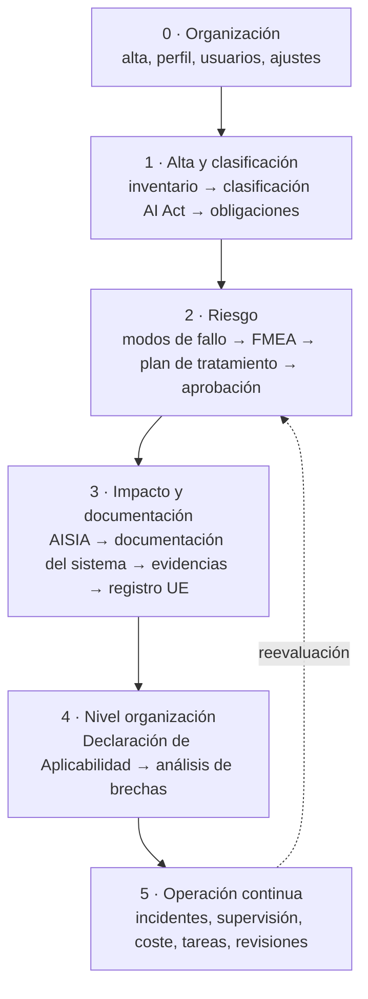

# Visión general de Fluxion

Fluxion es una plataforma de gobernanza y gestión de riesgos de la inteligencia artificial. Permite a
una organización saber qué [sistemas de IA](../glosario.md#sistema-de-ia) tiene, qué le exige la
normativa por cada uno, qué riesgos presentan, qué está haciendo para tratarlos y con qué
[evidencias](../glosario.md#evidencia) lo demuestra.

## Propósito

Fluxion reúne en un solo lugar el ciclo completo de cumplimiento de la IA:
- El [inventario de sistemas de IA](../glosario.md#inventario-de-sistemas-de-ia).
- La [clasificación AI Act](../glosario.md#clasificación-ai-act) y las
  [obligaciones](../glosario.md#obligación) que se derivan de ella.
- La evaluación de riesgos mediante el [análisis de modos de fallo (FMEA)](../glosario.md#análisis-de-modos-de-fallo-fmea).
- El [plan de tratamiento](../glosario.md#plan-de-tratamiento) y su aprobación.
- La [evaluación de impacto](../glosario.md#evaluación-de-impacto-del-sistema-de-ia-aisia).
- La documentación regulatoria.
- La [Declaración de Aplicabilidad ISO 42001](../glosario.md#declaración-de-aplicabilidad-iso-42001).
- La operación continua: incidentes, supervisión humana, coste y tareas.

Se ofrece como servicio en la nube, con los datos de cada [organización](../glosario.md#organización)
aislados de los demás. Tiene un conjunto de funcionalidades incluidas siempre (el [Core](../glosario.md#core))
y [módulos](../glosario.md#módulo) que se contratan aparte. Ver [Módulos y planes](modulos-y-planes.md).

## Problema que resuelve

El AI Act impone obligaciones distintas según el nivel de riesgo de cada sistema y el papel que la
organización tiene en él: proveedor, responsable del despliegue, importador, distribuidor o
representante autorizado. ISO/IEC 42001 pide además un sistema de gestión con riesgos evaluados,
controles justificados e información documentada. Sin una herramienta, ese trabajo suele quedar
repartido en hojas de cálculo, documentos sueltos y correos, y aparecen cuatro problemas:

- **Falta de visibilidad:** no se sabe con certeza cuántos sistemas de IA hay ni cuáles son de alto
  riesgo. Fluxion mantiene el inventario y puede detectar automáticamente sistemas no declarados (con
  el módulo [Descubrimiento de inventario](../glosario.md#descubrimiento-de-inventario)).
- **Obligaciones sin aterrizar:** pasar del texto del Reglamento a qué hay que hacer en cada sistema es
  laborioso. Fluxion propone la clasificación y las obligaciones aplicables a partir de los datos del
  sistema, y una persona las revisa.
- **Evaluación de riesgos sin método común:** cada equipo valora el riesgo a su manera. Fluxion parte
  de un [catálogo de tablas básicas](../glosario.md#catálogo-de-tablas-básicas) con cientos de
  [modos de fallo](../glosario.md#modo-de-fallo) y escalas fijas, y calcula una
  [zona de riesgo](../glosario.md#zona-de-riesgo) comparable entre sistemas.
- **Trazabilidad para auditoría:** demostrar ante un auditor o una autoridad qué se decidió, quién y
  con qué prueba exige reconstruir el histórico. En Fluxion cada decisión queda versionada, con su
  aprobación, sus evidencias e [instantáneas](../glosario.md#instantánea) fechadas.

## Roles

Fluxion distingue diez [roles](../glosario.md#rol). El detalle está en
[Plataforma](plataforma.md#roles).

| Rol | Responsabilidad en Fluxion |
|---|---|
| Administrador | Configura la organización, gestiona miembros, roles y módulos |
| Responsable del SGAI | Coordina el ciclo de gobernanza de la IA |
| CAIO | Supervisión estratégica de la cartera de sistemas de IA |
| DPO | Cumplimiento en protección de datos |
| Responsable del sistema | Gestiona el ciclo de vida de uno o varios sistemas |
| Analista de riesgos | Evalúa y trata los riesgos mediante el análisis de modos de fallo |
| Analista de cumplimiento | Verifica el cumplimiento del AI Act, ISO/IEC 42001 y otra normativa |
| Directivo | Consulta indicadores y resúmenes |
| Auditor | Consulta de solo lectura de todos los módulos y evidencias |
| Lector | Consulta sin modificar |

> TODO: confirmar los nombres de negocio de «Responsable del SGAI» y «Responsable del sistema»
> (en la aplicación aparecen como «SGAI Manager» y «System Owner»).

## Flujo de trabajo

El recorrido tiene una fase de puesta en marcha y cuatro fases que se repiten por cada sistema y por
cada ciclo de revisión.

**0. Puesta en marcha (una vez).** La organización se da de alta y completa un breve onboarding:
sector, país, madurez frente a ISO/IEC 42001 y foco inicial. Después completa su ficha (datos
legales, responsables de gobierno), invita a sus miembros con su rol y configura avisos, conectores y
flujos de aprobación. Hasta completar el onboarding, la aplicación no deja continuar.

**1. Alta y clasificación de cada sistema.**
- El sistema se registra con un asistente por pasos, o se incorpora desde un
  [sistema detectado](../glosario.md#sistema-detectado-pendiente-de-alta).
- Fluxion propone su [nivel de riesgo AI Act](../glosario.md#nivel-de-riesgo-ai-act). Una persona lo
  confirma.
- Del nivel de riesgo y del [rol en la cadena de valor](../glosario.md#rol-en-la-cadena-de-valor) salen
  las obligaciones aplicables, cada una con su artículo.

**2. Evaluación y tratamiento del riesgo.**
- Fluxion activa en el sistema los modos de fallo que le aplican y los
  [prioriza](../glosario.md#priorización).
- El equipo evalúa cada modo priorizado (ocurrencia, detectabilidad y severidad) y de ahí resulta la
  zona de riesgo del sistema. Nunca queda por debajo del [suelo AI Act](../glosario.md#suelo-ai-act).
- Para cada modo se decide una [opción de tratamiento](../glosario.md#opción-de-tratamiento) en el
  plan de tratamiento.
- El plan se aprueba con un [nivel de aprobación](../glosario.md#nivel-de-aprobación) que depende de
  la zona.
- Sin modos de fallo activados, el análisis no puede empezar.

**3. Impacto y documentación.**
- Se completa la evaluación de impacto del sistema (AISIA). Sus secciones de modos de fallo y acciones
  de tratamiento se alimentan de la fase anterior.
- Con el módulo [Documentación del sistema](../glosario.md#documentación-del-sistema) se generan la
  documentación técnica del Anexo IV, la FRIA, la DPIA y la ficha del modelo.
- Se adjuntan las evidencias de cada obligación.
- En los sistemas de alto riesgo se prepara la [ficha para el registro UE](../glosario.md#ficha-para-el-registro-ue).

**4. Nivel organización.**
- Se elabora la Declaración de Aplicabilidad ISO 42001 a partir de las evaluaciones de impacto
  aprobadas: Fluxion no la propone sin al menos una aprobada.
- El [análisis de brechas](../glosario.md#brecha) muestra en un solo lugar lo que falta: obligaciones
  sin cubrir, riesgos sin tratar, controles sin implantar y evidencias caducadas.

**5. Operación continua.**
- Registro de [incidentes](../glosario.md#incidente), con los plazos de notificación del AI Act.
- [Supervisión humana](../glosario.md#supervisión-humana) de las decisiones del sistema.
- Coste y uso de los modelos.
- [Tareas](../glosario.md#tarea) y revisiones periódicas de lo aceptado o pospuesto.

Cada reevaluación crea una versión nueva y la anterior se conserva.

> **Pendiente de implementar.** Los disparadores automáticos de reevaluación (por un incidente, un
> cambio del sistema, un cambio normativo o el vencimiento de un plazo). Hoy la reevaluación se inicia
> a mano.

En todo el recorrido está disponible el [Asistente SGAI](../glosario.md#asistente-sgai): responde
preguntas sobre la normativa y los sistemas de la organización, apoyándose en un
[corpus normativo](../glosario.md#corpus-normativo).

## Relación normativa

| Norma | Referencia | Qué cubre Fluxion |
|---|---|---|
| AI Act | Art. 5, 6, 50 y Anexo III | Clasificación del sistema por nivel de riesgo |
| AI Act | Art. 3.3 a 3.7 | Rol de la organización en la cadena de valor, que determina las obligaciones |
| AI Act | Art. 9 | Sistema de gestión de riesgos: identificación, estimación y tratamiento mediante el análisis de modos de fallo y el plan de tratamiento |
| AI Act | Art. 11 y Anexo IV | Documentación técnica (módulo Documentación del sistema) |
| AI Act | Art. 14 | Medición de la supervisión humana (módulo Supervisión post-comercialización) |
| AI Act | Art. 27 | Evaluación de impacto en los derechos fundamentales (FRIA) |
| AI Act | Art. 49 y 71 | Preparación de los datos para el registro en la base de datos de la UE. La presentación es manual |
| AI Act | Art. 73 | Registro de incidentes graves y control del plazo de notificación |
| ISO/IEC 42001 | §6.1.2 y §6.1.3 | Evaluación y tratamiento de riesgos de la IA |
| ISO/IEC 42001 | §6.1.3 y Anexo A | Declaración de Aplicabilidad de los 38 controles |
| ISO/IEC 42001 | §6.1.4 | Evaluación de impacto del sistema de IA (AISIA) |
| ISO/IEC 42001 | §7.5 | Información documentada: evidencias versionadas y documentos aprobados |
| ISO/IEC 42001 | §9.3 | Revisión por la Dirección, como uno de los tipos de [comité](../glosario.md#comité) |
| RGPD | Art. 35 | Evaluación de impacto relativa a la protección de datos (DPIA) |

El corpus normativo del Asistente SGAI incluye además el MDR, el IVDR, DORA, el ENS y las guías de la
AESIA. Esas normas no tienen hoy un flujo de cumplimiento propio en Fluxion.

> TODO: confirmar qué marcos, además del AI Act y de ISO/IEC 42001, se presentan comercialmente como
> cubiertos. En la organización se pueden declarar como [marcos aplicables](../glosario.md#marco-aplicable),
> pero no hay obligaciones de catálogo específicas para ellos.

## Módulos relacionados

Este documento resume todo el producto. Cada parte tiene su documento de negocio:

- **Plataforma:** [Plataforma](plataforma.md) (organización, usuarios, roles y avisos) ·
  [Módulos y planes](modulos-y-planes.md) · [Hoja de ruta](hoja-de-ruta.md).
- **Core:** Inventario de sistemas de IA · Clasificación AI Act · Obligaciones · Análisis de modos de
  fallo (FMEA) · Plan de tratamiento · Análisis de brechas · Biblioteca de evidencias · Declaración de
  Aplicabilidad ISO 42001 · Informes del sistema · Incidentes · Flujos de aprobación · Tareas ·
  Asistente SGAI · Catálogo de tablas básicas.
- **Módulos contratables:** Descubrimiento de inventario · Coste y uso de IA (FinOps) · Supervisión
  post-comercialización · Documentación del sistema · Actas y paquetes de auditoría · Evaluación de
  impacto.

El índice completo está en [indice.md](../indice.md). La arquitectura técnica se describe en
[arquitectura.md](../tecnica/arquitectura.md).
