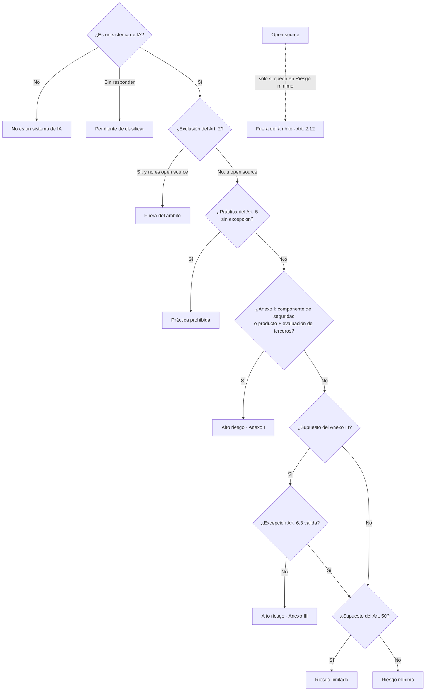
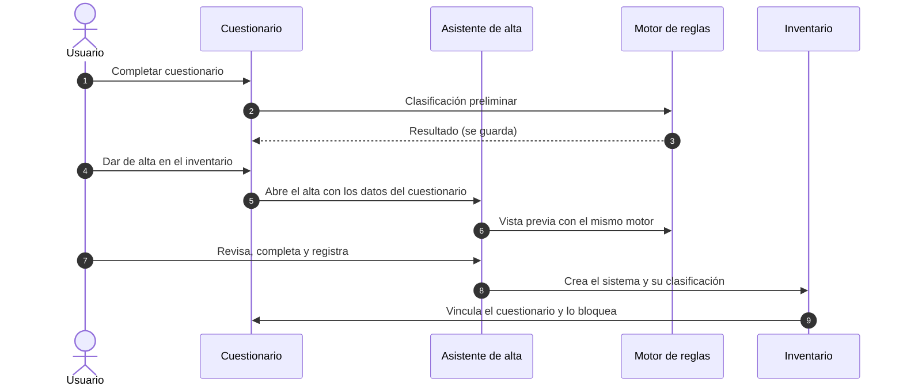

# Cuestionario preliminar: reglas de clasificación AI Act y volcado al alta

Especificación de las reglas de negocio que debe aplicar el
[cuestionario preliminar](../glosario.md#cuestionario-preliminar) para obtener una
[clasificación AI Act](../glosario.md#clasificación-ai-act) preliminar de un sistema, y de cómo sus
respuestas se vuelcan en el asistente de [alta de sistema](../funcional/inventario-alta.md).

Es un documento de **especificación**, no de descripción: dice lo que debe hacer la aplicación. Lo que
ya existe se indica como tal.

## 0. Decisiones de partida

Tomadas por el responsable del proyecto el 2026-10-19:

| # | Decisión |
|---|---|
| D1 | El cuestionario da una **clasificación preliminar**. La clasificación que queda en el sistema la calcula el alta al registrarlo, con el **mismo motor de reglas** |
| D2 | El volcado **abre el asistente de alta relleno** con las respuestas; la persona lo revisa, lo completa y registra el sistema. Un cuestionario da lugar a **un solo sistema** y queda bloqueado tras el volcado |
| D3 | **Modelo de IA de uso general (GPAI)** se trata como una **categoría aparte**, que se suma al nivel de riesgo del sistema. Deja de ser un valor del nivel de riesgo |
| D4 | Documento para producto y para desarrollo |
| D5 | Alcance: **solo el AI Act**. Los datos de RGPD y del resto de marcos se vuelcan si tienen campo, pero no tienen reglas aquí |

## 1. Situación actual

Estado tras los bloques B13a, B13b y B13c (2026-10-22) y B13d (2026-10-26):

- **Motor único (B13a).** Las reglas de §4 están implementadas en `lib/ai-act` y las usan el alta, la
  edición, la reclasificación y el alta desde sistemas detectados. El servicio de agentes ya no clasifica
  por reglas. Sin supuestos AI Act, el motor hace una clasificación aproximada con el dominio y el tipo de
  output (principio 2).
- **Cuestionario (B13b).** Incluye los cambios Q-01 a Q-13 de §8 y las reglas RN-V01 a RN-V12 de §5. Sus
  respuestas se traducen a supuestos AI Act (`lib/preliminary-questionnaire/to-aiact.ts`) y el panel
  **Clasificación preliminar** muestra el resultado del motor en todas las secciones. Al completar, la
  clasificación se guarda en `preliminary_questionnaires.classification` (§7).
- **Volcado al alta (B13c).** Implementadas las reglas RN-W01 a RN-W15 de §6, con la simplificación de
  RN-W04 indicada en §6.2. **Dar de alta en el inventario** abre el asistente relleno
  (`lib/preliminary-questionnaire/to-wizard.ts`, tabla de §6.3) con el bloque **Supuestos AI Act** en el
  paso 3, que también está en la edición del sistema. Al registrar, el cuestionario queda vinculado
  (`preliminary_questionnaires.ai_system_id`) y es de solo lectura, también en la base de datos
  (migración `20261022110000_cuestionario_vinculo.sql`). En el asistente, GPAI deja de ser una opción de
  «¿Es este un sistema de inteligencia artificial?» y pasa a ser un indicador aparte (D3).
- **GPAI y catálogo (B13d).** GPAI deja de ser un nivel de riesgo también en los datos: los sistemas con
  nivel `gpai` pasan a la categoría GPAI (`is_gpai`), con nivel **Pendiente de clasificar** y la marca
  «Pendiente de revisar con el motor nuevo», y un CHECK impide el valor (§4.7). El catálogo de
  obligaciones aplica los cambios de DP-10 (§4.9) y la vista `compliance.v_system_obligations` replica en
  SQL las reglas RN-O01 a RN-O07 del motor (migración `20261026090000_ai_act_gpai_catalogo.sql`). Las
  pantallas (inventario, ficha, informes, evaluaciones, dashboard) ya no muestran GPAI como nivel; el
  inventario y la ficha muestran la categoría GPAI aparte.
- **Cuestionarios anteriores.** Los completados antes de B13b no tienen clasificación guardada y, mientras
  no se respondan las preguntas nuevas, se clasifican como **Pendiente de clasificar**.

## 2. Principios

1. **Un único motor.** Las reglas de este documento se implementan una sola vez y las usan el
   cuestionario, el alta, la edición y la reclasificación. El motor del servicio de agentes se alinea con
   él o deja de clasificar por reglas.
2. **Los supuestos, no el dominio.** El cuestionario recoge los supuestos concretos del AI Act (cada
   práctica del Art. 5, cada punto del Anexo III, cada categoría del Anexo I). El motor clasifica con ellos.
   El dominio y el tipo de output solo se usan como respaldo cuando un sistema no tiene supuestos (sistemas
   dados de alta sin cuestionario).
3. **El nivel es del sistema; las obligaciones dependen del rol.** El nivel de riesgo se determina por lo
   que hace el sistema. Las obligaciones se obtienen cruzando ese nivel con el
   [rol en la cadena de valor](../glosario.md#rol-en-la-cadena-de-valor) de la organización.
4. **Siempre explicable.** Cada resultado indica qué respuestas lo han provocado y qué regla se aplicó.
5. **Siempre preliminar.** El cuestionario nunca fija la clasificación del sistema; la propone. Una
   persona la confirma en el alta.
6. **Sin respuesta no es «no».** Una casilla sin marcar no equivale a «no aplica». Para clasificar hay que
   responder de forma explícita (ver RN-V02).

## 3. Resultado de la clasificación preliminar

El motor devuelve un resultado con estas partes:

| Parte | Valores | Notas |
|---|---|---|
| **Ámbito** | Dentro del ámbito · Fuera del ámbito (con motivo) · No es un sistema de IA | Ver §4.1 |
| **Nivel de riesgo AI Act** | Práctica prohibida · Alto riesgo · Riesgo limitado · Riesgo mínimo · Pendiente de clasificar | Sin GPAI (D3). Solo si está dentro del ámbito |
| **Vía del alto riesgo** | Anexo I Sección A · Anexo I Sección B · Anexo III (punto y letra) | Solo en alto riesgo |
| **Excepción del Art. 6.3** | No aplica · Invocada y válida · Invocada y no válida | Solo en supuestos del Anexo III |
| **Supuestos de transparencia** | Lista de Art. 50.1, 50.2, 50.3, 50.4 | Acumulable con cualquier nivel |
| **Categoría GPAI** | Proveedor de modelo GPAI (sí/no) · con riesgo sistémico (sí/no/sin determinar) · Sistema basado en un modelo GPAI de terceros (informativo) | D3 |
| **Roles** | Roles declarados y roles sugeridos | Ver §4.7 |
| **Obligaciones aplicables** | Códigos del catálogo (`AI-ACT-ART…`) | Ver §4.8 |
| **Fundamento** | Lista de reglas aplicadas, con las respuestas que las activaron | Principio 4 |
| **Avisos** | Contradicciones y datos que faltan | Ver §5 |

**Decidido (DP-10, 2026-10-20).** Se aceptan los términos «Fuera del ámbito» y «Sistema basado en un
modelo GPAI de terceros». Falta incorporarlos a `glosario.md`.

### Orden de evaluación

Después, y con independencia del nivel, se evalúan la **transparencia** (acumulable con alto riesgo),
la **categoría GPAI** y los **roles**.

## 4. Reglas de clasificación

Cada regla tiene un identificador estable (`RN-…`) para poder citarla en el fundamento del resultado, en
el código y en las pruebas.

### 4.1 Ámbito (AI Act, Art. 2 y Art. 3.1)

| Regla | Condición (respuestas) | Resultado |
|---|---|---|
| **RN-A01** | `q4_usa_ia` = No | **No es un sistema de IA**. No se evalúa nada más. Aviso si hay supuestos marcados en Finalidad prevista (RN-V05) |
| **RN-A02** | `q4_usa_ia` sin responder | **Pendiente de clasificar** |
| **RN-A03** | `q10_exclusiones` incluye `militar` | **Fuera del ámbito** · Art. 2.3 (fines militares, de defensa o de seguridad nacional) |
| **RN-A04** | `q10_exclusiones` incluye `cooperacion` | **Fuera del ámbito** · Art. 2.4 (autoridades de terceros países y organizaciones internacionales en cooperación policial y judicial) |
| **RN-A05** | `q10_exclusiones` incluye `id` | **Fuera del ámbito** · Art. 2.6 / 2.8 (investigación y desarrollo científico, o actividades previas a la introducción en el mercado). Aviso: las pruebas en condiciones reales no están excluidas |
| **RN-A06** | `q10_exclusiones` incluye `open_source` | **No excluye por sí sola.** Se clasifica con normalidad; solo si el resultado es Riesgo mínimo y no hay supuestos del Art. 50 queda **Fuera del ámbito** · Art. 2.12. Si el sistema es prohibido, de alto riesgo o tiene supuestos del Art. 50, la exclusión no aplica y se avisa |
| **RN-A07** | `q10_exclusiones` incluye la exclusión por uso personal no profesional (ver Q-09) | **Fuera del ámbito** · Art. 2.10 |
| **RN-A08** | Varias exclusiones | Se aplica la primera de este orden: A03, A04, A07, A05, A06. Todas constan en el fundamento |

> **✔ Corregido en B13b (Q-09).** La antigua opción `profesional` decía «El sistema de IA se utiliza para
> actividades **exclusivamente profesionales**». El Art. 2.10 excluye el uso **personal de carácter no
> profesional**: la opción decía lo contrario y excluía del ámbito a casi cualquier sistema de una
> empresa. Se sustituyó por `uso_personal`, y las respuestas guardadas con `profesional` **no se tratan
> como exclusión**.

### 4.2 Prácticas prohibidas (AI Act, Art. 5.1)

Bloque **Supuestos clase 1 · Bloque A** (`c1`).

| Regla | Opción | Art. 5.1 | Excepción que hay que preguntar (Q-02) |
|---|---|---|---|
| **RN-P01** | `subliminal` | a) | — |
| **RN-P02** | `vulnerabilidades` | b) | — |
| **RN-P03** | `scoring_social` | c) | — |
| **RN-P04** | `riesgo_delito` | d) | No aplica si el sistema apoya una valoración humana basada en hechos objetivos y verificables ligados a una actividad delictiva |
| **RN-P05** | `scraping_facial` | e) | — |
| **RN-P06** | `emociones` | f) | No aplica si se usa por motivos médicos o de seguridad |
| **RN-P07** | `categorizacion_biometrica` | g) | No aplica al etiquetado o filtrado de conjuntos de datos biométricos adquiridos lícitamente en el ámbito de la aplicación de la ley |
| **RN-P08** | `rbi_tiempo_real` | h) | Solo admisible en los supuestos tasados del Art. 5.1.h, con autorización previa (Art. 5.2 a 5.7) |

- **RN-P10.** Si hay al menos una práctica marcada sin su excepción, el nivel es **Práctica prohibida**.
  El fundamento lista todas las prácticas marcadas.
- **RN-P11.** Si todas las prácticas marcadas tienen su excepción declarada y justificada, no son
  prohibidas, pero se evalúan como supuestos del Anexo III: emociones y categorización biométrica →
  Anexo III, punto 1; identificación biométrica → punto 1.a; predicción de delitos → punto 6.
- **RN-P12.** Una práctica prohibida no se puede volcar como sistema operativo sin aviso: el alta muestra
  «Práctica prohibida: el sistema no puede introducirse en el mercado ni utilizarse en la UE» y propone el
  estado **Retirado** o **Desarrollo** (ver RN-W07).

### 4.3 Alto riesgo por el Anexo I (AI Act, Art. 6.1)

Bloque **Supuestos clase 2 · Bloque A** (`c2a`, `c2a_productos`).

El Art. 6.1 exige **dos condiciones a la vez**: (a) el sistema es componente de seguridad de un producto, o
es en sí mismo un producto, regulado por la legislación del Anexo I; y (b) ese producto debe someterse a
una evaluación de la conformidad de terceros.

| Regla | Condición | Resultado |
|---|---|---|
| **RN-H01** | (`c2a` incluye `componente_seguridad` **o** el sistema es en sí mismo un producto, Q-03) **y** `c2a` incluye `evaluacion_terceros` **y** al menos una categoría en `c2a_productos` | **Alto riesgo · Anexo I** |
| **RN-H02** | Se cumple (a) pero no (b) | No es alto riesgo por esta vía. Aviso: «Sin evaluación de terceros no es alto riesgo por el Art. 6.1; se sigue evaluando el Anexo III» |
| **RN-H03** | Hay categorías marcadas sin ninguna opción de `c2a`, o al revés | Incompleto: aviso RN-V06 y nivel **Pendiente de clasificar** |
| **RN-H04** | Sección del Anexo I según la categoría (tabla siguiente) | Se informa la sección. En la **Sección B** solo se aplican determinados artículos del AI Act (Art. 2.2), así que las obligaciones de alto riesgo del catálogo no se sugieren automáticamente: se avisa para revisión manual |

| Sección A (nuevo marco legislativo) | Sección B (otra legislación de armonización) |
|---|---|
| `maquinaria`, `juguetes`, `embarcaciones_recreo`, `ascensores`, `atex`, `radioelectricos`, `presion`, `cable`, `epi`, `gas`, `sanitarios`, `sanitarios_iv` | `aviacion`, `dos_tres_ruedas`, `agricolas`, `marinos`, `motor_remolques`, `motor_seguridad`, ferroviario (falta, Q-03) |

> TODO: confirmar con el responsable jurídico cómo deben tratarse las obligaciones de los sistemas del
> Anexo I Sección B. El catálogo de obligaciones no distingue el régimen del Art. 2.2. (DP-10: pendiente de
> revisión jurídica.)

### 4.4 Alto riesgo por el Anexo III (AI Act, Art. 6.2)

Bloque **Supuestos clase 2 · Bloque B**. Cada opción marcada es un supuesto del Anexo III:

| Regla | Campo y opción | Anexo III | Dominio sugerido para el alta (RN-W03) |
|---|---|---|---|
| **RN-H10** | `c2b_biometria` · `identificacion` | 1.a Identificación biométrica remota (no la verificación) | — |
| **RN-H11** | `c2b_biometria` · `conclusiones_biometricas` | 1.b Categorización biométrica y 1.c reconocimiento de emociones | — |
| **RN-H12** | `c2b_infra` · `componente_seguridad` | 2 Infraestructuras críticas | `infra` |
| **RN-H13** | `c2b_educacion` · `acceso`, `resultados`, `nivel`, `examenes` | 3.a a 3.d | `educacion` |
| **RN-H14** | `c2b_empleo` · `seleccion`, `condiciones` | 4.a y 4.b | `rrhh` |
| **RN-H15** | `c2b_asistencia` · `admisibilidad` | 5.a Prestaciones y servicios públicos esenciales | `otro` |
| **RN-H16** | `c2b_solvencia` · `solvencia` | 5.b Solvencia y calificación crediticia (salvo detección de fraude) | `credito` |
| **RN-H17** | `c2b_seguros` · `precios` | 5.c Evaluación de riesgos y fijación de precios en seguros de vida y salud | `seguros` |
| **RN-H18** | `c2b_emergencias` · `llamadas` | 5.d Llamadas de emergencia y triaje | `seguridad` |
| **RN-H19** | `c2b_ley` · `victima`, `poligrafos`, `pruebas`, `reincidencia`, `perfiles` | 6.a a 6.e Garantía del cumplimiento del Derecho | `seguridad` |
| **RN-H20** | `c2b_migracion` · `poligrafos`, `riesgo`, `solicitudes`, `deteccion` | 7.a a 7.d Migración, asilo y control fronterizo | `migracion` |
| **RN-H21** | `c2b_justicia` · `judicial`, `electoral` | 8.a y 8.b Justicia y procesos democráticos | `justicia` |

- **RN-H22.** Con al menos un supuesto marcado y sin excepción válida del Art. 6.3 (§4.5), el nivel es
  **Alto riesgo · Anexo III**. El fundamento lista los puntos.
- **RN-H23.** Los supuestos del punto 1 (biometría) solo son alto riesgo si su uso está permitido; si
  coincide con una práctica prohibida (§4.2), manda la prohibición.

> **⚠ Opciones del cuestionario que no coinciden con el Anexo III** (se corrigen en Q-04 y Q-05):
> - `c2b_infra` habla de «infraestructuras digitales críticas del tráfico rodado, ferroviario y aéreo». El
>   Anexo III, punto 2, cita la infraestructura digital crítica, el tráfico rodado y el suministro de agua,
>   gas, calefacción y electricidad; no cita el ferroviario ni el aéreo.
> - `c2b_seguros` · `admisibilidad` (acceso a seguros de vida y salud) no figura en el Anexo III, que solo
>   cita la evaluación de riesgos y la fijación de precios (5.c). Hasta revisarla, el motor la trata como
>   5.c y lo indica en el fundamento.
>
> TODO: confirmar con el responsable jurídico el tratamiento de `c2b_seguros` · `admisibilidad`. Mientras
> tanto (DP-10, 2026-10-20), la opción se ha retirado del cuestionario.

### 4.5 Excepción del Art. 6.3

Un sistema del Anexo III **no es de alto riesgo** si no plantea un riesgo importante para la salud, la
seguridad o los derechos fundamentales y cumple al menos una de las condiciones del Art. 6.3. El
cuestionario actual no la pregunta: se añade el bloque Q-06.

| Regla | Condición | Resultado |
|---|---|---|
| **RN-E01** | Se invoca la excepción y se marca al menos una condición: a) tarea procedimental limitada; b) mejora del resultado de una actividad humana previa; c) detección de patrones de decisión sin sustituir ni influir en la valoración humana sin revisión; d) tarea preparatoria de una evaluación | Excepción **válida**, salvo RN-E02 |
| **RN-E02** | El sistema **elabora perfiles** de personas físicas: `c3` incluye `perfiles`, o `c2b_ley` incluye `perfiles`, o se responde «Sí» en la pregunta de perfilado de Q-06 | Excepción **no válida**: el Art. 6.3 dice que el sistema siempre es de alto riesgo. Se avisa |
| **RN-E03** | Excepción válida | El sistema sale de alto riesgo y se evalúa el Art. 50. Se añade la obligación de **documentar la evaluación antes de introducirlo en el mercado y registrarlo** (Art. 6.4 y 49.2) si la organización es proveedor |
| **RN-E04** | Se invoca sin justificación | Incompleto (RN-V07) |

> **💡 Nota de producto.** La excepción es una valoración del proveedor con efectos legales. Conviene que
> el alta exija confirmarla de forma explícita y que quede en el historial de la clasificación.

### 4.6 Transparencia (AI Act, Art. 50)

Las obligaciones del Art. 50 dependen de **qué hace** el sistema, no de su nivel, y se suman a las de
alto riesgo.

| Regla | Supuesto | Respuesta que lo activa | Obligado |
|---|---|---|---|
| **RN-T01** | 50.1 · Interactúa directamente con personas físicas | `c3` incluye `interaccion` | Proveedor |
| **RN-T02** | 50.2 · Genera contenido sintético de audio, imagen, vídeo o texto | `c3` incluye `generacion` | Proveedor |
| **RN-T03** | 50.3 · Reconocimiento de emociones o categorización biométrica | `c2b_biometria` incluye `conclusiones_biometricas`, o RN-P11 con `emociones` o `categorizacion_biometrica` | Responsable del despliegue |
| **RN-T04** | 50.4 · Ultrasuplantaciones (*deep fakes*) o texto publicado para informar al público sobre asuntos de interés público | Nuevas preguntas de Q-07 | Responsable del despliegue |

- **RN-T05.** Si el sistema no es prohibido ni de alto riesgo y tiene al menos un supuesto del Art. 50, el
  nivel es **Riesgo limitado**.
- **RN-T06.** Si es de alto riesgo, el nivel sigue siendo **Alto riesgo** y los supuestos del Art. 50 se
  añaden al resultado.
- **RN-T07.** Sin supuestos del Art. 50 ni de niveles superiores, el nivel es **Riesgo mínimo**.

> **ℹ Aclaración.** `c3` · `reconocimiento` («Reconocimiento de imágenes, texto o voz») no activa por sí
> solo el Art. 50: solo lo hace si es reconocimiento de emociones o categorización biométrica (RN-T03).

### 4.7 Modelo de IA de uso general (D3)

GPAI deja de ser un nivel. El resultado lleva una **categoría GPAI** independiente:

| Regla | Condición (nuevas preguntas, Q-08) | Resultado |
|---|---|---|
| **RN-G01** | La organización **desarrolla un modelo de IA de uso general y lo introduce en el mercado** (Art. 3.63) | **Proveedor de modelo GPAI**. Aplican las obligaciones de alcance GPAI (Art. 53; Art. 54 si el proveedor está fuera de la UE) |
| **RN-G02** | RN-G01 y el modelo supera 10^25 FLOP de cómputo de entrenamiento, o la Comisión lo ha designado | **Con riesgo sistémico** (Art. 51). Añade el Art. 55 |
| **RN-G03** | RN-G01 y no se sabe el cómputo | Riesgo sistémico **sin determinar**: aviso |
| **RN-G04** | RN-G01 con licencia libre y de código abierto y sin riesgo sistémico | Obligaciones del Art. 53 reducidas (Art. 53.2): aviso para revisión manual |
| **RN-G05** | El sistema **usa** un modelo GPAI de un tercero (por ejemplo, vía API) | **Sistema basado en un modelo GPAI de terceros**. Informativo: no genera obligaciones de proveedor de modelo |
| **RN-G06** | La organización modifica (*fine-tuning*) un modelo GPAI de terceros y lo introduce en el mercado | Posible **proveedor de modelo GPAI** por la modificación: aviso para revisión manual |

- **RN-G07.** La categoría GPAI no cambia el nivel de riesgo del sistema. Un sistema basado en un modelo
  GPAI se clasifica por lo que hace (§4.2 a §4.6).

**Consecuencias en el modelo de datos** (ver §7):
- `ai_systems.aiact_risk_level` deja de recibir `gpai`.
- `ai_systems.is_gpai` pasa a significar «la organización es proveedora de un modelo GPAI».
- Se añade el riesgo sistémico y el indicador de «basado en un modelo GPAI de terceros».
- Los sistemas existentes con nivel `gpai` se migran: `is_gpai = true` y nivel **Pendiente de clasificar**
  para que se reclasifiquen.

**Decidido (DP-10, 2026-10-20).** GPAI es una categoría aparte, no un nivel de riesgo (D3).

**Implementado.** RN-G01 a RN-G07 en el motor (B13a); las columnas `gpai_systemic_risk` y
`gpai_third_party_based`, en B13a. La migración de los sistemas con nivel `gpai` (`is_gpai = true`, nivel
`pending` y `aiact_review_pending = true`) y el CHECK `chk_ai_systems_aiact_risk_level_sin_gpai`, que impide
el valor, en B13d (`20261026090000_ai_act_gpai_catalogo.sql`). El valor sigue en el enum, en desuso, y en
`classification_events.risk_level` para el histórico. El inventario y la ficha muestran la categoría GPAI
junto al nivel (B13d).

### 4.8 Rol en la cadena de valor (AI Act, Art. 3.3 a 3.7 y Art. 25)

El rol lo **declara** la persona (`pos_roles`). El motor **sugiere** roles a partir de la propiedad del
sistema y **avisa** de las incoherencias, pero nunca cambia los declarados.

| Regla | Condición | Sugerencia o aviso |
|---|---|---|
| **RN-R01** | `propiedad` = `propio_organizacion` | Sugerir **Proveedor**; además **Responsable del despliegue** si la organización lo usa |
| **RN-R02** | `propiedad` = `tercero_organizacion` | Sugerir **Responsable del despliegue** |
| **RN-R03** | `propiedad` = `propio_cliente` | El proveedor suele ser el cliente, que lo introduce con su nombre. Sugerir **ningún rol** y avisar de que la organización pasa a ser proveedor si lo comercializa con su propio nombre |
| **RN-R04** | `propiedad` = `tercero_cliente` | El responsable del despliegue suele ser el cliente. Sugerir **ningún rol**, salvo que la organización lo use bajo su propia autoridad |
| **RN-R05** | `tercero_organizacion` y `prov_en_europa` = No, y la organización lo comercializa en la UE | Sugerir revisar **Importador** |
| **RN-R06** | Nivel **Alto riesgo** y la organización (no proveedora) pone su nombre o marca, lo modifica sustancialmente o cambia su finalidad prevista (preguntas de Q-11), o `u_forma` incluye `fine_tuning` | Aviso: **pasa a ser proveedor** (Art. 25.1). Sugerir **Proveedor** |
| **RN-R07** | `pos_roles` incluye `ninguno` y algún otro rol | Error: son excluyentes (RN-V08) |
| **RN-R08** | Roles declarados distintos de los sugeridos | Aviso, no bloqueo. Se muestran ambos |
| **RN-R09** | `pos_roles` vacío o solo `ninguno`, y el sistema está dentro del ámbito | Aviso: sin rol solo se sugieren las obligaciones que aplican a cualquier rol |

### 4.9 Obligaciones sugeridas

Las obligaciones salen del catálogo (`compliance.obligations`), cruzando su alcance (`scope`) y sus roles
(`applies_to_roles`) con el resultado:

| Regla | Alcance del catálogo | Se sugiere si… | Estado |
|---|---|---|---|
| **RN-O01** | `all` | El sistema está dentro del ámbito y la organización tiene un rol al que aplica (por ejemplo, Art. 4 alfabetización) | Implementado (motor, B13a; vista, B13d) |
| **RN-O02** | `high_risk` | Nivel **Alto riesgo** (Anexo I Sección A o Anexo III) y el rol coincide | Implementado (motor, B13a; vista, B13d) |
| **RN-O03** | `transparency` | Hay un supuesto del Art. 50 **cuyo obligado coincide con el rol** (§4.6). Sustituye la aproximación actual por nivel | Implementado (motor, B13a; catálogo dividido y vista, B13d) |
| **RN-O04** | `gpai` | Categoría **Proveedor de modelo GPAI** (Art. 55 solo con riesgo sistémico) | Implementado (motor, B13a; vista, B13d) |
| **RN-O05** | Prohibición | Nivel **Práctica prohibida**: se sugiere el Art. 5 y ninguna otra; el resultado indica la retirada o el rediseño | Implementado (motor, B13a; vista, B13d) |
| **RN-O06** | Art. 27 (FRIA) | Responsable del despliegue de alto riesgo del Anexo III (salvo el punto 2) que es organismo de derecho público o entidad privada que presta servicios públicos, o que despliega sistemas de los puntos 5.b o 5.c (Art. 27.1). Requiere la pregunta de Q-10 | Implementado (motor, B13a; descripción del catálogo y vista, B13d) |
| **RN-O07** | Art. 6.4 y 49.2 | Excepción del Art. 6.3 válida y rol Proveedor | Implementado (motor, B13a; obligación `AI-ACT-ART6-4` y vista, B13d) |
| **RN-O08** | Art. 26 por apartados | Responsable del despliegue de alto riesgo: 26.1, 26.2, 26.4, 26.5, 26.6, 26.9 y 26.12 siempre (como RN-O02); 26.7 solo con empleo (Anexo III, punto 4); 26.8 solo si es organismo público (Q-10) y Anexo III salvo el punto 2; 26.10 solo con identificación biométrica remota (punto 1.a); 26.11 solo con Anexo III salvo el punto 2 | Implementado (motor, catálogo y vista, B17a, `20261027160000_ai_act_art26_apartados.sql`). Origen: [informe del flujo de trabajo](informe-flujo-trabajo-ia.md) |

**Decidido (DP-10, 2026-10-20).** Cambios del catálogo de obligaciones, a aplicar en B13:
- el Art. 50 se divide en 50.1 a 50.4 (RN-O03);
- el Art. 27 solo se sugiere en los supuestos del Art. 27.1 (RN-O06);
- obligación nueva para documentar la excepción del Art. 6.3 (Art. 6.4 y 49.2, RN-O07).

**Implementado en B13d** (`20261026090000_ai_act_gpai_catalogo.sql`):
- el Art. 50 se divide en `AI-ACT-ART50-1` y `-2` (obligado: proveedor) y `AI-ACT-ART50-3` y `-4`
  (obligado: responsable del despliegue), con los tipos de evidencia del Art. 50. `AI-ACT-ART50` queda
  **retirada** (columna nueva `compliance.obligations.retired_at`): no se sugiere, pero se conserva en los
  sistemas que la tenían registrada;
- el Art. 27 cambia de descripción; la regla RN-O06 la aplican el motor y la vista;
- obligación nueva `AI-ACT-ART6-4`, solo para el rol Proveedor;
- `compliance.v_system_obligations` aplica RN-O01 a RN-O07 a partir de `aiact_result`, con la misma lógica
  que `suggestObligations`. Para los sistemas sin resultado del motor aproxima la transparencia y la FRIA
  por nivel y las marca como condicionales. La aplicación no la usa: las obligaciones sugeridas las calcula
  el motor.

> **ℹ Nota de implementación (B13d).** La vista incluye además las obligaciones de ISO/IEC 42001 para
> todos los sistemas, que el motor no trata porque solo carga el catálogo del AI Act. Una obligación del AI
> Act sin alcance (`scope` nulo) no se sugiere en ninguno de los dos.

## 5. Reglas del cuestionario: completitud y coherencia

| Regla | Qué comprueba | Efecto |
|---|---|---|
| **RN-V01** | Mínimo para clasificar: `q4_usa_ia`, `propiedad`, `pos_roles`, cada bloque de Finalidad prevista (`c1`, `c2a`, `c2b_*`, `c3`) y la pregunta GPAI de Q-08 | Sin ellos, la clasificación es **Pendiente de clasificar** y el cuestionario no se puede **Completar** |
| **RN-V02** | Cada bloque de casillas de Finalidad prevista tiene una opción explícita «Ninguno de los anteriores» (Q-01), excluyente con las demás | Distingue «no aplica» de «sin responder» |
| **RN-V03** | Si `q4_usa_ia` = No, Finalidad prevista y Posición en la cadena no se piden | El cuestionario se puede completar con «No es un sistema de IA» |
| **RN-V04** | Exclusión del Art. 2 marcada (salvo open source) | El resto de Finalidad prevista pasa a opcional |
| **RN-V05** | `q4_usa_ia` = No con supuestos marcados | Aviso de contradicción. Clasificación **Pendiente** hasta resolverla |
| **RN-V06** | `c2a` y `c2a_productos` incoherentes (RN-H03) | Aviso; no se puede completar |
| **RN-V07** | Excepción del Art. 5 (Q-02) o del Art. 6.3 (Q-06) sin justificación | No se puede completar |
| **RN-V08** | `pos_roles` con `ninguno` y otro rol | No se puede completar |
| **RN-V09** | Excepción del Art. 6.3 invocada con perfilado (RN-E02) | Aviso visible en el resultado |
| **RN-V10** | Detalle de un sí/no marcado «En caso afirmativo» | Solo se exige si la respuesta es Sí (antes de B13b se exigía también con No, `E20`) |
| **RN-V11** | La clasificación preliminar se recalcula en cada guardado y se muestra en el cuestionario | Panel **Clasificación preliminar** visible en todas las secciones |
| **RN-V12** | Al **Completar**, se guarda una copia del resultado con la versión de las reglas | Ver §7 |

**Implementado en B13b** (`missingRequired` y `coherenceErrors` de `schema.ts`). Diferencias con el texto
de la tabla:

- **RN-V01:** el bloque `c2b_*` se considera respondido con algún supuesto marcado o con la pregunta
  `c2b_ninguno` (ver la nota de Q-01 en §8).
- **RN-V02:** la opción «Ninguno» existe en `c1`, `c2a` y `c3` (se guarda como `__ninguno`); el bloque
  `c2b_*` tiene una sola pregunta «Ninguno» para todo el Anexo III.
- **RN-V05:** además del aviso en el resultado, impide **Completar**, igual que RN-V06, RN-V08 y la
  incompatibilidad de «Ninguno» con otras opciones. Mensaje: «Hay respuestas contradictorias: resuélvelas
  para completar el cuestionario.».
- **RN-V07:** la justificación de las excepciones del Art. 5 y del Art. 6.3 es obligatoria cuando se
  invocan; la pregunta de excepción del Art. 5 no lo es (sin responder, la práctica sigue siendo
  prohibida).
- **RN-V09:** lo emite el motor como aviso RN-E02.
- **RN-V10:** aplica a las preguntas 3 y 6 y a la reutilización de software (`p_reutiliza`).
- **RN-V11:** el panel se recalcula en cada cambio de respuesta, no solo al guardar; no guarda nada.
- Un campo oculto por una condición (bloques de Q-02, Q-06, Q-08 y Q-11) no se exige.

## 6. Volcado al asistente de alta

### 6.1 Flujo

### 6.2 Reglas

| Regla | Regla de negocio | Estado |
|---|---|---|
| **RN-W01** | **Dar de alta en el inventario** solo aparece en cuestionarios **Completados** sin sistema vinculado | Implementado (B13c) |
| **RN-W02** | Abre `/inventario/nuevo?cuestionario={id}`. El servidor lee el cuestionario de la organización y lo convierte en datos iniciales del asistente con la tabla de §6.3 | Implementado (B13c) |
| **RN-W03** | Un campo del alta con dos o más candidatos (por ejemplo, el dominio cuando hay supuestos de varios puntos del Anexo III) se deja vacío y se muestra la lista de candidatos | Implementado (B13c) |
| **RN-W04** | El asistente muestra el aviso «Datos precargados desde el cuestionario «{título}»» y marca cada campo precargado. Todo sigue siendo editable | Implementado con simplificación (B13c, ver nota) |
| **RN-W05** | Los supuestos AI Act del cuestionario (§7) se vuelcan a un bloque nuevo **Supuestos AI Act** del paso 3, editable. El motor clasifica con ellos (principio 2) | Implementado (B13c) |
| **RN-W06** | Si la clasificación final del alta difiere de la preliminar, la vista previa lo indica («Preliminar: X · Actual: Y») y el historial guarda las dos. No bloquea | Implementado (B13c) |
| **RN-W07** | Con una práctica prohibida, el alta muestra el aviso de RN-P12 y propone el estado Retirado | Implementado (B13c) |
| **RN-W08** | Fuera del ámbito o «No es un sistema de IA»: se permite el alta para dejar constancia, con aviso. La clasificación queda con su motivo | Implementado (B13c) |
| **RN-W09** | Al registrar, en la misma operación: se crea el sistema, se escribe `preliminary_questionnaires.ai_system_id` y se registra en el historial «Sistema registrado desde el cuestionario preliminar», con la clasificación preliminar y la final | Implementado (B13c, ver nota) |
| **RN-W10** | Si se abandona el alta, no se vincula nada | Implementado (B13c) |
| **RN-W11** | Un cuestionario vinculado es de **solo lectura**. Para cambiar datos se edita la ficha del sistema | Implementado (B13c) |
| **RN-W12** | Un sistema solo puede tener un cuestionario de origen (índice único sobre `ai_system_id`) | Implementado (B13c) |
| **RN-W13** | Si se elimina el sistema, el vínculo se borra (la FK ya es `ON DELETE SET NULL`) y el cuestionario vuelve a ser editable | Implementado (FK existente; el trigger de B13c permite el cambio) |
| **RN-W14** | La ficha del sistema enlaza con su cuestionario de origen | Implementado (B13c) |
| **RN-W15** | Las respuestas sin campo en el alta (tabla de §6.4) se conservan en el cuestionario y se consultan desde ese enlace | Implementado (B13c) |

> **ℹ Nota de implementación (B13c).**
> - **RN-W01:** el botón aparece en el formulario solo si no hay cambios sin guardar (el alta usa las
>   respuestas guardadas), y en el listado como **Dar de alta**; los vinculados muestran **En el
>   inventario →**.
> - **RN-W02:** con un cuestionario inexistente, sin completar o ya vinculado, la página muestra un error
>   en lugar del asistente. El servidor vuelve a comprobarlo al registrar.
> - **RN-W04 (simplificación):** el aviso lista los campos precargados, pero los campos no se marcan uno a
>   uno en el formulario.
> - **RN-W05:** el bloque es el mismo componente de preguntas que el cuestionario
>   (`components/questionnaire/supuestos-ai-act.tsx` y `field-view.tsx`). Es opcional en el alta y en la
>   edición: sin él, el motor usa la vía de respaldo. En la edición se carga desde `ai_systems.aiact_inputs`
>   (`inputsToAnswers`). Los campos del alta que también son supuestos se combinan con el bloque
>   (`wizardAiActInputs`): «¿Es IA?» y fine-tuning mandan sobre el bloque; el origen fija la propiedad si
>   el bloque no la tiene o la contradice. Con bloque, los interruptores de GPAI y de práctica prohibida se ocultan.
> - **RN-W07:** el aviso aparece si el motor da Práctica prohibida, con el botón **Marcar como Retirado**.
> - **RN-W09:** no es una transacción de base de datos. El vínculo se escribe tras crear el sistema y solo
>   si el cuestionario sigue sin sistema; si no, se borra el sistema y se muestra «No se pudo vincular el
>   cuestionario: ya tiene un sistema. No se ha registrado el sistema.». El evento es
>   `system_registered_from_questionnaire`, con `questionnaire_id`, `preliminary`, `preliminary_level`,
>   `final` y `final_level`.
> - **RN-W11:** solo lectura en el formulario (preguntas desactivadas, sin guardar ni completar), en las
>   server actions (guardar y eliminar se rechazan) y en la base de datos (trigger
>   `trg_preliminary_questionnaire_locked`, que impide cambiar `answers` y `status`).
> - **RN-W12:** índice único parcial `uq_preliminary_questionnaires_ai_system`.

### 6.3 Correspondencia de campos

Claves del cuestionario (`answers`) → claves del asistente (`INIT` de `SystemWizard.jsx`).

**Paso 1 · Identificación**

| Campo del alta | Origen en el cuestionario | Transformación |
|---|---|---|
| `name` | `prov_nombre_comercial`, si no `q5_tecnologia`, si no `q2_objeto` | Primer valor no vacío, como `deriveTitle`; recortado a 120 caracteres |
| `description` | `q2_objeto` | Literal |
| `technicalDesc` | `c_descripcion` | Literal |
| `domain` | Supuestos del Anexo III | Tabla de §4.4. Uno solo → ese dominio; varios → RN-W03; ninguno → vacío |
| `status` | `q1_tipo` | Proyecto u oportunidad → `desarrollo` (sugerido). Práctica prohibida → RN-W07 |
| Etiquetas | — | Añadir `cuestionario-preliminar` |

**Paso 2 · Propósito**

| Campo del alta | Origen | Transformación |
|---|---|---|
| `intendedUse` | `q8_uso` | Literal |
| `outputTypes` | `c3` | `acceso_servicios` → `decision`; `perfiles` y `reconocimiento` → `clasificacion`; `predicciones` → `prediccion`; `decisiones` → `recomendacion`; `generacion` → `generacion`; `patrones` → `deteccion`; `asignacion` → `optimizacion`. Mismo orden de prioridad. Se marcan todos; el alta sigue guardando solo el primero (`I11`) |
| `interactsPersons` | `c3` | `true` si incluye `interaccion` |
| `fullyAutomated` | — | Sin origen: se pide en el alta |

**Paso 3 · Impacto**

| Campo del alta | Origen | Transformación |
|---|---|---|
| `isAISystem` | `q4_usa_ia` | Sí → `true`; No → `false` |
| `isGPAI` | Q-08 | `true` solo con RN-G01 |
| `prohibitedPractice` | `c1` | `true` si queda alguna práctica sin excepción (RN-P10). Con el bloque **Supuestos AI Act**, el interruptor se oculta y la práctica prohibida la decide el motor con `c1` |
| `affectsPersons` | Anexo III | `true` si hay algún supuesto del Anexo III; si no, se pide en el alta |
| `biometric` | `c2b_biometria`, `c1` | `true` si hay supuestos biométricos |
| `criticalInfra` | `c2b_infra` | `true` si está marcado |
| Bloque nuevo **Supuestos AI Act** | `q10_exclusiones`, `c1` y excepciones, `c2a`, `c2a_productos`, `c2b_*`, Art. 6.3, Art. 50, GPAI | Copia estructurada (§7) |

**Paso 4 · Datos** (sin reglas AI Act, D5)

| Campo del alta | Origen | Transformación |
|---|---|---|
| `processesPersonalData` | `q3_datos_personales` | Sí → `true`; No → `false` |
| `trainingDataDoc` | `d_origen_documentado` | Sí → `si`; No → `no` |

**Paso 5 · Tecnología**

| Campo del alta | Origen | Transformación |
|---|---|---|
| `origin` | `propiedad` | `propio_*` → `interno`; `tercero_*` → `saas` (sugerido; puede ser `proveedor`) |
| `baseModel` | `q5_tecnologia` | Literal |
| `externalModel` | `prov_nombre_comercial` | Solo si `propiedad` es `tercero_*` |
| `extProvider` | `prov_nombre` | Ídem |
| `valueChainRoles` | `pos_roles`, `a25_*` | `proveedor` → `provider`; `responsable_despliegue` → `deployer`; `importador` → `importer`; `distribuidor` → `distributor`; `representante` → `authorised_representative`; `ninguno` → vacío. Si alguna pregunta del cambio de rol del Art. 25 (`a25_marca`, `a25_modificacion`, `a25_finalidad`) es «Sí», se añade `provider` (DP-11, 2026-10-27) |
| `hasFineTuning` | `u_forma` | `true` si incluye `fine_tuning` |

**Paso 6 · Gobierno**

| Campo del alta | Origen | Transformación |
|---|---|---|
| `aiOwner` | `responsable` | Sugerido; el responsable del proyecto no siempre es el del sistema |
| `responsibleTeam` | `mercado_detalle` | Solo si `mercado_corporativo` = `corporativo` |

### 6.4 Respuestas sin campo en el alta

Se conservan en el cuestionario (RN-W15): datos del proyecto (`mercado_corporativo`, `cliente`,
`empresa_grupo`), autorización y contrato del cliente (`q6_*`, `q7_*`), infraestructura (`q9_infra`,
`u_infraestructura`), datos del proveedor (`prov_grupo_internacional`, `prov_matriz_extranjera`,
`prov_en_europa`, `prov_pais`), estado de análisis (`est_*`), bloque de otra información y desarrollos
previos (`i_*`, `p_*`), `u_parametrizaciones`, `pos_justificacion` y `pos_cliente`.

**Campos del alta sin origen en el cuestionario**, que se completan en el asistente: versión, código
interno, fecha de despliegue, usos prohibidos, usuarios objetivo, escala y geografía, grupos vulnerables y
menores, categorías de datos y bases legales, tipo de sistema de IA, entornos, MLOps, explicabilidad, todo
el paso 6 salvo responsable y equipo, y todo el paso 7.

> **💡 Sugerencia.** `est_doc_tecnica` y `est_instrucciones` informan de si el proveedor ha entregado su
> documentación y sus instrucciones de uso (Art. 13 y 26). No equivalen a `hasTechDoc` (documentación
> técnica propia, Art. 11), así que no se vuelcan; se pueden mostrar como ayuda en el paso 7.

## 7. Datos que hay que guardar

| Dato | Dónde | Contenido |
|---|---|---|
| Clasificación preliminar | `preliminary_questionnaires`, columna nueva (por ejemplo `classification jsonb`) | Resultado de §3, reglas aplicadas y versión de las reglas. Se guarda al completar (RN-V12) |
| Supuestos AI Act del sistema | `ai_systems`, columna nueva (por ejemplo `aiact_inputs jsonb`) | Exclusiones del Art. 2, prácticas del Art. 5 con sus excepciones, Anexo I (componente, producto, evaluación de terceros, categorías), supuestos del Anexo III, excepción del Art. 6.3 y perfilado, supuestos del Art. 50 |
| Categoría GPAI | `ai_systems.is_gpai` (redefinida) y columnas nuevas | Proveedor de modelo, riesgo sistémico, basado en modelo de terceros |
| Vínculo | `preliminary_questionnaires.ai_system_id` (ya existe) | Índice único (RN-W12) |
| Historial | `ai_system_history` | Evento de RN-W09 |
| Nivel de riesgo | `ai_systems.aiact_risk_level` | Sin el valor `gpai` (§4.7; CHECK desde B13d). Para «Fuera del ámbito» y «No es un sistema de IA» hace falta un valor nuevo o un campo de ámbito |

**Decidido (DP-10, 2026-10-20).** «Fuera del ámbito» y «No es un sistema de IA» se guardan en un **campo de
ámbito aparte**, no como valores nuevos de `aiact_risk_level`.

**Implementado.** La clasificación preliminar se guarda en `preliminary_questionnaires.classification`
(B13b): `{result, obligations, computed_at}`. Los supuestos AI Act, la categoría GPAI y el campo de ámbito
del sistema se añadieron en B13a. El vínculo (índice único y bloqueo por trigger) y el historial del
volcado, en B13c (`20261022110000_cuestionario_vinculo.sql`). La migración de los sistemas con nivel `gpai` y el CHECK que
impide el valor, en B13d (`20261026090000_ai_act_gpai_catalogo.sql`).

## 8. Cambios en el cuestionario

| Id | Cambio | Motivo | Reglas | Estado |
|---|---|---|---|---|
| **Q-01** | Opción «Ninguno de los anteriores» en `c1`, `c2a`, cada `c2b_*` y `c3`, excluyente | Distinguir «no aplica» de «sin responder» | RN-V02 | Implementado con variación en `c2b_*` (B13b, ver nota) |
| **Q-02** | Preguntas de excepción para `riesgo_delito`, `emociones`, `categorizacion_biometrica` y `rbi_tiempo_real`, con justificación | Excepciones del Art. 5.1 | RN-P04 a P08, P11 | Implementado (B13b) |
| **Q-03** | Separar «es componente de seguridad» de «es en sí mismo un producto»; añadir **Interoperabilidad del sistema ferroviario** a `c2a_productos` | Art. 6.1 y Anexo I Sección B | RN-H01, H04 | Implementado (B13b) |
| **Q-04** | Corregir el texto de `c2b_infra` según el Anexo III, punto 2 | Texto erróneo | RN-H12 | Implementado (B13b) |
| **Q-05** | Revisar `c2b_seguros` · `admisibilidad` (retirada del cuestionario el 2026-10-20, a la espera de revisión jurídica) | No figura en el Anexo III | RN-H17 | Opción retirada el 2026-10-20; revisión jurídica abierta |
| **Q-06** | Bloque nuevo **Excepción del Art. 6.3**: ¿se invoca?, condiciones a) a d), «¿El sistema elabora perfiles de personas físicas?» y justificación. Solo visible con supuestos del Anexo III | Art. 6.3 | RN-E01 a E04 | Implementado (B13b) |
| **Q-07** | Preguntas nuevas: «¿Genera o manipula imagen, audio o vídeo que constituya una ultrasuplantación?» y «¿Genera texto que se publica para informar al público sobre asuntos de interés público?» | Art. 50.4 | RN-T04 | Implementado (B13b) |
| **Q-08** | Bloque nuevo **Modelo de IA de uso general**: ¿la organización desarrolla un modelo GPAI y lo introduce en el mercado?, cómputo de entrenamiento (más o menos de 10^25 FLOP, o desconocido), ¿licencia libre?, ¿el sistema usa un modelo GPAI de terceros? | D3 | RN-G01 a G06 | Implementado (B13b) |
| **Q-09** | Sustituir la exclusión `profesional` por «Uso por personas físicas en el marco de una actividad puramente personal de carácter no profesional» | Texto invertido | RN-A07 | Implementado (B13b) |
| **Q-10** | Pregunta «¿La organización es un organismo de derecho público o una entidad privada que presta servicios públicos?» | Ámbito del Art. 27 | RN-O06 | Implementado (B13b) |
| **Q-11** | Preguntas del Art. 25 (solo con alto riesgo y sin rol Proveedor): ¿se comercializa con nombre o marca propios?, ¿se ha modificado sustancialmente?, ¿se ha cambiado su finalidad prevista? | Cambio de rol a proveedor | RN-R06 | Implementado (B13b) |
| **Q-12** | Eliminar `q4_propiedad`, duplicada de `propiedad` | `E20` | — | Implementado (B13b) |
| **Q-13** | Ayuda en `q4_usa_ia` con la definición de sistema de IA del Art. 3.1 | Evitar que se marque «Sí» por cualquier automatización | RN-A01 | Implementado (B13b) |

> **ℹ Nota de implementación (B13b).**
> - **Q-01:** por decisión de producto, el bloque `c2b_*` no tiene una opción «Ninguno» en cada uno de
>   sus once grupos, sino una sola pregunta sí/no, `c2b_ninguno` («¿Ninguno de los supuestos de este
>   bloque? (Anexo III)»). Es obligatoria salvo que se marque algún supuesto del Anexo III e incompatible
>   con marcar alguno. Cumple la intención de RN-V02. Pendiente de validar por el responsable del proyecto.
> - **Q-02:** claves `c1_exc_riesgo_delito`, `c1_exc_emociones`, `c1_exc_categorizacion_biometrica` y
>   `c1_exc_rbi_tiempo_real`, visibles solo con la práctica marcada.
> - **Q-03:** opción `producto` en `c2a`; `c2a_productos` añade `ferroviario` y solo se muestra con algún
>   supuesto de `c2a`.
> - **Q-05:** las respuestas guardadas con `c2b_seguros` · `admisibilidad` se tratan como el Anexo III,
>   punto 5.c, hasta la revisión jurídica.
> - **Q-06:** claves `c63_invoca`, `c63_condiciones`, `c63_perfiles` y `c63_justificacion`.
> - **Q-07:** `c3_deepfake` y `c3_texto_publico`. **Q-08:** `gpai_desarrolla` (obligatoria),
>   `gpai_computo`, `gpai_licencia_libre`, `gpai_usa_terceros` y `gpai_modifica` (fine-tuning de un modelo
>   de terceros, solo si se usa uno).
> - **Q-09:** opción `uso_personal`; las respuestas guardadas con `profesional` ya no se tratan como
>   exclusión. **Q-10:** `q_organismo_publico`. **Q-11:** `a25_marca`, `a25_modificacion` y
>   `a25_finalidad`, visibles con supuestos del Anexo I o III y sin el rol Proveedor.
> - **Q-12:** las respuestas guardadas con `q4_propiedad` se siguen leyendo como propiedad si falta
>   `propiedad`.

Los cambios de texto no rompen las respuestas guardadas porque las claves se mantienen (comentario de
`schema.ts`). Las preguntas nuevas necesitan claves nuevas; los cuestionarios ya completados quedan con
clasificación **Pendiente** hasta que se respondan.

## 9. Casos de prueba

Resultado esperado del motor para casos tipo. Sirven como pruebas de aceptación.

Los casos 1, 3, 5, 7, 8, 9, 11, 12, 13 y 15 están cubiertos, a partir de las respuestas del cuestionario,
por `apps/web/tests/cuestionario-clasificacion.test.ts` (B13b).
El volcado al alta (correspondencia de §6.3, RN-W03, RN-W05 y la conversión de los supuestos guardados en
respuestas del bloque) lo cubre `apps/web/tests/cuestionario-alta.test.ts` (B13c).

| # | Caso | Respuestas clave | Nivel | Otros resultados |
|---|---|---|---|---|
| 1 | Chatbot propio de atención al cliente sobre un LLM de terceros | `propiedad` `propio_organizacion`; `c3` `interaccion`, `generacion`; Q-08 usa modelo de terceros; roles proveedor y responsable del despliegue | Riesgo limitado | Art. 50.1 y 50.2 (proveedor); basado en modelo GPAI de terceros; Art. 4 |
| 2 | Herramienta interna de resúmenes con un LLM comercial | `tercero_organizacion`; `c3` `generacion`; rol responsable del despliegue | Riesgo limitado | Ninguna obligación del Art. 50 para este rol (50.2 es del proveedor); Art. 4 |
| 3 | Scoring de crédito propio | `c2b_solvencia` `solvencia`; roles proveedor y responsable del despliegue | Alto riesgo · Anexo III 5.b | Obligaciones de alto riesgo de ambos roles; FRIA (RN-O06) |
| 4 | Detección de fraude en pagos | `c2b_ninguno` Sí (B13b: «Ninguno» único del bloque B); `c3` `patrones` | Riesgo mínimo | Art. 4 |
| 5 | Cribado de CV que invoca el Art. 6.3 | `c2b_empleo` `seleccion`; excepción a); `c3` `perfiles` | Alto riesgo · Anexo III 4.a | Excepción **no válida** (RN-E02) |
| 6 | Clasificación de expedientes con excepción del Art. 6.3 | `c2b_asistencia` `admisibilidad`; excepción d); sin perfilado; rol proveedor | Riesgo mínimo | Obligación de documentar y registrar (RN-O07) |
| 7 | Detección de emociones de empleados | `c1` `emociones`; sin excepción | Práctica prohibida | Art. 5; retirada o rediseño |
| 8 | Ídem por motivos de seguridad | `c1` `emociones` con excepción de seguridad | Alto riesgo · Anexo III 1.c | Art. 50.3 si es responsable del despliegue |
| 9 | Componente de seguridad de una máquina con evaluación de terceros | `c2a` `componente_seguridad`, `evaluacion_terceros`; `maquinaria` | Alto riesgo · Anexo I Sección A | — |
| 10 | Ídem sin evaluación de terceros | Sin `evaluacion_terceros` | Se evalúa Anexo III y Art. 50 | Aviso RN-H02 |
| 11 | Modelo fundacional propio publicado | Q-08 desarrolla y comercializa modelo; cómputo desconocido | Según el uso (§4.2 a 4.6) | Proveedor de modelo GPAI; riesgo sistémico sin determinar; Art. 53 |
| 12 | Proyecto de investigación científica | `q10_exclusiones` `id` | Fuera del ámbito · Art. 2.6 | Aviso de pruebas en condiciones reales |
| 13 | Librería open source de clasificación de imágenes | `open_source`; ningún supuesto | Fuera del ámbito · Art. 2.12 | — |
| 14 | Ídem usada para identificación biométrica | `open_source`; `c2b_biometria` `identificacion` | Alto riesgo · Anexo III 1.a | La exclusión no aplica (RN-A06) |
| 15 | No usa IA, pero marca supuestos | `q4_usa_ia` No; `c3` `decisiones` | Pendiente de clasificar | Aviso RN-V05 |

## 10. Fuera de alcance

- Reglas de RGPD (DPIA, bases legales, categorías especiales), DORA y otros marcos (D5).
- Fechas de aplicación escalonada del AI Act.
- Ámbito territorial (Art. 2.1): el cuestionario no pregunta dónde se usa el resultado del sistema.
- Clasificación con IA desde el cuestionario: el resultado preliminar es solo de reglas. La clasificación
  con IA sigue disponible en la ficha del sistema.

## Documentos relacionados

- [Formulario del cuestionario preliminar](../funcional/cuestionario-preliminar-formulario.md) y
  [Cuestionarios preliminares](../funcional/cuestionario-preliminar.md).
- [Alta de sistema](../funcional/inventario-alta.md) y [Ficha del sistema](../funcional/ficha-sistema.md).
- [Clasificación AI Act](../negocio/clasificacion-ai-act.md), [Obligaciones](../negocio/obligaciones.md),
  [Evaluación de impacto](../negocio/evaluacion-de-impacto.md).
- [Flujo completo, del onboarding al sistema evaluado](../funcional/flujo-completo-evaluacion.md),
  GAP-07 y GAP-09.
