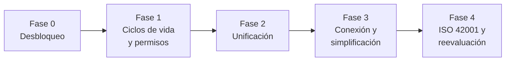
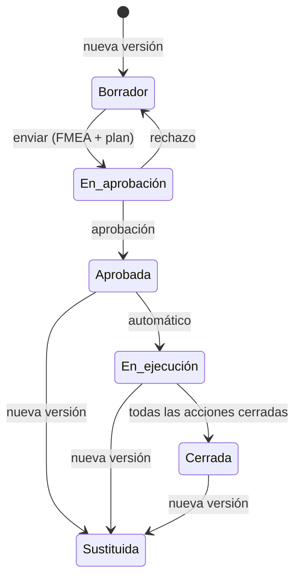
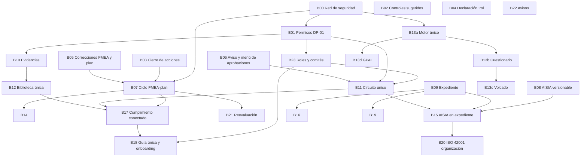

# Plan de resolución de gaps y simplificación del flujo de evaluación

Plan para cerrar los gaps del [flujo completo de evaluación](../funcional/flujo-completo-evaluacion.md)
(GAP-01 a GAP-34) y aplicar la [especificación del cuestionario preliminar](cuestionario-preliminar-reglas.md).
Incluye además un diagnóstico de los procesos que se han complicado sin necesidad o que parten de un
planteamiento que genera fricción, con propuestas de rediseño.

**Cómo está organizado:**
- **Parte I · Resumen ejecutivo.** Diagnóstico, fases y decisiones. Se lee en cinco minutos.
- **Parte II · Fricciones de diseño.** Procesos mal planteados y alternativas.
- **Parte III · Plan de desarrollo.** Bloques de trabajo con alcance técnico, dependencias, tallas,
  migraciones, decisiones y criterios de aceptación. Es el detalle.
- **Parte IV · Implicaciones transversales.**
- **Anexo.** Incidencias de [`_incidencias.md`](../_incidencias.md) que no afectan al flujo.

**Tallas relativas** (orientativas, para una persona):

| Talla | Esfuerzo |
|---|---|
| S | Hasta 3 días |
| M | 1 a 2 semanas |
| L | 3 a 5 semanas |
| XL | Más de 5 semanas; conviene partirlo |

Las tallas no incluyen la actualización de la documentación ni la validación con usuarios.

---

# Parte I · Resumen ejecutivo

## 1. Diagnóstico

**Hoy no se puede completar la evaluación de un sistema de punta a punta.** Hay cinco cortes:

1. No se puede elegir Mitigar en el plan de tratamiento (controles sugeridos vacíos).
2. Las acciones del plan no se pueden cerrar (no se crean sus tareas).
3. La Declaración de Aplicabilidad no se puede enviar ni aprobar.
4. Sin un miembro con rol DPO no se puede editar el plan.
5. No se puede reevaluar: la evaluación FMEA, el plan y la AISIA no tienen un ciclo de vida completo.

Los cortes 1 a 4 son errores puntuales y baratos. El 5 es de diseño.

Detrás de los 34 gaps hay **cuatro causas de fondo**. Atacarlas resuelve muchos gaps a la vez y evita que
aparezcan otros:

| Causa | Qué pasa | Gaps |
|---|---|---|
| **C1 · Permisos dispersos** | Los permisos se comprueban a mano en cada fichero, a veces con roles que ya no existen, a veces solo en la pantalla y a veces solo en la base de datos. La matriz de permisos existe pero es código muerto | DPO obligatorio, 14, 22, 24, 26 |
| **C2 · Ciclos de vida a medias** | Cada objeto (evaluación FMEA, plan, AISIA, expediente, Declaración) tiene estados que ningún flujo asigna o transiciones que faltan | 13, 20, 23, 24, 28, 32 |
| **C3 · Mecanismos duplicados** | Tres formas de aprobar, dos almacenes de evidencias, dos motores de clasificación, dos recomendadores del siguiente paso, dos formularios para dar de alta un sistema | 07, 09, 14, 17, 19, 22, 24, 26, 34 |
| **C4 · Fases desconectadas** | Lo que se hace en una fase no actualiza las demás: obligaciones, controles de la Declaración, brechas y evidencias se mantienen a mano por separado | 11, 12, 29, 30, 31, 33 |

## 2. Plan en cinco fases

| Fase | Objetivo | Bloques | Talla total | Resultado visible |
|---|---|---|---|---|
| **0 · Desbloqueo** | Recorrer el flujo de punta a punta sin rediseñar nada | B00 a B06 | 3 M + 5 S | Un sistema se puede evaluar entero, salvo la reevaluación |
| **1 · Ciclos de vida y permisos** | Cada objeto con estados completos y el modelo de roles de DP-01 | B07 a B10, B23 | 2 L + 3 M | Se puede reevaluar; las aprobaciones tienen rastro |
| **2 · Unificación** | Un circuito de aprobación, una biblioteca de evidencias, un motor de clasificación con el cuestionario | B11 a B13 | 2 XL + L | Menos pantallas y reglas; el cuestionario clasifica y da de alta |
| **3 · Conexión y simplificación** | Que las fases se alimenten entre sí y reducir el trabajo del FMEA y la AISIA | B14 a B19 | 3 L + 4 M | Menos trabajo manual; guía de un solo siguiente paso |
| **4 · ISO 42001 y reevaluación** | Cubrir el sistema de gestión y la operación continua | B20 a B22 | L + M + S | Evaluación completa ISO 42001 y reevaluación guiada |

Las fases 0 y 1 son de corrección. Las fases 2 y 3 son de rediseño y dependen de las decisiones del
apartado 4. La fase 4 añade funcionalidad.

## 3. Las cinco simplificaciones con más retorno

| # | Propuesta | Qué elimina |
|---|---|---|
| 1 | **Un único circuito de aprobación** para todo lo que se aprueba, con una política por defecto al crear la organización (F-01) | Tres mecanismos, el aprobador asignado al azar y la referencia de acta tecleada a mano |
| 2 | **Ciclo de vida único de la evaluación FMEA y el plan de tratamiento**: se aprueban juntos y una nueva versión sustituye a ambos (F-06, decidido en DP-03) | Dos ciclos de vida paralelos, uno de ellos sin final |
| 3 | **La acción del plan es la unidad de trabajo**; la tarea es opcional (F-07) | La dependencia de las tareas para cerrar acciones |
| 4 | **La AISIA como una plantilla más del expediente documental**, con secciones derivadas (F-09) | Un asistente propio, un ciclo de aprobación propio y la doble introducción de datos |
| 5 | **Estimación por familia como forma de trabajo por defecto** del FMEA, con la zona crítica primero (F-05) | Unas 119 evaluaciones individuales por sistema (medidas en `circuito.md`) |

## 4. Decisiones

| Id | Decisión | Antes de | Recomendación |
|---|---|---|---|
| **DP-01** | Quién prepara, revisa y aprueba cada objeto; roles y comités | B01, B11, B23 | **Decidida** (2026-10-19). Ver §5 |
| **DP-02** | Definición de «sistema totalmente evaluado» | B18 | **Decidida** (2026-10-19). Ver §5 |
| **DP-03** | Ciclo de vida único de la evaluación FMEA y el plan de tratamiento (F-06) | B07 | **Decidida** (2026-10-19): sí |
| **DP-04** | ¿La AISIA pasa al Core? (GAP-06) | B15 | **Decidida** (2026-10-20): sí. La exige ISO/IEC 42001 (§6.1.4) y la Declaración depende de ella |
| **DP-05** | AISIA como plantilla del expediente (F-09) | B15 | **Decidida** (2026-10-20): sí. B08 se reduce al mínimo |
| **DP-06** | Consolidación de los informes del sistema (F-10) | B16 | **Decidida** (2026-10-20): sí. Se retira el dossier técnico como pantalla; el registro UE pasa a plantilla del expediente; el informe de brechas, al análisis de brechas por sistema |
| **DP-07** | ¿La exclusión de brechas pasa por aprobación? (La clasificación AI Act ya tiene aprobador en DP-01) | B11 | **Decidida** (2026-10-20): sí para «Riesgo sin tratar» y «Obligación sin cubrir»; aprueba el Responsable del SGAI. El resto sigue sin aprobación |
| **DP-08** | Plan parcial sobre los modos críticos (F-05, opción C de `circuito.md`) | B14 | **Decidida** (2026-10-20): sí, en una segunda iteración de B14 (la primera, evaluación por familias por defecto) |
| **DP-09** | Alcance ISO 42001 de organización (cláusulas 4 a 10) | B20 | **Decidida** (2026-10-20): las 10 obligaciones ISO del catálogo, a nivel organización, con sesiones de comité y acta. Detalle (2026-10-28): códigos y cláusulas corregidos (A.6.1 → §6.2…); vista ISO 42001 › Sistema de gestión con propuestas por datos (§8.2, §6.1.4, §7.2, §9.3) o por evidencias; sesiones con acta en PDF como evidencia; la Revisión por la dirección con el orden del día de §9.3.2 y recordatorio anual. B20a, B20b y B20c integrados |
| **DP-10** | Términos y modelo de datos pendientes de la especificación del cuestionario (`_pendientes.md` 236 a 242) | B13 | **Decidida** (2026-10-20): ver la [especificación](cuestionario-preliminar-reglas.md), «Decisiones del 2026-10-20» |
| **DP-11** | Aplicabilidad de los documentos del expediente según el rol en la cadena de valor y el nivel de riesgo | B16 | **Decidida** (2026-10-27). Ver §5 |
| **DP-12** | Datos de entrada (Art. 26.4), vigilancia del funcionamiento (Art. 26.5) y FRIA cuando no aplica | B28, B29 | **Decidida** (2026-10-28): fichas declarativas con verificaciones periódicas y evidencias (informe de calidad o perfilado y/o muestra anonimizada; nunca el dataset en bruto); revisión del funcionamiento trimestral y verificación de los datos de entrada semestral, modificables por sistema; obligatorias en alto riesgo con la organización como responsable del despliegue y opcionales en el resto; tipo de evidencia «Registro de monitorización» asociado al Art. 26.5 y nuevo «Informe de calidad de datos de entrada» para el Art. 26.4; señales automáticas como verificación, más adelante. FRIA: si no aplica, la pestaña explica el motivo (o pide la respuesta que falta) y se puede redactar como buena práctica, sin que cuente como obligación |

## 5. Decisiones tomadas

### DP-11 · Documentos del expediente según rol y nivel de riesgo

Decidida por el responsable el 2026-10-27, antes de B16. Cada plantilla del expediente tiene una regla de
aplicabilidad, definida en un solo sitio, según el rol de la organización en la cadena de valor del sistema y su
clasificación AI Act. El expediente muestra a cada sistema solo lo que le aplica, en uno de tres modos:
**redactar** (Fluxion compone el documento), **documentación del proveedor** (se adjunta como evidencia lo que
entrega el proveedor) o **no aplica**.

| Plantilla | Redactar | Documentación del proveedor | No aplica |
|---|---|---|---|
| Anexo IV | Proveedor y alto riesgo | No proveedor y alto riesgo | Resto |
| Registro UE (Anexo VIII) | Proveedor y alto riesgo (sección A); proveedor que aplica la excepción del Art. 6.3 (sección B, Art. 49.2); responsable del despliegue que es autoridad pública y sistema de alto riesgo (sección C, Art. 49.3) | No proveedor y alto riesgo (número de registro del proveedor) | Resto. Infraestructura crítica (Anexo III, punto 2): registro nacional, no en la base de datos de la UE |
| FRIA | Responsable del despliegue obligado por el Art. 27 | — | Resto |
| Ficha del modelo | Proveedor de un modelo GPAI | — | Resto |
| DPIA | El sistema trata datos personales | — | Resto |
| AISIA | Siempre (ISO/IEC 42001) | — | — |

- **Documentación del proveedor.** Quien despliega no suele recibir el Anexo IV, sino las instrucciones de uso
  (Art. 13), la declaración UE de conformidad (Art. 47) y el número de registro (Art. 49). La opción se llama
  «Documentación del proveedor» y admite esos documentos.
- **Proveedor.** Lo es quien tiene ese rol declarado en el sistema, también el proveedor sobrevenido por
  modificación sustancial o comercialización con su marca (Art. 25).
- Lectura del AI Act pendiente de revisión jurídica (como TODO 238 y 239).

### DP-01 · Roles, comités y circuito de aprobación

Fuente: hoja de trabajo del responsable del proyecto (capturas del 2026-10-19; textos completos confirmados el 2026-10-20). Modelo basado en las tres
líneas de defensa. Ni el AI Act ni ISO/IEC 42001 prescriben un organigrama: ISO/IEC 42001 (§5.3) exige
asignar roles, responsabilidades y autoridades, y el AI Act exige funciones concretas (Art. 4, 14, 17, 26
y 27).

**Mapa de aprobaciones por objeto.** Regla general: quien prepara no aprueba. Los niveles 1 a 3
corresponden a las zonas del plan de tratamiento (III-IV, II e I).

| Objeto | Prepara | Revisa o consulta | Aprueba |
|---|---|---|---|
| Clasificación AI Act | Responsable del sistema | Legal / Cumplimiento | Responsable del SGAI; si es alto riesgo o se invoca el Art. 6.3, Comité de IA |
| Evaluación de riesgos y plan · nivel 1 | Analista + Responsable del sistema | CISO si hay controles de seguridad | Responsable del SGAI |
| Evaluación de riesgos y plan · nivel 2 (Zona II) | Analista + Responsable del sistema | CISO si hay controles de seguridad | Comité de Riesgos de IA |
| Evaluación de riesgos y plan · nivel 3 (Zona I, severidad 9) | Analista + Responsable del sistema | Comité de Riesgos de IA | Revisión por la Dirección |
| AISIA / FRIA | Analista | DPO (dictamen), Legal | Comité de IA |
| DPIA | Responsable del tratamiento | DPO (dictamen obligatorio) | Responsable del tratamiento (negocio) |
| Documentación técnica (Anexo IV) | Responsable del sistema | Responsable del SGAI | Responsable del SGAI (o función de calidad, si es proveedor) |
| Declaración de Aplicabilidad | Responsable del SGAI | Comité de IA | Alta dirección / Revisión por la Dirección |
| Evidencias | Quien las aporta | — | Responsable del SGAI o revisor designado distinto del autor |
| Política de IA | CAIO / Responsable del SGAI | Comité de IA | Alta dirección |

**Comités** (composición y cadencia orientativas):

| Comité | Composición típica | Función | Cadencia |
|---|---|---|---|
| Comité de IA (dirección o ética) | CAIO (preside), negocio, Legal, DPO (voz sin voto), CISO, Responsable del SGAI (secretaría) | Casos de uso nuevos, alto riesgo, excepciones del Art. 6.3, cuestiones éticas | Mensual o por demanda |
| Comité de Riesgos de IA | Responsable del SGAI (preside), Riesgos corporativos, CISO, Cumplimiento, responsables de sistema implicados | Planes de tratamiento de nivel 2, aceptación de riesgos altos, seguimiento de acciones | Trimestral |
| Revisión por la Dirección | Alta dirección, CAIO, Responsable del SGAI | Lo que exige ISO/IEC 42001 §9.3: estado del SGAI, objetivos, no conformidades, riesgos críticos, recursos | Al menos anual |
| Comité técnico / validación de modelos (opcional) | MLOps, ciencia de datos, Responsable del sistema | Revisión de la calidad técnica antes del Comité de Riesgos | Por demanda |

**Roles individuales:**

| Rol | Función | Base normativa | Papel en las aprobaciones | Línea |
|---|---|---|---|---|
| Alta dirección (CEO, consejo) | Fija la política de IA y el apetito al riesgo; asigna recursos | ISO/IEC 42001 §5.1, §5.2 | Aprueba la política de IA y los riesgos críticos residuales | Gobierno |
| CAIO / Responsable de IA | Dirige la estrategia y el portafolio de IA | Práctica habitual | Propone; preside el Comité de IA | 1.ª |
| Responsable del SGAI | Mantiene el sistema de gestión: inventario, Declaración de Aplicabilidad, métricas, informes a dirección | ISO/IEC 42001 §5.3 | Aprueba el nivel 1; custodia el circuito | 2.ª |
| Responsable del sistema | Responde de un sistema concreto en todo su ciclo de vida | ISO/IEC 42001 A.3.2 | Prepara la evaluación y el plan; no aprueba lo suyo | 1.ª |
| Analista de riesgos de IA | Ejecuta FMEA, AISIA y evaluaciones de impacto | ISO/IEC 42001 §6.1, §8.2 | Evalúa; no aprueba | 2.ª |
| Responsable de supervisión humana | Persona competente que puede intervenir o detener el sistema | AI Act, Art. 14, 26.2 | Valida que la supervisión es viable antes del despliegue | 1.ª |
| DPO | Asesora y supervisa en materia de datos personales | RGPD, Art. 37-39 | Consultivo: emite dictamen en DPIA y FRIA; no aprueba | 2.ª (independiente) |
| Cumplimiento / Legal | Interpreta obligaciones y clasificación AI Act | — | Valida la clasificación y las excepciones (Art. 6.3) | 2.ª |
| Seguridad de la información (CISO) | Ciberseguridad y robustez | AI Act, Art. 15 | Valida los controles de seguridad del plan | 2.ª |
| Auditoría interna | Verifica el SGAI | ISO/IEC 42001 §9.2 | Nunca aprueba; audita lo aprobado | 3.ª |

**Reglas del circuito:**

| Regla | Contenido | Base |
|---|---|---|
| Segregación | Quien prepara no aprueba. Quien aprueba un riesgo no lo audita | Tres líneas de defensa; ISO/IEC 42001 §9.2 |
| DPO consultivo, no ejecutor | El DPO emite dictamen; no edita ni aprueba planes de tratamiento (antes solo el DPO editaba el plan; lo corrigió B01) | RGPD, Art. 38.3 y 38.6 |
| Quórum y voto | Definir quórum, quién vota y quién solo opina (DPO, auditor externo) y cómo se resuelve un empate (voto del presidente o escalado) | Validez de las decisiones de comité |
| Delegación con caducidad | Por ausencia, siempre con fecha de fin y nunca hacia quien preparó el objeto | Evitar bloqueos sin romper la segregación |
| Acta | Cada decisión de comité con orden del día, asistentes, votos y motivación | Evidencia para auditoría |

**Configuración mínima (organización pequeña).** Con tres personas y un DPO externo se cubre lo esencial:

| Persona | Roles que acumula | Qué hace en el circuito |
|---|---|---|
| Persona 1 | Alta dirección + CAIO | Aprueba el nivel 3 y la política de IA |
| Persona 2 | Responsable del SGAI + Cumplimiento | Aprueba los niveles 1 y 2; con la dirección forma el Comité de Riesgos |
| Persona 3 | Responsable del sistema + Analista | Prepara clasificación, evaluación y plan |
| DPO (externo) | DPO | Dictamen en DPIA y FRIA, en régimen de consultoría |

Incompatibles: preparar y aprobar el mismo objeto (rompe la segregación); DPO y Responsable del SGAI en la
misma persona (conflicto de intereses, RGPD Art. 38.6).

Los comités son orientativos: las organizaciones grandes suelen añadir el comité técnico o de validación
de modelos antes del de riesgos.

**Qué implica para Fluxion** (se desarrolla en B01, B11 y el bloque nuevo B23):

| # | Implicación | Situación actual | Bloque |
|---|---|---|---|
| I-01 | **Varios roles por persona.** La configuración mínima acumula roles | Cada miembro tiene un solo rol (`profiles.role`) | B23 |
| I-02 | **Funciones que no son roles de Fluxion:** CISO, Legal, Riesgos corporativos, Responsable del tratamiento, función de calidad, Responsable de supervisión humana | `org_role` no las tiene; Alta dirección ≈ Directivo, Cumplimiento ≈ Analista de cumplimiento, Auditoría interna ≈ Auditor | B23 |
| I-03 | **Comité técnico / validación de modelos** | Solo hay tres tipos de comité | B23 |
| I-04 | **Pasos de consulta (dictamen) sin voto**, algunos obligatorios (DPO en DPIA) | Las políticas solo tienen pasos de aprobación | B11 |
| I-05 | **Pasos condicionales**: CISO solo si el plan tiene controles de seguridad; aprobador de la clasificación según el nivel o el Art. 6.3 | El contexto de la política solo admite el nivel de aprobación | B11 |
| I-06 | **Objetos aprobables nuevos o separados:** clasificación AI Act, política de IA y cada plantilla del expediente por separado (DPIA y Anexo IV tienen aprobadores distintos) | Cinco tipos; los documentos comparten una política | B11 |
| I-07 | **Voz sin voto en comités** (DPO, auditor externo) | `committee_members` no distingue | B23 |
| I-08 | **Segregación reforzada:** quien prepara no aprueba (también por delegación); el Auditor nunca aprueba | Solo «quien solicita no aprueba», configurable | B11 |
| I-09 | **Incompatibilidades** de roles (DPO + Responsable del SGAI) | No se validan | B23 |
| I-10 | **El DPO deja de editar el plan** | Hoy es el único que puede | B01 |
| I-11 | **Actas de cada decisión de comité** con orden del día y asistentes | Acta solo al cerrar una solicitud con paso de comité | B11, B20 |

> **Tensión de plazos (decidido el 2026-10-20).** El nivel 3 lo aprueba la Revisión por la Dirección, con
> cadencia «al menos anual», pero un plan de Zona I tiene un plazo de 30 días. **Decisión: la dirección
> delega expresamente la aprobación de los planes de Zona I**, con las reglas de la delegación del circuito
> (fecha de fin y nunca hacia quien preparó el plan). Algo parecido, menos grave, ocurre con el Comité de
> Riesgos (trimestral) frente al plazo de 90 días de la Zona II. Se implementa en B11 (políticas por
> defecto con delegación).

**Segunda revisión del FMEA (decidido el 2026-10-20).** No figura en el mapa: la resuelve el Responsable
del SGAI, distinto del evaluador (segunda línea), como ya hace la aplicación desde B01.

### DP-02 · Definición de «sistema totalmente evaluado»

Definición por **etapas** (Clasificado, Evaluado, Tratado), con **Vigente** como condición transversal y la
Declaración de Aplicabilidad como requisito de organización. Lo exigible depende del nivel de riesgo y del
rol. El texto completo está en el
[flujo completo](../funcional/flujo-completo-evaluacion.md#qué-significa-sistema-totalmente-evaluado).

Ajustes respecto a la definición de trabajo anterior: la instantánea de brechas deja de ser condición; las
acciones ejecutadas pasan a la etapa Tratado; la Declaración pasa a requisito de organización.

**Qué implica:** B18 calcula etapas, no casillas, y necesita tres datos que hoy no existen: el
**responsable de la supervisión humana** de cada sistema (B23), la **AISIA ligera** para riesgo mínimo
(B15) y si la organización es **autoridad pública** (pregunta Q-10 de la
[especificación del cuestionario](cuestionario-preliminar-reglas.md), B13).

### DP-03 · Ciclo de vida único

Aprobada la propuesta F-06: la evaluación FMEA y el plan de tratamiento se envían, se aprueban y se
sustituyen juntos. Se desarrolla en B07.

---

# Parte II · Fricciones de diseño

Procesos que no son errores, sino planteamientos que complican el uso o el mantenimiento. Cada uno lleva
una propuesta. Las propuestas son libres, como pediste: algunas cambian el funcionamiento actual.

## F-01 · Tres formas de aprobar

**Hoy.** El plan de tratamiento tiene su propia aprobación (aprobador asignado automáticamente) y,
además, puede pasar por Flujos de aprobación si hay política. La AISIA, el expediente, las evidencias y la
Declaración tienen cada uno su cambio de estado con reglas propias. La clasificación, la exclusión de
obligaciones y la exclusión de brechas, que también son decisiones de aceptación, no se aprueban.

**Por qué es un mal planteamiento.** Flujos de aprobación se diseñó como el motor común
(`lib/approvals/effects.ts` está pensado para engancharse por tipo de objeto), pero se dejó conviviendo con
las vías antiguas. El resultado es que el mismo hecho, «alguien con autoridad da por bueno esto», tiene
seis implementaciones con garantías distintas: unas con segregación, aviso y acta, y otras sin ninguna.
Para un auditor, dos documentos del mismo expediente tienen rastros distintos.

**Propuesta.**
- Una sola vía: todo objeto aprobable abre una solicitud en Flujos de aprobación.
- Al crear la organización se siembra una **política por defecto** para cada tipo de objeto (un paso, por
  rol). Con ella no existe el caso «sin política».
- Se elimina la aprobación propia del plan (`approveTreatmentPlanAction`, `rejectTreatmentPlanAction`,
  `resolvePlanApprover`) y la referencia de acta tecleada.
- Los efectos de cada tipo se escriben en `effects.ts`.

**Talla:** L (bloque B11).

## F-02 · Dos almacenes de evidencias

**Hoy.** Las evidencias de las acciones del plan van a `fluxion.evidences`; todas las demás, a
`system_evidences`. Las primeras no tienen ciclo de revisión, no aparecen en la biblioteca, no cuentan en
brechas ni respaldan obligaciones, pero son las que cambian la severidad residual del FMEA.

**Por qué es un mal planteamiento.** La evidencia más importante para el riesgo (la que demuestra que un
control funciona) es la que menos controles tiene.

**Propuesta.** Biblioteca única (decisión 30 del inventario). La acción del plan enlaza una evidencia de la
biblioteca, y la severidad residual solo cuenta cuando esa evidencia es **Válida**. **Talla:** L (B12).

## F-03 · Dos motores de clasificación y una clasificación por aproximación

**Hoy.** El motor TypeScript del alta deduce el alto riesgo del dominio y del tipo de output; el motor
Python de la reclasificación tiene otras reglas; el cuestionario recoge los supuestos exactos del AI Act y
no los usa nadie.

**Por qué es un mal planteamiento.** Preguntar «¿en qué dominio está?» y «¿qué tipo de output da?» para
inferir el Anexo III es más impreciso y más largo que preguntar directamente por el supuesto, que es lo
que hace el cuestionario.

**Propuesta.** La de la [especificación del cuestionario](cuestionario-preliminar-reglas.md): un motor por
supuestos, compartido, y el motor Python deja de clasificar por reglas (solo la clasificación con IA, que
usa el motor común como referencia). **Talla:** XL, partido en B13a a B13d.

## F-04 · Dos formularios de siete pasos para dar de alta un sistema

**Hoy.** El cuestionario preliminar (7 secciones) y el asistente de alta (7 pasos, unos 70 campos) piden
información que se solapa en parte, con nombres y valores distintos.

**Por qué es un mal planteamiento.** Son dos fichas del mismo objeto en dos momentos de su vida (idea y
sistema). Mantenerlas separadas obliga a la correspondencia de campos de la especificación y a volver a
pedir datos.

**Propuesta en dos tiempos.**
- **Corto plazo (decidido, D2):** volcado del cuestionario al alta, como dice la especificación.
- **Medio plazo (propuesta):** que el cuestionario cree el sistema desde el principio en un estado nuevo
  **Propuesto**, y que el alta sea completar ese mismo sistema. Desaparecen el volcado, el bloqueo del
  cuestionario y la tabla de correspondencias. Las respuestas sin campo (proyecto, cliente, proveedor) pasan
  a una pestaña **Origen** de la ficha.

**Talla:** M (corto plazo, dentro de B13) y L (medio plazo, fuera de este plan).

## F-05 · Granularidad del FMEA

**Hoy.** En el sistema de prueba medido en `circuito.md`: 286 modos activados, 119 priorizados, unas 6
horas de trabajo experto. La estimación por familia existe, pero aplicarla sobrescribe los ajustes
manuales (`R6`), no es el modo por defecto y el autoguardado rellena valores en ítems pendientes (`R5`).
No se dice cuántos modos hay ni cuáles importan hasta entrar.

**Por qué es un mal planteamiento.** Se pide una estimación individual donde la información se agrupa en
unas diez familias, y el método no prioriza: se evalúa la lista entera.

**Propuesta.**
1. Al entrar: «N modos priorizados, M en zona crítica». Orden por criticidad, no por activación.
2. **Familia por defecto:** la evaluación arranca por las familias; los modos solo se tocan como
   excepción, y las excepciones quedan marcadas como manuales y no se sobrescriben.
3. **Plan parcial (DP-08):** permitir enviar el plan cuando están evaluados los modos de las familias con
   severidad 8 o más, dejando el resto en una segunda ronda.

**Talla:** L (B14).

## F-06 · Evaluación FMEA y plan de tratamiento con ciclos separados (decidido, DP-03)

**Hoy.** La evaluación tiene estados borrador, en revisión, aprobada y sustituida, pero solo se usan los
dos primeros; el plan tiene seis estados y solo se usan tres. Lo que se aprueba es el plan. Como la
evaluación nunca sale de «En revisión», no se puede crear una versión nueva, y guardar la devuelve a
borrador.

**Por qué es un mal planteamiento.** Para la organización son una sola cosa: «la evaluación de riesgos del
sistema», que se aprueba una vez (AI Act, Art. 9.5). Tener dos ciclos obliga a sincronizarlos y hoy no se
sincronizan.

**Propuesta.** Un ciclo único, guiado por el plan:

- Si no hay modos que tratar, la evaluación se envía igualmente a aprobación (con plan vacío). Así siempre
  hay una aprobación del riesgo residual.
- Una vez enviada, la evaluación es de solo lectura (corrige `R4`).

**Talla:** L (B07).

## F-07 · Las acciones solo se cierran a través de tareas

**Hoy.** Cerrar una acción y registrar su severidad residual exige una tarea vinculada, y las tareas no se
crean. La acción y la tarea tienen estados distintos que un trigger sincroniza.

**Por qué es un mal planteamiento.** La acción del plan ya tiene responsable, fecha y estado: es una tarea.
Duplicarla en `tasks` solo aporta el kanban y los comentarios, a cambio de una sincronización frágil.

**Propuesta.** La acción es la unidad. Se cierra desde el plan (**Cerrar acción** con severidad residual y
evidencia). La tarea pasa a ser opcional: **Crear tarea de seguimiento** si se quiere usar el kanban, y
completarla propone cerrar la acción. **Talla:** M (B03, corrección inmediata, y B07, rediseño).

## F-08 · Mitigar exige un control del catálogo

**Hoy.** Sin una plantilla de control asociada al modo en el catálogo, no se puede elegir Mitigar.

**Propuesta.** Permitir un control libre (título y descripción) además de los sugeridos. **Talla:** S
(dentro de B02).

## F-09 · La AISIA repite datos y tiene su propio mundo

**Hoy.** S1 y S2 vuelven a pedir datos de la ficha (y no los guardan si no se editan); S3 y S4 piden
seleccionar a mano los modos y el plan; tiene su propio asistente, su ciclo de aprobación (sin rastro ni
segregación) y no genera PDF ni evidencia. Mientras tanto, el expediente documental ya resuelve exactamente
ese problema: apartados derivados de los datos, redacción humana, huecos obligatorios, aprobación, PDF
inmutable y evidencia.

**Por qué es un mal planteamiento.** Es el mismo tipo de documento (una plantilla por epígrafes con datos
derivados) implementado dos veces, y la versión de la AISIA es la menos madura.

**Propuesta.** La AISIA pasa a ser una **plantilla del expediente** (`aisia`), con:
- S1, S2, S3 y S4 **derivadas** de la ficha, de la evaluación aprobada y de su plan;
- S5 y S6 de redacción propia;
- el ciclo, la aprobación (vía Flujos de aprobación), el PDF y la evidencia del expediente.

La sincronización con los controles A.5.2-A.5.5 de la Declaración se conserva como efecto de la
aprobación. **Talla:** L (B15). Requiere DP-04 y DP-05.

## F-10 · Cinco documentos de sistema que se solapan

**Hoy.** Para un sistema hay: Anexo IV (expediente), dossier técnico, ficha para el registro UE, informe
de brechas del sistema y, en la ficha, la pestaña de ficha técnica. Los tres informes componen datos
parecidos con reglas distintas (por ejemplo, el recuento de modos FMEA difiere, `E9`), y sus evidencias
siguen reglas distintas a las del expediente.

**Propuesta.**
- **Anexo IV** es el documento oficial de documentación técnica.
- **Dossier técnico:** se retira como pantalla; su contenido útil ya está en la ficha y en el Anexo IV.
- **Ficha para el registro UE:** pasa a ser una plantilla del expediente (`eu_registry`) con los datos del
  Anexo VIII (corrige `E13`).
- **Informe de brechas del sistema:** pasa a ser el análisis de brechas filtrado por sistema, con su
  instantánea.

**Talla:** M (B16). Requiere DP-06.

## F-11 · Brechas, obligaciones y Declaración mantenidas por separado

**Hoy.** Las obligaciones se resuelven a mano; las brechas se calculan a partir de ellas, del plan y de las
evidencias, pero no incluyen la Declaración; los controles de la Declaración se marcan a mano. Aprobar el
plan no resuelve el Art. 9; aprobar el Anexo IV no resuelve el Art. 11.

**Propuesta.** Las obligaciones y los controles **proponen** su estado a partir de lo hecho en otras fases
(sin cambiarlo solos: la persona confirma):

| Hecho | Propuesta |
|---|---|
| Evaluación de riesgos aprobada | Art. 9 resuelta |
| Expediente Anexo IV aprobado | Art. 11 resuelta |
| Evidencia válida vinculada a todos los tipos exigidos por el catálogo | Obligación resuelta |
| Control implantado en un plan con evidencia válida | Control equivalente de la Declaración implantado |

Y las brechas incluyen los controles aplicables de la Declaración sin implantar. **Talla:** L (B17).

## F-12 · Tres guías para saber qué hacer

**Hoy.** La guía estática del onboarding (tres pasos por foco), el siguiente paso del Dashboard
(`lib/dashboard/data.ts`) y el siguiente paso de Evaluaciones (`lib/evaluations/data.ts`), cada uno con sus
reglas. Ninguno cubre el recorrido completo.

**Propuesta.** Una **lista de verificación por sistema** con los criterios de «evaluado» (DP-02),
calculada en un único módulo. De ella salen: la tarjeta de estado en la ficha, el siguiente paso del
Dashboard y la columna de etapa de Evaluaciones. **Talla:** M (B18).

## F-13 · Tres formas de decir quién es responsable

**Hoy.** Gobernanza guarda nombres en texto libre; los roles de los miembros deciden permisos; los comités
tienen sus miembros; y la aprobación del plan elige aprobador con roles inexistentes. Los responsables de
Gobernanza no se usan en nada.

**Propuesta.** Gobernanza referencia **miembros** (Responsable del SGAI, DPO) y comités; las políticas por
defecto (F-01) los usan como aprobadores. El onboarding pide estos nombramientos (GAP-02). **Talla:** M
(B18).

## F-14 · Dos formas de aceptar un riesgo

**Hoy.** Aceptar un riesgo en el plan exige 100 caracteres, fecha de revisión, no estar en severidad 9 y
aprobación. Excluir la brecha «Riesgo sin tratar» de ese mismo modo exige 10 caracteres y ningún
aprobador.

**Propuesta.** Las brechas de tipo Riesgo sin tratar y Control sin implantar no se excluyen desde el
análisis de brechas: se resuelven en el plan. Las de tipo Obligación sin cubrir se excluyen excluyendo la
obligación, con aprobación si la política lo pide (DP-07). Solo Evidencia caducada se puede posponer desde
brechas. **Talla:** S (dentro de B17).

## F-15 · Evidencias generadas con reglas distintas

**Hoy.** El PDF del expediente nace **Válido** aunque el expediente no esté aprobado; los informes nacen
**Pendientes de revisión**; cualquier formulario permite fijar **Válida** directamente.

**Propuesta.** Regla única: una evidencia nace **Pendiente de revisión**, salvo que sea el entregable de un
objeto **aprobado** por Flujos de aprobación, en cuyo caso nace **Válida** con la aprobación como rastro. El
estado no se elige en el formulario. **Talla:** S (B09 y B10).

## F-16 · Empaquetado comercial que corta el flujo

**Hoy (objetivo de `_inventario.md` §10).** La Declaración (Core) depende de la AISIA (módulo); el Anexo IV,
obligatorio para un proveedor de alto riesgo, está en un módulo. Hoy no se nota porque el control por
módulo no está implementado.

**Propuesta.** Antes de implementar el control por módulo, revisar que **todo lo necesario para la
definición de «evaluado» esté en el Core**: AISIA (DP-04) y Anexo IV. Los módulos aportan automatización
(conectores, supervisión, coste) o volumen (FRIA, DPIA, ficha del modelo, paquetes de auditoría), no
pasos obligatorios. **Talla:** decisión, sin desarrollo.

## F-17 · Onboarding que pregunta lo que no se usa

**Hoy.** El onboarding pide madurez, estado ISO, estado del inventario y foco, que solo cambian la guía
estática. No pide personas ni responsables, que son lo que bloquea después.

**Propuesta.** Reducirlo a tres pasos: **Organización** (sector, país, marcos), **Equipo** (invitar al
Responsable del SGAI y al DPO con su rol; constituir el Comité de IA) y **Primer sistema** (cuestionario o
alta). Madurez e ISO pasan a la ficha de la organización. **Talla:** M (B18).

---

# Parte III · Plan de desarrollo

Cada bloque indica: gaps y fricciones que resuelve, alcance técnico, cambios de datos, dependencias,
talla, riesgos, decisiones y criterios de aceptación.

## Mapa de dependencias

## Fase 0 · Desbloqueo

Objetivo: que el flujo se pueda recorrer entero con el diseño actual. Correcciones de bajo riesgo, sin
cambios de modelo salvo B03.

### B00 · Red de seguridad mínima

- **Por qué primero.** No hay tests automatizados (`CLAUDE.md`) y las comprobaciones estáticas no
  funcionan como se indica (`T15`). Los bloques B07, B11, B12 y B13 cambian lógica central.
- **Alcance.**
  - Arreglar `tools/check-server-actions.sh` y `tools/check-python.sh` (`T15`).
  - Tests unitarios de las funciones puras: `lib/fmea/domain.ts` (zonas, severidad sugerida),
    `getApprovalLevelForZone`, `classifyAIAct` (y después el motor nuevo con los 15 casos de la
    especificación del cuestionario).
  - Un test de integración del recorrido: alta → modos → FMEA → plan → aprobación, contra una base local.
- **Talla:** M. **Acepta si:** los tests corren en local y en el despliegue antes de construir la imagen.

### B01 · Permisos del plan y del FMEA según DP-01

- **Resuelve:** «sin DPO no hay flujo»; parte de GAP-14; I-10.
- **Alcance.**
  - Sustituir `['admin', 'editor', 'dpo', 'technical']` en `plan/actions.ts:130` y
    `evaluar/actions.ts:984` por los roles que **preparan**: Responsable del sistema y Analista de riesgos.
    El DPO deja de editar.
  - Segunda revisión del FMEA: Responsable del SGAI, distinto del evaluador (confirmado el 2026-10-20).
  - Aprobador de la vía sin política (`getApproverRolePriority`, `lib/fmea/treatment-plan.ts:316`):
    nivel 1, Responsable del SGAI. Los niveles 2 y 3 son comités: sin política, se asigna también al
    Responsable del SGAI con el aviso «Este plan requiere el Comité de Riesgos / la Revisión por la
    Dirección: configura la política». Las políticas de comité ya se pueden crear hoy.
  - Llevar los conjuntos de roles a una constante común (`lib/auth/roles-flujo.ts` o similar), que B23
    sustituye después por roles múltiples.
- **Talla:** S. **Acepta si:** un Analista de riesgos edita y envía el plan; un DPO no puede editarlo; el
  aprobador de nivel 1 es el Responsable del SGAI.

### B02 · Controles sugeridos y control libre

- **Resuelve:** GAP-15; F-08.
- **Alcance.**
  - `control_templates(..., name, ...)` → `title` en `lib/fmea/data.ts:498`,
    `lib/fmea/treatment-plan.ts:669` y la consulta de brechas (`R1`).
  - Control libre en el detalle de la acción: título y descripción, crea un `controls` sin `template_id`.
    Revisar que `controls.template_id` admita nulos (migración si no).
- **Talla:** S + S. **Acepta si:** un modo con controles en el catálogo los muestra; uno sin ellos permite
  crear un control libre y mitigar.

### B03 · Cierre de acciones sin depender de tareas

- **Resuelve:** GAP-18; primer paso de F-07.
- **Alcance.**
  - **Cerrar acción** en el detalle de la acción, sin tarea: reutiliza la lógica de
    `recordMitigarResidualAction` haciendo `taskId` opcional.
  - Crear la tarea al **decidir** la opción, no al insertar la acción: mover la lógica del trigger
    `trg_treatment_action_create_task` (hoy `BEFORE INSERT`, schema `:7316`) a `saveTreatmentActionDecision`,
    o añadir el caso `UPDATE OF option` al trigger.
- **Datos:** migración que cree las tareas de las acciones ya decididas sin tarea (no aceptadas).
- **Talla:** M. **Riesgo:** duplicar tareas si se ejecuta dos veces; la migración debe ser idempotente.
- **Acepta si:** una acción de Mitigar se cierra desde el plan con severidad residual; las nuevas acciones
  decididas tienen tarea.

### B04 · Declaración de Aplicabilidad: rol y propietario

- **Resuelve:** GAP-28 (la parte de error).
- **Alcance.**
  - `.eq('id', user.id)` → `.eq('user_id', user.id)` en `plantillas/soa-iso42001/page.tsx:56` y
    `actions.ts:237` y `:286`.
  - Propietario de control: guardar el identificador que espera la FK (`E2`, patrón `P1`).
  - Política de lectura y escritura de `soa_controls_log` para que el historial se guarde (`E3`).
- **Talla:** S. **Acepta si:** un Responsable del SGAI envía y aprueba la Declaración; «Aprobado por» muestra
  su nombre; el historial de controles registra cambios.

### B05 · Correcciones del FMEA y del plan

- **Resuelve:** GAP-13 (parte), GAP-16, GAP-21 (parte).
- **Alcance.**
  - El autoguardado no cambia el estado ni el evaluador de una evaluación enviada (`R4`): fuera de
    borrador, `saveFmeaDraft` se rechaza.
  - El autoguardado no rellena O, D y severidad en ítems pendientes (`R5`).
  - **Guardar borrador** del plan guarda también las decisiones (`R7`), o se elimina y queda solo el
    autoguardado.
  - Diferir guarda fecha de revisión (`R8`).
  - Estimación por familia: no sobrescribir ítems ajustados a mano (`R6`), con una marca `manual_override`
    en `fmea_items`.
- **Talla:** M. **Datos:** columna `fmea_items.manual_override`.

### B06 · Aviso al aprobador y bandeja visible

- **Resuelve:** GAP-01, parte de GAP-14.
- **Alcance.**
  - En `submitTreatmentPlanForApproval`, vía sin política: aviso en la app al aprobador asignado.
  - Entrada **Aprobaciones** siempre visible (`app/(app)/layout.tsx`, `showApprovals`) y `approvals` fuera
    de `lib/modules/registry.ts` (decisión de `_inventario.md` §14.2).
- **Talla:** S.

**Al terminar la fase 0:** el flujo se recorre hasta la Declaración aprobada. Quedan sin resolver la
reevaluación, la calidad del rastro y la fricción.

## Fase 1 · Ciclos de vida y permisos

### B07 · Ciclo único de la evaluación de riesgos

- **Resuelve:** GAP-13, GAP-20, parte de GAP-32; F-06 y F-07.
- **Alcance.**
  - Máquina de estados de la Parte II, F-06, en un módulo (`lib/fmea/lifecycle.ts`) que usen evaluación y
    plan.
  - Al aprobar el plan: evaluación `approved`, plan `approved` → `in_progress`.
  - Al cerrar la última acción: plan `closed`.
  - **Nueva versión** desde la ficha o desde Evaluaciones: copia los ítems de la evaluación vigente, marca la
    anterior y su plan como `superseded`. `getOrCreateEvaluation` deja de reutilizar evaluaciones en
    revisión.
  - Envío sin candidatos: también va a aprobación, con plan vacío.
  - La comparativa FMEA deja de ser inalcanzable.
- **Datos.** Migración de estados existentes: evaluaciones `in_review` con plan `approved` → `approved`;
  planes `approved` con todas las acciones cerradas → `closed`.
- **Depende de:** B00, B03, B05.
- **Talla:** L. **Riesgo:** es el núcleo del producto; requiere B00.
- **Acepta si:** se puede crear la versión 2 de un sistema evaluado, comparar con la 1 y la 1 queda
  sustituida y en solo lectura.

### B08 · AISIA versionable y con permisos en servidor

- **Resuelve:** GAP-22 (parte), GAP-23.
- **Alcance.**
  - **Nueva versión** desde una AISIA aprobada: copia secciones y marca la anterior como sustituida (estado
    nuevo `superseded`).
  - Comprobación de rol en `approveAisia` y `rejectAisia` y segregación (quien envía no aprueba).
  - Guardar la precarga de S1 y S2 al crear la AISIA (`E19`).
  - `syncAisiaSoaControls` no modifica una Declaración que no esté en borrador: deja un aviso para la
    siguiente revisión.
- **Talla:** M. Si se aprueba DP-05, este bloque se reduce al mínimo y su trabajo pasa a B15.
- **Decidido (2026-10-20, DP-05 aprobada):** B08 mínimo (talla S): permisos y segregación en servidor,
  la sincronización no toca una Declaración que no esté en borrador y la precarga de S1-S2 se guarda. La
  nueva versión y «Sustituida» pasan a B15, con las versiones del expediente (B09).

### B09 · Expediente documental: ciclo y rastro

- **Resuelve:** GAP-24 (parte); F-15.
- **Alcance.**
  - Transiciones completas (volver a borrador desde revisión; `superseded` al reabrir un aprobado).
  - Historial de cambios de estado en `ai_system_history`.
  - Rótulo y metadatos del PDF según la plantilla (`E15`).
  - La evidencia del PDF nace **Pendiente de revisión** salvo con el expediente aprobado.
  - Aprobadores según DP-01: Anexo IV, Responsable del SGAI; DPIA, responsable del tratamiento con dictamen
    del DPO; FRIA, Comité de IA. Hasta B11, con la constante de B01.
- **Talla:** M.

### B10 · Evidencias: revisión obligatoria y versiones

- **Resuelve:** GAP-26 (parte), GAP-27 (parte); F-15.
- **Alcance.**
  - Quitar **Estado** de los formularios de alta y edición; el estado solo cambia por el ciclo de revisión.
  - Política de inserción en `system_evidence_versions` (`E4`).
  - Límite de tamaño único (vista y servidor, `E6`).
  - Errores visibles cuando la base de datos rechaza la operación (patrón `P5`).
- **Talla:** M. **Datos:** ninguno; las evidencias marcadas válidas sin revisión se quedan como están, con
  una etiqueta `sin-revision` para revisarlas si se quiere.

**Permisos centralizados.** En esta fase conviene recuperar `lib/auth/permissions.ts` (hoy código muerto)
como la única fuente de permisos y usarlo en B07 a B10, en la interfaz (botones) y en el servidor. Es la
causa C1. **Talla:** M, repartida entre los bloques.

### B23 · Modelo de roles y comités (DP-01)

- **Resuelve:** I-01, I-02, I-03, I-07, I-09; parte de GAP-04 y GAP-05.
- **Alcance.**
  - **Roles múltiples por miembro:** tabla `member_roles` (o `profiles.roles` como array) y migración desde
    `profiles.role`. Todas las comprobaciones de rol (servidor, interfaz y RLS) pasan a «tiene alguno de».
    Es el momento de recuperar `lib/auth/permissions.ts` como fuente única (causa C1).
  - **Funciones de gobierno** que no son perfiles de permisos: CISO, Legal, Riesgos corporativos,
    Responsable del tratamiento, función de calidad. Propuesta: designaciones en la organización
    (Gobernanza, F-13) en lugar de roles nuevos.
  - **Responsable de supervisión humana por sistema** (Art. 14 y 26.2): campo en la ficha, ligado a un
    miembro. Lo necesita DP-02.
  - **Comités:** tipo nuevo `technical_committee`; `committee_members.has_vote` (voz sin voto); quórum y
    regla de desempate por comité.
  - **Incompatibilidades:** validación al asignar roles y miembros de comité (DPO y Responsable del SGAI).
  - **Pantalla Roles y permisos** de Usuarios: pasa de descriptiva a reflejar el mapa de aprobaciones.
- **Decidido (2026-10-20).** B23a hecho (roles múltiples). Para B23b se aprueba íntegra la
  [propuesta](propuesta-b23b-roles-comites.md): funciones como designaciones, supervisión humana y
  responsable por sistema, comités con asesores sin voto, quórum por mayoría y desempate del presidente. **Implementado el 2026-10-20.**
- **Datos:** migración de un rol a roles múltiples; tipos de comité; columnas de comité.
- **Depende de:** B00, B01.
- **Talla:** L. **Riesgo:** toca todas las comprobaciones de rol y las políticas RLS que lo leen.
- **Acepta si:** la configuración mínima de DP-01 (tres personas y un DPO externo) se puede dar de alta y
  recorrer el circuito completo sin romper la segregación.

## Fase 2 · Unificación

### B11 · Circuito único de aprobación

- **Resuelve:** GAP-14, GAP-17, GAP-22, GAP-24, GAP-26 (validación), parte de GAP-28 y GAP-30; F-01.
- **Alcance.**
  - **Efectos** en `lib/approvals/effects.ts` para `aisia_assessment`, `document`, `soa`, `evidence` y, si
    se decide (DP-07), `classification` y `gap_disposition` (tipos nuevos en `approval_object_type`).
  - Cada objeto abre su solicitud al enviarse a aprobación (AISIA, expediente, Declaración, evidencia).
  - **Políticas por defecto** sembradas al crear la organización (trigger junto a `grant_trial_modules`)
    y migración para las existentes, con el **mapa de aprobaciones de DP-01**.
  - **Delegación de la dirección para Zona I** (decidido el 2026-10-20): la política de nivel 3 admite que
    la Revisión por la Dirección delegue la aprobación de los planes de Zona I, con fecha de fin y nunca en
    quien preparó el plan.
  - **Pasos de consulta** sin voto que registran un dictamen; pueden ser obligatorios (DPO en DPIA) (I-04).
  - **Pasos condicionales** según el contexto del objeto: controles de seguridad en el plan, nivel de
    riesgo o excepción del Art. 6.3 en la clasificación (I-05). Amplía el contexto de `approval_policy_for`.
  - **Tipos de objeto nuevos:** `classification` y `ai_policy`, y políticas por plantilla del expediente
    (I-06).
  - **Segregación reforzada:** quien prepara no aprueba ni por delegación; el Auditor no aprueba (I-08).
  - Eliminar la vía propia del plan: `resolvePlanApprover`, `approveTreatmentPlanAction`,
    `rejectTreatmentPlanAction` y `approver_id` como aprobador efectivo.
  - Cancelación visible para el solicitante, que devuelve el objeto a borrador y avisa (`O7`).
  - Caducidad configurable de solicitudes, aviso solo a los nuevos decisores (`O8`), correo de
    aprobaciones (`S12`).
  - Pestaña de **Delegaciones** para cualquier miembro, y pestaña de políticas para Responsable del SGAI y
    CAIO (`A15`).
  - Acta en todo cierre, no solo con comité.
- **Datos.**
  - Planes «En aprobación» por la vía antigua: abrir su solicitud con la política por defecto.
  - AISIA y expedientes «En revisión»: ídem.
- **Depende de:** B01, B06, B23; DP-07.
- **Talla:** XL. Partir en: B11a efectos y apertura por tipo (L), B11b políticas por defecto y migración
  (M), B11c cancelación, caducidad y avisos (M), B11d pasos de consulta y condicionales (M).
- **Estado (2026-10-21).** B11a a B11g integrados: ningún objeto aprobable se aprueba fuera del circuito
  (criterio de aceptación cumplido). La clasificación AI Act y la política de IA como objetos aprobables
  (I-06) se difieren a B13 y B20, que crean esos objetos.
- **Acepta si:** los cinco tipos de objeto se aprueban desde **Aprobaciones**, con segregación, aviso, acta
  y efecto; no queda ninguna aprobación fuera del circuito.

### B12 · Biblioteca de evidencias única

- **Resuelve:** GAP-19; F-02.
- **Alcance.**
  - Migrar `fluxion.evidences` a `system_evidences` (los ficheros ya están en el mismo MinIO; cambia la
    fila, no el objeto).
  - `treatment_actions.evidence_id` apunta a `system_evidences`.
  - El trigger `trigger_evidence_closes_action` solo traslada la severidad residual si la evidencia es
    **Válida**; si no, la acción queda «Completada, pendiente de evidencia».
  - Las evidencias de acción aparecen en la biblioteca y en el detalle de la acción.
- **Talla:** L. **Riesgo:** migración de FKs en producción; hacerla con ventana y verificación de recuentos.
- **Estado (2026-10-21).** Integrado. Las acciones ya completadas no se revisan retroactivamente.

### B13 · Motor único de clasificación y cuestionario

Implementa la [especificación del cuestionario](cuestionario-preliminar-reglas.md). Resuelve GAP-07,
GAP-08, GAP-09 y GAP-10; F-03 y F-04 (corto plazo).

| Sub-bloque | Alcance | Talla |
|---|---|---|
| **B13a · Motor y datos** | Módulo `lib/ai-act/` con las reglas `RN-A`, `RN-P`, `RN-H`, `RN-E`, `RN-T`, `RN-G`, `RN-R` y `RN-O`; columnas `ai_systems.aiact_inputs`, ámbito y GPAI; el alta, la edición y la reclasificación manual lo usan; el motor Python deja de clasificar por reglas (`I1`-`I3`) y la clasificación con IA lo usa como referencia | L |
| **B13b · Cuestionario** | Cambios Q-01 a Q-13; panel **Clasificación preliminar**; reglas `RN-V`; columna `preliminary_questionnaires.classification` | M |
| **B13c · Volcado** | Reglas `RN-W`; bloque **Supuestos AI Act** en el paso 3 del alta; vínculo y bloqueo; enlace en la ficha | M |
| **B13d · GPAI y migración** | `aiact_risk_level` sin `gpai`; sistemas existentes migrados a `is_gpai` + pendiente; vista `v_system_obligations` según `RN-O03` y `RN-O04` | S |

- **Además (GAP-08 y GAP-10):** el alta desde **Sistemas detectados** clasifica con el motor común; la
  reclasificación y la conciliación dejan evento en el historial (`I10`); editar la ficha propone
  reclasificar si cambian los supuestos (`I17`).
- **Depende de:** B00 (los 15 casos de prueba de la especificación son los tests de aceptación); DP-10.
- **Riesgo:** reclasificar los sistemas existentes cambiaría sus obligaciones. No reclasificar en bloque:
  marcar «Pendiente de revisar con el motor nuevo» y que cada organización concilie.
- **Estado (2026-10-26).** B13 cerrado: B13a, B13b, B13c y B13d integrados (motor único; cuestionario con
  clasificación preliminar; alta desde el cuestionario y bloque **Supuestos AI Act**; GPAI fuera de los niveles y
  catálogo de obligaciones según RN-O).
- **Estado (2026-10-27).** B14a integrado: resumen al entrar, orden por criticidad, familia como forma de evaluar
  por defecto, excepciones marcadas como ajuste manual y trazabilidad por modo. B14b integrado: plan parcial
  (DP-08). B14 cerrado.
- **Estado (2026-10-27).** B15 en tres partes: B15a (plantilla `aisia` inactiva, políticas, Declaración y **Analizar
  AISIA**) y B15b (AISIA existentes migradas, plantilla activa, asistente retirado) integrados; B15c (tablas `aisia_*` retiradas tras validar
  la migración) integrado. B15 cerrado.
- **Estado (2026-10-27).** B16 cerrado: B16a (aplicabilidad del expediente por rol y nivel, DP-11, y documentación del
  proveedor), B16b (ficha para el registro UE con el Anexo VIII) y B16c (brechas por sistema con instantánea; dossier
  técnico e informe de brechas del sistema retirados) integrados.

## Fase 3 · Conexión y simplificación

### B14 · FMEA por familias y priorizado

- **Resuelve:** F-05.
- **Alcance.** Recuento y zona crítica al entrar; orden por criticidad; familia como vista por defecto; en
  una segunda iteración, plan parcial (DP-08).
- **Depende de:** B05 (marca manual), B07.
- **Talla:** L. **Acepta si:** el sistema de prueba de `circuito.md` se evalúa con unas 10 estimaciones de
  familia y sus excepciones, sin perder trazabilidad por modo.

### B15 · AISIA como plantilla del expediente

- **Resuelve:** GAP-22 y GAP-23 (definitivo), GAP-06 (con DP-04); F-09.
- **Alcance.**
  - Plantilla `aisia` en `document_templates` con S1 a S6; S1-S4 derivadas en `lib/documents/compose.ts`
    a partir de la ficha, la evaluación aprobada y su plan.
  - Migración de las AISIA existentes a `documents` (contenido redactado de S5-S6 y de los campos libres de
    S1-S4).
  - **Analizar AISIA** de la Declaración lee los documentos `aisia` aprobados.
  - Retirar el asistente `/inventario/[id]/aisia/[assessmentId]` y las tablas `aisia_*` tras la migración.
- **Depende de:** B09, B11; DP-04, DP-05.
- **Talla:** L.

### B16 · Informes del sistema consolidados

- **Resuelve:** GAP-25; F-10.
- **Alcance.** Plantilla `eu_registry` en el expediente con el Anexo VIII; informe de brechas como filtro por
  sistema de `/gaps` con instantánea; retirada del dossier técnico (con redirección a la ficha). Con DP-11:
  aplicabilidad de cada plantilla según rol y nivel de riesgo, y modo «Documentación del proveedor».
- **Partes:** B16a (aplicabilidad y documentación del proveedor), B16b (`eu_registry`, secciones A, B y C del
  Anexo VIII), B16c (informe de brechas por sistema y retirada del dossier técnico).
- **Depende de:** B09; DP-06, DP-11.
- **Talla:** M.

### B17 · Cumplimiento conectado

- **Resuelve:** GAP-11, GAP-29, GAP-30; F-11 y F-14.
- **Alcance.**
  - Motor de **propuestas de estado** para obligaciones y controles de la Declaración (tabla de F-11),
    mostradas como «Propuesta: Resuelta» con **Aceptar**.
  - Usar la relación obligación-tipo de evidencia del catálogo (`C6`) para saber si una obligación está
    cubierta.
  - Brechas de tipo **Control de la Declaración sin implantar**.
  - Exclusión de brechas según F-14.
- **Ampliación** ([informe del flujo de trabajo](informe-flujo-trabajo-ia.md), 2026-10-27): B17a, el Art. 26 por
  apartados (RN-O08) y la fecha de exigibilidad de cada obligación; B17b, notificación de la FRIA (Art. 27.3) y su
  vínculo con la DPIA; B17c, propuestas de estado de las obligaciones desde las aprobaciones; B17d, exclusión de
  brechas según F-14; B17e, obligación resuelta por evidencias de los tipos exigidos, controles de la Declaración
  propuestos desde el plan y brechas de controles sin implantar.
- **Decisiones para B17e (2026-10-27):** cada evidencia lleva el tipo del catálogo (`compliance.evidence_types`),
  elegido al subirla, y los tipos libres actuales se traducen cuando se pueda; se propone una correspondencia
  inicial entre las plantillas de control (CTL-001 a CTL-059) y los controles del Anexo A de la ISO 42001, para
  revisión; la brecha de control de la Declaración sin implantar cuenta una por cada sistema vinculado al control.
- **B17e2 (2026-10-27):** correspondencia inicial aprobada y cargada (`compliance.control_template_soa_controls`,
  mantenida en **Datos › Plantilla ↔ Anexo A**); los controles de la Declaración proponen «Implantado» desde el plan
  de tratamiento.
- **B17e3 (2026-10-27):** gap «Control de la Declaración sin implantar», uno por sistema vinculado, que se
  resuelve en la Declaración (no se excluye). Con él se cierra B17.
- **Depende de:** B07, B11, B12.
- **Talla:** L.

### B18 · Guía única y onboarding de gobierno

- **Resuelve:** GAP-02, GAP-03, GAP-04, GAP-34; F-12, F-13 y F-17.
- **Alcance.**
  - Módulo `lib/evaluation-status/` que calcula la **etapa** de DP-02 (Clasificado, Evaluado, Tratado,
    Vigente) y lo exigible según el nivel de riesgo y el rol, por sistema y por organización.
  - Tarjeta de estado en la ficha con la etapa alcanzada y lo que falta para la siguiente; siguiente paso del Dashboard y etapa de Evaluaciones calculados con él
    (sustituye las dos cascadas actuales).
  - Onboarding de tres pasos (F-17), solo para el Administrador; los invitados se saltan los pasos de
    organización (`A2`).
  - Gobernanza con referencias a miembros.
- **Depende de:** B17 (para que la lista refleje estados conectados), B23 (responsable de supervisión humana), B13 (autoridad pública).
- **Talla:** M+M.
- **Ampliación** ([informe del flujo de trabajo](informe-flujo-trabajo-ia.md), 2026-10-27): plan de despliegue para
  alto riesgo según el rol, con aviso al pasar a producción sin completarlo (decisión 2), y consecuencia de una
  práctica prohibida. Se divide en B18a (etapas de DP-02: tarjeta en la ficha, siguiente paso del Dashboard y etapa
  de Evaluaciones), B18b (plan de despliegue y paso a producción) y B18c (onboarding de tres pasos y gobernanza con
  miembros).
- **Decisiones (2026-10-27):** práctica prohibida, etapa final «Retirada o rediseño» y **bloqueo** de los estados
  Producción y Piloto; fuera del ámbito o no es un sistema de IA, se queda en Clasificado; documentos del Art. 53
  del proveedor GPAI, pendientes de definir; el marcado CE se acredita con la declaración UE de conformidad del
  proveedor (Art. 47) adjunta y válida, sin campo propio; el plan de despliegue va en la tarjeta de etapa de la
  ficha, solo en alto riesgo con la organización como responsable del despliegue.
- **Estado (2026-10-27):** B18 cerrado: B18a, B18b y B18c integrados. La gobernanza con referencias a miembros (F-13) ya
  estaba hecha en B23b (funciones designadas, Responsable del SGAI y DPO por rol, comités con miembros) y en B11b
  (políticas por defecto que los usan); B18c solo la conecta con el onboarding.

### B19 · Hitos como evidencia

- **Resuelve:** GAP-33.
- **Alcance.** Al aprobarse (efecto de B11): PDF inmutable de la evaluación de riesgos (FMEA + plan) y de la
  Declaración, con el renderer existente y registro como evidencia. La AISIA ya lo tiene si se hace B15.
- **Depende de:** B09, B11.
- **Talla:** M.

## Fase 4 · ISO 42001 y operación continua

### B20 · Sistema de gestión ISO/IEC 42001

- **Resuelve:** GAP-05, GAP-12, GAP-31.
- **Alcance.**
  - Obligaciones ISO del catálogo asignadas a la **organización** (no a sistemas): tabla
    `organization_obligations` o `system_obligations` con `ai_system_id` nulo.
  - Sesiones de comité con orden del día, asistentes, decisiones y acta (decisión 62; tabla
    `committee_sessions` ya existe sin uso). La Revisión por la Dirección es una sesión de su comité.
  - Corregir las referencias ISO del catálogo (codificadas como Anexo A cuando son cláusulas).
- **Depende de:** B11 (actas), B15 (AISIA).
- **Talla:** L. **Decisión:** DP-09.

### B21 · Reevaluación guiada

- **Resuelve:** GAP-32 (definitivo).
- **Alcance.** Disparadores (decisión 63; tabla `reevaluation_triggers` sin uso): fecha de próxima
  revisión, incidente grave vinculado al sistema, cambio de supuestos AI Act en la ficha, actualización del
  catálogo. Cada disparador crea una tarea **Reevaluar sistema** y lo marca en la lista de verificación.
- **Depende de:** B07, B13a, B18.
- **Talla:** M.

### B22 · Avisos pendientes

- **Resuelve:** GAP-21, GAP-27.
- **Alcance.** Aviso al escalar una revisión de aceptación (decisión 70); aviso de caducidad de evidencias
  a su responsable (decisión 71); destinatario correcto del recordatorio semanal (`R11`, patrón `P1`).
- **Talla:** S.

## Fase 5 · Operación del despliegue (tras el documento de comprobación)

### B28 · Datos de entrada y vigilancia del funcionamiento

- **Alcance.** DP-12. B28a: datos de entrada (Art. 26.4): quién los controla, qué espera el sistema, fuentes
  y controles, verificaciones semestrales con evidencia y tarea al vencer. B28b: plan de vigilancia
  (Art. 26.5): indicadores, umbrales, frecuencia, responsable y fuente; revisiones trimestrales con los datos
  de la aplicación del periodo y enlace a avisar al proveedor, suspender el uso o dar parte de un incidente.
  Ambas afectan a Vigente y proponen resolver su obligación.
- **Talla:** M + M.

### B29 · FRIA visible y voluntaria

- **Alcance.** DP-12. En alto riesgo del Anexo III con la organización como responsable del despliegue, la
  pestaña FRIA aparece siempre: explica por qué no aplica o pide responder si la organización es organismo
  público; se puede redactar como buena práctica sin que cuente como obligación.
- **Talla:** S.

## Trazabilidad gap → bloque

| Gap | Bloques | | Gap | Bloques |
|---|---|---|---|---|
| Sin DPO | B01 | | GAP-18 | B03, B07 |
| GAP-01 | B06 | | GAP-19 | B12 |
| GAP-02 | B18 | | GAP-20 | B07 |
| GAP-03 | B18 | | GAP-21 | B05, B22 |
| GAP-04 | B18, B23 | | GAP-22 | B08, B11, B15 |
| GAP-05 | B20, B23 | | GAP-23 | B08, B15 |
| GAP-06 | DP-04, B15 | | GAP-24 | B09, B11 |
| GAP-07 | B13b, B13c | | GAP-25 | B16 |
| GAP-08 | B13 | | GAP-26 | B10, B11 |
| GAP-09 | B13a | | GAP-27 | B10, B22 |
| GAP-10 | B13, B11 (DP-07) | | GAP-28 | B04, B11 |
| GAP-11 | B17 | | GAP-29 | B17 |
| GAP-12 | B20 | | GAP-30 | B11, B17 |
| GAP-13 | B05, B07 | | GAP-31 | B20 |
| GAP-14 | B01, B06, B11 | | GAP-32 | B07, B08, B21 |
| GAP-15 | B02 | | GAP-33 | B19 |
| GAP-16 | B05 | | GAP-34 | B18 |
| GAP-17 | B11 | | | |

---

# Parte IV · Implicaciones transversales

## 1. Migraciones de datos

| Bloque | Migración | Riesgo | Reversible |
|---|---|---|---|
| B03 | Tareas para acciones decididas sin tarea | Bajo (idempotente) | Sí |
| B05 | `fmea_items.manual_override` | Bajo | Sí |
| B07 | Estados de evaluaciones y planes | Medio: cambia lo que ven los usuarios | Con copia previa |
| B11 | Políticas por defecto; solicitudes para objetos en revisión | Medio | Sí |
| B12 | `evidences` → `system_evidences` y FK de acciones | Alto: datos de producción con ficheros | Con copia previa y ventana |
| B13d | `aiact_risk_level = gpai` → `is_gpai` + pendiente | Medio: cambia obligaciones mostradas | Con copia previa |
| B15 | AISIA → documentos del expediente | Alto | Conservar tablas `aisia_*` hasta validar |
| B20 | Obligaciones ISO de organización | Bajo | Sí |

Todas son migraciones nuevas en `supabase/migrations/` (una migración aplicada no se edita, `CLAUDE.md`).
`infra/db/migrate.sh` no es atómico (`T9`): conviene corregirlo antes de B07.

## 2. Impacto en las organizaciones que ya usan Fluxion

- **Fase 0:** sin impacto visible salvo que «empieza a funcionar».
- **B07:** las evaluaciones antiguas aparecen como aprobadas o sustituidas; hay que avisarlo.
- **B11:** cambia dónde se aprueba: todo pasa a **Aprobaciones**. Requiere comunicación y una nota en la
  aplicación.
- **B13:** los sistemas existentes quedan marcados para revisar con el motor nuevo; las obligaciones no
  cambian hasta que la organización concilia.
- **B15 y B16:** desaparecen pantallas (asistente de AISIA, dossier técnico). Redirecciones desde las rutas
  antiguas.

## 3. Documentación que hay que actualizar

| Bloque | Documentos |
|---|---|
| B01, B11, B23 | `funcional/usuarios.md`, `funcional/organizacion.md`, `negocio/plataforma.md`, `funcional/plan-de-tratamiento.md`, `funcional/aprobaciones.md`, `funcional/ajustes.md`, `negocio/flujos-de-aprobacion.md`, `glosario.md` (nivel de aprobación) |
| B07 | `funcional/fmea-evaluacion.md`, `funcional/plan-de-tratamiento.md`, `funcional/evaluaciones.md`, `negocio/analisis-modos-de-fallo.md`, `negocio/plan-de-tratamiento.md` |
| B12 | `funcional/evidencias.md`, `negocio/biblioteca-evidencias.md`, `tecnica/modelo-datos.md` |
| B13 | `funcional/inventario-alta.md`, `funcional/cuestionario-preliminar*.md`, `negocio/clasificacion-ai-act.md`, `negocio/obligaciones.md`, `glosario.md` (nivel de riesgo, GPAI), `tecnica/servicio-agentes.md` |
| B15, B16 | `funcional/aisia.md`, `funcional/expediente-documental.md`, `funcional/dossier-tecnico.md`, `funcional/registro-ue.md`, `negocio/evaluacion-de-impacto.md`, `negocio/informes-del-sistema.md` |
| B18 | `funcional/onboarding.md`, `funcional/dashboard.md`, `funcional/organizacion.md` |
| Todos | `funcional/flujo-completo-evaluacion.md` (marcar gaps cerrados), `_incidencias.md` |

## 4. Riesgos del plan

| Riesgo | Mitigación |
|---|---|
| Regresiones en lógica central sin tests | B00 antes de B07, B11 y B13 |
| Fase 2 larga sin entregas visibles | Partir B11 y B13 en sub-bloques entregables por separado |
| Decisiones pendientes que paran bloques | DP-01 a DP-03 ya están decididas; el resto, antes de la fase 2 |
| Rediseños que no convencen a los usuarios | Validar F-05, F-09 y F-17 con un prototipo antes de B14, B15 y B18 |
| Migraciones con datos reales | Copia previa, ventana, verificación de recuentos y conservación de tablas antiguas hasta validar |

## 5. Lo que este plan no recomienda

- **Reescribir el FMEA desde cero.** El método es sólido; el problema es de granularidad y de ciclo de vida.
- **Reclasificar en bloque los sistemas existentes** con el motor nuevo.
- **Implementar el control por módulo antes de F-16:** cortaría el flujo a las organizaciones sin AISIA.
- **Añadir funcionalidad nueva (fase 4) antes de cerrar las fases 0 y 1.**

---

# Anexo · Incidencias que no afectan al flujo

Incidencias de [`_incidencias.md`](../_incidencias.md) que no intervienen en el recorrido de evaluación. Se
pueden abordar en paralelo o aprovechar cuando se toque el área. Quedan fuera los hallazgos de seguridad
(§10 de `_incidencias.md`, y `A17`), según `CLAUDE.md`.

| Área | Incidencias | Cuándo abordarlas |
|---|---|---|
| Acceso y plataforma | `A1`, `A4`-`A10`, `A12`-`A14`, `A16`, `A18`, `A19` | En paralelo; `A9` y `A13` antes de B18 |
| Inventario | `I12`-`I15`, `I19`, `I21` | Con B13 |
| Riesgo y tratamiento | `R14`, `R16`, `R17` | `R14` con B17; `R16`, `R17` en paralelo |
| Evidencias e informes | `E5`, `E7`-`E9`, `E11`, `E14`, `E17`, `E18` | `E5`, `E7` con B10; `E8`, `E9`, `E11`, `E14` con B16; `E17`, `E18` con B09 |
| Operación diaria | `O1`-`O6` (incidentes), `O9`-`O12` (supervisión y coste), `O13`-`O20` (tareas y asistente) | En paralelo; `O13`-`O16` antes de B03 si se mantienen las tareas como seguimiento |
| Catálogo de tablas básicas | `C1`-`C9` | `C1` (catálogo por organización) es un proyecto propio; `C6` con B17 |
| Integración y servicios | `S1`-`S11`, `S13`-`S20` | `S13`-`S15` (RAG de clasificación) con B13a; `S9` con B11; el resto en paralelo |
| Operación e infraestructura | `T1`-`T16` | `T9` y `T15` antes de la fase 1; `T1`, `T2` (copias de seguridad) con prioridad propia |
| Documentación del repositorio | `D1`-`D7` | En paralelo |
| Patrones transversales | `P1`-`P12` | `P1` (identificadores de perfil) conviene corregirlo de una vez antes de la fase 1: afecta a B04, B07, B10, B11 y B22 |
