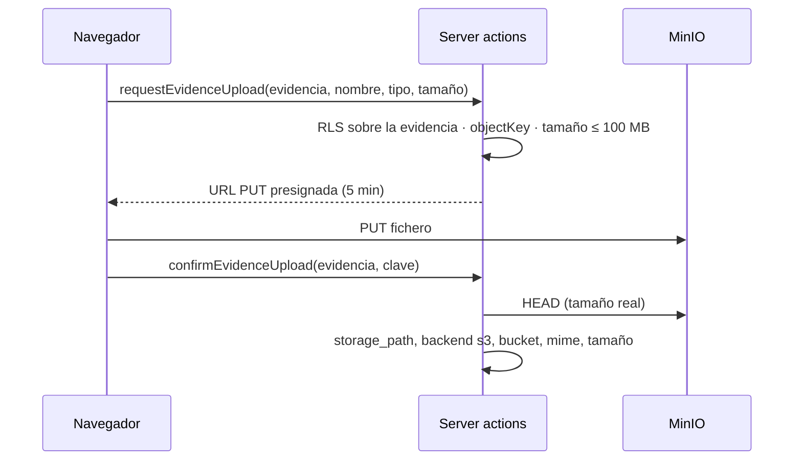

# Almacenamiento de ficheros

Dónde y cómo guarda Fluxion los ficheros. Hay dos almacenes:

| Almacén | Contenido |
|---|---|
| **MinIO/S3** | [Evidencias](../glosario.md#evidencia) y PDF generados |
| **Supabase Storage** | Avatares, logos, adjuntos de tareas y evidencias anteriores a MinIO |

## Componentes

| Componente | Ubicación | Responsabilidad |
|---|---|---|
| Cliente S3 | `lib/storage/objects.ts` (`server-only`) | `putObject` con SHA-256 en los metadatos, `signedDownloadUrl`, `signedUploadUrl`, `statObject`, `deleteObject`, `objectKey`, `s3Configured` |
| Evidencias de la biblioteca | `lib/evidences/storage.ts`, `storage-actions.ts` | Subida con URL presignada en tres pasos y descarga |
| Evidencias del plan de tratamiento | `fmea/[evaluationId]/plan/actions.ts` | Subida a través del servidor |
| PDF generados | `lib/documents/render.ts` | Ver [Generación de PDF](generacion-pdf.md) |
| Adjuntos de tareas | `tareas/actions.ts` | Supabase Storage, a través del servidor |
| Logo y avatar | `api/organization/upload-logo`, `api/user/upload-avatar` | Supabase Storage. Ver [API interna](api-interna.md#ficheros-de-perfil) |

### Subida de evidencias de la biblioteca

- La clave del objeto la genera siempre el servidor. La confirmación exige que empiece por
  `org/<organización>/evidences/<evidencia>/`.
- La organización se toma de la evidencia, no de lo que envía el navegador.

**Evidencias del plan de tratamiento:**
- El fichero llega al servidor, hasta 20 MB.
- El servidor lo sube con `putObject`, que calcula el SHA-256.
- Si falla el registro, borra el objeto.

### Descarga

| Origen | Cómo | Caducidad |
|---|---|---|
| Evidencia en S3 | URL presignada de `GetObject` | 5 minutos |
| Evidencia histórica en Supabase | `createSignedUrl` en `evidence-files`, con la sesión del usuario | 1 hora |
| PDF generado | `GET /api/documents/v1/renders/[id]/download`, con redirección | 5 minutos |
| Adjunto de tarea | URL firmada de Supabase | 1 hora |
| Logo y avatar | URL pública | — |

El almacén de lectura se elige por la columna `storage_backend`, no por la forma de la ruta.

> TODO: confirmar varios comportamientos de subida, borrado y sustitución.
> - **Huella de las evidencias:** las de la biblioteca no guardan `checksum_sha256`.
> - **Ficheros que no se borran:**
>   - borrar una evidencia elimina el registro, pero no el fichero;
>   - lo mismo ocurre al quitar un adjunto de tarea o al desvincular una evidencia del plan;
>   - sustituir el fichero de una evidencia deja el anterior en el almacén.
> - **Función de borrado de ficheros:** existe, pero nadie la usa, y deja el registro en un estado que
>   no admite la base de datos.
> - **Tipos de fichero:** las evidencias no tienen lista de tipos admitidos.
> - **Límites de tamaño:** son distintos para lo mismo: 100 MB en la biblioteca, 20 MB en el plan de
>   tratamiento y 25 MB en el bucket histórico.

## Modelo de datos

| Objeto | Tipo | Campos clave | Migración |
|---|---|---|---|
| `fluxion.system_evidences` | tabla | `storage_backend` (`supabase` por defecto, `s3`), `storage_bucket` (obligatorio si es `s3`), `storage_path`, `checksum_sha256`, `mime_type`, `file_size_bytes` | `20260819090000_storage_backend.sql` |
| `fluxion.evidences` | tabla | Evidencias del plan de tratamiento, con las mismas columnas de almacén | `20260819170000_fmea_evidences_storage_backend.sql` |
| `fluxion.v_evidence_storage_split` | vista (`security_invoker`) | Por organización y almacén: número de evidencias, sin huella y bytes | ídem |
| `fluxion.document_renders` | tabla | `storage_backend` (`s3` por defecto), `storage_bucket`, `storage_path` | `20260819230000_document_renders.sql` |
| `fluxion.task_attachments` | tabla | Ruta en `task-attachments`, borrado lógico (`deleted_at`) | `00000000000001_schema.sql` |

Las evidencias anteriores a MinIO siguen en Supabase. No hay una migración que las traslade.

### Claves de objeto

**Formato:** `objectKey()` genera `org/{organizationId}/{scope}/{entityId}/{Date.now()}-{nombre}`.

**Saneado del nombre:**
- los caracteres fuera de `a-zA-Z0-9._-` se sustituyen por `_`;
- los puntos iniciales, también;
- se corta a 120 caracteres.

| Fichero | Almacén / bucket | Clave |
|---|---|---|
| Evidencia (biblioteca y plan) | S3 `fluxion-evidences` | `org/{org}/evidences/{evidencia}/{ts}-{nombre}` |
| PDF generado | S3 `fluxion-documents` | `org/{org}/documents/{documento}/{ts}-{nombre}.pdf` |
| Evidencia histórica | Supabase `evidence-files` | `{org}/…` |
| Adjunto de tarea | Supabase `task-attachments` | `{org}/{tarea}/{adjunto}.{ext}` |
| Logo | Supabase `organization-logos` | `{org}/logo.{ext}` |
| Avatar | Supabase `user-avatars` | `{usuario}/avatar.{ext}` |

### Buckets

**MinIO/S3:**

| Bucket | Configuración |
|---|---|
| `fluxion-evidences` | Versionado |
| `fluxion-documents` | Versionado y bloqueo GOVERNANCE de 10 años (AI Act, Art. 18). La aplicación no puede borrar mientras dure la retención |

**Notas de MinIO:**
- El usuario de la aplicación no tiene permiso para saltarse la retención.
- Se eligió GOVERNANCE y no COMPLIANCE para poder atender el derecho de supresión del RGPD.
- La subida desde el navegador necesita CORS en MinIO.

**Supabase Storage** (`00000000000003_auth_storage.sql`):

| Bucket | Público | Límite | Acceso |
|---|---|---|---|
| `evidence-files` | No | 25 MB | Lectura, alta y borrado en la carpeta de la propia organización |
| `task-attachments` | No | 25 MB | Solo service role. La aplicación admite PDF, imágenes, Office, TXT y CSV |
| `organization-logos` | Sí | 5 MB | Alta y cambio en la carpeta de la organización. La aplicación limita a 2 MB y al Administrador |
| `user-avatars` | Sí | 5 MB | Alta y cambio en la carpeta del usuario. La aplicación limita a 2 MB |

Supabase Storage guarda los ficheros en el disco del servidor (`STORAGE_BACKEND: file`).

> TODO: confirmar la configuración de MinIO. La retención, el versionado y la CORS están documentados en
> `docs/infra/README.md`, pero el repositorio no contiene el script que los configura.

## API

Las operaciones son server actions y rutas internas:
- `requestEvidenceUpload`, `confirmEvidenceUpload` y `getEvidenceDownloadUrl` para las evidencias;
- las rutas de subida de logo y avatar, y la de descarga de PDF, descritas en [API interna](api-interna.md).

No hay una API externa de ficheros.

## Dependencias

| Dependencia | Uso | Si no está disponible |
|---|---|---|
| MinIO (`@aws-sdk/client-s3`, `@aws-sdk/s3-request-presigner` ^3.1113.0) | Evidencias y PDF | Sin `S3_ENDPOINT` y credenciales, fallan la subida de evidencias y la generación de PDF. No se recurre a Supabase |
| Supabase Storage | Ficheros pequeños y evidencias históricas | — |

### Copias de seguridad

| Script | Frecuencia | Qué hace |
|---|---|---|
| `infra/backups/minio-backup.sh` | Diaria | Espejo de los dos buckets de MinIO con un usuario de solo lectura, y archivo comprimido diario que se conserva 14 días. Copia solo la última versión de cada objeto |
| `infra/backups/offsite-backup.sh` | Diaria, después de las locales | Copia cifrada en cliente (rclone `crypt`) a Backblaze B2 de los volcados de Postgres y de los archivos de MinIO |
| `infra/backups/offsite-verify.sh` | Semanal | Descarga y valida el último volcado de Postgres |

> TODO: confirmar varios puntos de las copias de seguridad.
> - **Supabase Storage:** los ficheros (logos, avatares, adjuntos de tareas y evidencias históricas) no
>   tienen copia de seguridad.
> - **Verificación externa:** no comprueba las copias de MinIO.
> - **README de copias de seguridad:** se contradice sobre si existe destino externo.

Ver [Copias de seguridad](copias-de-seguridad.md).

## Seguridad

- **Control de acceso en MinIO:** MinIO no aplica RLS, así que antes de firmar una URL la aplicación
  comprueba con la RLS del usuario que el registro le es visible.
- **Rutas de los objetos:** las claves llevan la organización y las genera el servidor.
- **Supabase Storage:** las políticas limitan cada carpeta a su organización o a su usuario.
- **PDF:** quedan protegidos por la retención del bucket.

Ver [Seguridad](seguridad.md).

## Configuración

| Variable | Obligatoria | Valor por defecto | Descripción |
|---|---|---|---|
| `S3_ENDPOINT` | Sí | — | URL de MinIO |
| `S3_ACCESS_KEY_ID`, `S3_SECRET_ACCESS_KEY` | Sí | — | Usuario de la aplicación en MinIO |
| `S3_BUCKET_EVIDENCES` | No | `fluxion-evidences` | Bucket de evidencias |
| `S3_BUCKET_DOCUMENTS` | No | `fluxion-documents` | Bucket de PDF |
| `S3_REGION` | No | `us-east-1` | Región |
| `S3_FORCE_PATH_STYLE` | No | activado | Rutas tipo `endpoint/bucket/clave`, necesarias en MinIO |
| `NEXT_PUBLIC_SUPABASE_URL`, `SUPABASE_SERVICE_ROLE_KEY` | Sí | — | Supabase Storage |
