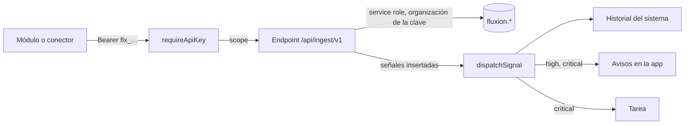

# API de ingesta

API por la que los módulos, los conectores y los sistemas de la organización envían datos a Fluxion:
[señales de riesgo](../glosario.md#señal-de-riesgo), sistemas detectados, decisiones de
[supervisión humana](../glosario.md#supervisión-humana) y hallazgos de IA no declarada.

Los módulos no escriben en la base de datos: todo entra por esta API.

La telemetría de modelos tiene su propio endpoint OTLP en el servicio de telemetría. Ver
[Telemetría](telemetria.md).

## Componentes

| Componente | Ubicación | Responsabilidad |
|---|---|---|
| Endpoints | `apps/web/app/api/ingest/v1/**` | Validar, comprobar pertenencia y escribir |
| Autenticación | `lib/auth/api-key.ts` | `requireApiKey`: clave, revocación, caducidad, límite y scope |
| Scopes | `lib/auth/scopes.ts` | Catálogo de permisos y equivalencias heredadas |
| Esquema de señales | `lib/signals/schema.ts` | Validación zod y lotes |
| Despacho de señales | `lib/signals/dispatch.ts` | Historial, avisos y tareas según la gravedad |
| Cliente Python | `packages/py-common/fluxion_common` | `CoreApiClient`, `SignalsClient`, `ConnectorClient` |



## Modelo de datos

| Objeto | Tipo | Campos clave | Migración |
|---|---|---|---|
| `fluxion.signals` | tabla | `system_id`, `source_module`, `signal_type`, `severity` (`info`, `low`, `medium`, `high`, `critical`), `title` (1-300), `metric_*`, `payload`, `status` (`new`, `acknowledged`, `actioned`, `dismissed`), `task_id`, `dedupe_key`. `UNIQUE (organization_id, dedupe_key)` | `20260812090000_signals_core.sql` |
| `fluxion.discovered_assets` | tabla | `source_module`, `asset_type`, `external_id`, `name`, `status` (`pending`, `linked`, `ignored`), `linked_system_id`, `first_seen_at`, `last_seen_at`. `UNIQUE (organization_id, source_module, external_id)` | `20260818140000_connectors_discovered_assets.sql` |
| `fluxion.connector_connections` | tabla | `connector_type`, `base_url`, `auth_type`, `secret_id` (Vault), `poll_interval_seconds` (≥ 60, por defecto 900), `sync_requested_at` | `20260818100000_connectors_connections.sql` |
| `fluxion.connector_sync_runs` | tabla | `status` (`ok`, `error`, `partial`), recuentos, `details`, `error_message` | ídem |
| `fluxion.hitl_decisions` | tabla | `decision`, `agreement` (por trigger), `dedupe_key`. `UNIQUE (organization_id, dedupe_key)` | `20260825090000_hitl_decisions.sql` |
| `fluxion.shadow_ai_findings` | tabla | `finding_type`, `category`, `pattern`, `file_path`, `line_number`, `severity`, `resolved_at` | `20260827090000_shadow_ai.sql` |

La organización sale siempre de la clave API: ningún endpoint la lee del cuerpo. Las escrituras usan
service role.

## API

### Autenticación y errores comunes

```http
Authorization: Bearer flx_<64 caracteres hexadecimales>
```

| Código | Cuerpo | Cuándo |
|---|---|---|
| 401 | `{"error":"unauthorized","message":"Clave API ausente o no válida."}`, con `WWW-Authenticate: Bearer` | Clave ausente, desconocida, revocada o caducada. La causa solo queda en el log |
| 403 | `{"error":"insufficient_scope","message":"La clave no tiene el permiso requerido: <scope>.","required_scope":"<scope>"}` | Falta el scope |
| 429 | `{"error":"rate_limited","message":"Demasiadas peticiones.","retry_after":<s>}`, con `Retry-After` | Más de 300 peticiones por minuto con la misma clave |
| 400 | `{"error":"invalid_json","message":"El cuerpo no es JSON válido."}` | Cuerpo ilegible |

**Formato de los errores:** `{"error":"<código>","message":"<texto>"}`.

**Versión:** la indica el prefijo `/api/ingest/v1/`.

**CORS:** la API no envía cabeceras CORS. Es para llamadas entre máquinas.

**Scopes:**

| Scope | Endpoints |
|---|---|
| `signals:write` | `ping`, `signals` |
| `inventory:write` | `discoveries`, `shadow-ai/findings` |
| `connectors:sync` | `connectors/config`, `connectors/runs` |
| `hitl:write` | `hitl-decisions` |
| `telemetry:write` | `POST /v1/traces` del servicio de telemetría |
| `signals:read`, `inventory:read` | Ningún endpoint los exige todavía |

Siguen admitidos los scopes heredados:
- `admin` concede todo;
- `write` cubre cualquier `*:write` y `*:read`;
- `read` cubre cualquier `*:read`;
- `connectors:sync` solo lo cubren él mismo y `admin`.

### Endpoints

| Método | Ruta | Scope | Lote | Resultado |
|---|---|---|---|---|
| `GET` | `/api/ingest/v1/ping` | `signals:write` | — | Organización, clave y scopes |
| `POST` | `/api/ingest/v1/signals` | `signals:write` | 1-100 | Por elemento |
| `POST` | `/api/ingest/v1/discoveries` | `inventory:write` | 1-100 | Por elemento |
| `GET` | `/api/ingest/v1/connectors/config?type=` | `connectors:sync` | — | Conexiones y credenciales |
| `POST` | `/api/ingest/v1/connectors/runs` | `connectors:sync` | 1 | `{ok, run_id}` |
| `POST` | `/api/ingest/v1/hitl-decisions` | `hitl:write` | 1-100 | Por elemento |
| `POST` | `/api/ingest/v1/shadow-ai/findings` | `inventory:write` | 0-500 | Todo o nada |

Los endpoints con lote aceptan un objeto o un array. `hitl-decisions` acepta además `{"decisions":[…]}`.

#### `GET /ping`

Comprueba la clave sin tocar datos.

```json
{"ok":true,"organization_id":"0f3c…","key_id":"7a21…","scopes":["signals:write"],"server_time":"2026-10-15T08:00:00.000Z"}
```

#### `POST /signals`

| Campo | Tipo | Obligatorio | Límites |
|---|---|---|---|
| `system_id` | uuid | No | Debe pertenecer a la organización de la clave |
| `source_module` | string | Sí | 1-64 |
| `source_ref` | string | No | ≤ 256 |
| `signal_type` | string | Sí | 1-64. Texto libre |
| `severity` | enum | Sí | `info` · `low` · `medium` · `high` · `critical` |
| `title` | string | Sí | 1-300 |
| `summary` | string | No | ≤ 4000 |
| `metric_name` | string | No | ≤ 64 |
| `metric_value`, `threshold` | número | No | Finitos |
| `payload` | objeto | No | Sin datos personales |
| `occurred_at` | fecha ISO con zona | No | Por defecto, ahora |
| `dedupe_key` | string | No | ≤ 256. Si se repite en la organización, la señal se ignora |

**Efectos de cada señal insertada** (las duplicadas no tienen efectos):

| Gravedad | Historial del sistema | Aviso en la app | Tarea |
|---|---|---|---|
| `info`, `low`, `medium` | Sí, si tiene sistema | — | — |
| `high` | Sí | Sí | — |
| `critical` | Sí | Sí | Sí, de prioridad crítica |

**Destinatarios del aviso:** los responsables del sistema. Si no hay, el Administrador, el Responsable
del SGAI, el CAIO y el Analista de riesgos. La tarea se asigna al primer destinatario.

```http
POST /api/ingest/v1/signals
Content-Type: application/json

[{"system_id":"1111…","source_module":"drift-monitor","signal_type":"drift.data","severity":"high",
  "title":"PSI sobre umbral en edad_cliente","metric_name":"psi","metric_value":0.31,"threshold":0.2,
  "dedupe_key":"drift:1111:edad_cliente:2026-10-15"}]
```

```json
{"received":1,"accepted":1,"duplicates":0,"rejected":0,
 "results":[{"index":0,"accepted":true,"duplicate":false,"signal_id":"aaaa…"}]}
```

Un elemento rechazado lleva su motivo en `error`, por ejemplo «system_id no pertenece a la organización
de esta clave.». Un fallo de la base de datos devuelve `500 insert_failed` para todo el lote.

#### `POST /discoveries`

Publica sistemas detectados pendientes de alta (ver
[Sistemas detectados](../funcional/descubrimientos.md)).

| Campo | Tipo | Obligatorio | Límites |
|---|---|---|---|
| `connection_id` | uuid | No | Conexión del conector |
| `source_module` | string | Sí | 1-64 |
| `asset_type` | string | Sí | 1-32. Por ejemplo, `model` o `repository` |
| `external_id` | string | Sí | 1-512 |
| `external_url` | string | No | ≤ 1000 |
| `name` | string | Sí | 1-300 |
| `description` | string | No | ≤ 4000 |
| `metadata` | objeto | No | — |

Cada descubrimiento se identifica por organización, `source_module` y `external_id`.
- Si se reenvía, se actualizan sus datos y `last_seen_at`.
- Se conservan su estado, el sistema vinculado y `first_seen_at`.

Respuesta: `{"received":1,"accepted":1,"rejected":0,"results":[{"index":0,"accepted":true}]}`.

#### `GET /connectors/config?type=mlflow|github|gitlab`

Devuelve las conexiones activas de ese tipo, con las credenciales descifradas de Vault, y el mapa `links`
de identificadores externos ya vinculados a un sistema del inventario.

```json
{"type":"mlflow","connections":[{"id":"c0ff…","name":"MLflow demo","base_url":"https://mlflow.example.test",
  "auth_type":"basic","username":"lector","password":"<ficticio>","poll_interval_seconds":900,
  "sync_requested_at":null}],"links":{"scoring-demo":"5e1d…"}}
```

Errores: `400 invalid_type` (tipo ausente o no admitido) y `500 query_failed`.

#### `POST /connectors/runs`

Registra una pasada de sincronización.

**Campos:**
- **Obligatorios:** `connector_type` y `started_at`. `status`, que vale `ok`, `error` o `partial`.
- **Opcionales:**
  - `connection_id`;
  - los recuentos `objects_seen`, `signals_published`, `signals_duplicated` y `signals_rejected`;
  - `details`;
  - `error_message`.

**Efectos:**
- actualiza el último estado de la conexión;
- borra la petición de sincronización manual si es anterior a la pasada.

Respuesta: `{"ok":true,"run_id":"3b9e…"}`. Error: `400 unknown_connection` si la conexión no es de la
organización.

#### `POST /hitl-decisions`

Registra las decisiones de supervisión humana. Ver
[Supervisión humana](../funcional/supervision-humana.md#validaciones).

| Campo | Tipo | Obligatorio | Límites |
|---|---|---|---|
| `system_id` | uuid | Sí | De la organización |
| `case_ref` | string | Sí | 1-200, referencia seudonimizada |
| `decision` | enum | Sí | `accepted` · `modified` · `overridden` · `not_used` |
| `ai_suggestion`, `human_outcome`, `reviewer_ref` | string | No | ≤ 200 |
| `ai_confidence` | número | No | 0-1 |
| `reason_code`, `reviewer_role` | string | No | ≤ 100 |
| `reason_note` | string | No | ≤ 2000 |
| `decided_in_ms` | entero | No | ≥ 0 |
| `occurred_at` | fecha ISO con zona | No | — |
| `dedupe_key` | string | No | ≤ 300 |
| `metadata` | objeto | No | Se rechaza si una clave parece contenido del caso (`name`, `email`, `dni`, `diagnosis`, `text`…) |

Respuesta: `{"accepted":1,"duplicates":0,"rejected":0,"results":[{"index":0,"accepted":true,"duplicate":false,"id":"d00d…"}]}`.

Error: `400 invalid_batch` si el lote está vacío o tiene más de 100 decisiones.

#### `POST /shadow-ai/findings`

**Formato:** foto completa de los hallazgos de IA no declarada de un repositorio.
- Cuerpo: `{"asset_external_id", "findings":[…]}`, con hasta 500 hallazgos.
- Cada hallazgo:
  - `finding_type`: `library`, `endpoint`, `credential` o `model_file`;
  - `category`: `llm`, `ml`, `vector_db`, `provider`, `secret` u `other`;
  - `pattern`, `file_path`, `line_number`, `severity` y `metadata`.

**Proceso:**
- Los hallazgos ya conocidos se actualizan y se reabren.
- Los que no aparecen en la pasada se marcan como resueltos.
- No se guarda código: un patrón de credencial de más de 60 caracteres se rechaza (`400
  pattern_too_long`).

**Errores:**
- `404 asset_not_found`: el repositorio no se ha publicado antes en `discoveries`, con
  `source_module = shadow-ai`;
- `500 write_failed`.

Respuesta: `{"asset_id":"a5a5…","written":2,"resolved":1}`.

> TODO: confirmar varios comportamientos de la ingesta.
> - **Elementos repetidos en un lote:** si `discoveries` o `shadow-ai/findings` reciben dos con la misma
>   clave, falla el lote entero con un 500.
> - **Hallazgos sin línea:** los que no traen `line_number` no se reconocen entre pasadas. Se acumulan
>   duplicados y se pierde la fecha del primer hallazgo.
> - **Mapa `links`:** no se filtra por tipo de conector.
> - **`ping` y conectores:** `ping` exige `signals:write`, así que un conector sin ese scope recibe un 403
>   al arrancar.
> - **`written` en los hallazgos:** devuelve el tamaño del lote, no las filas escritas.
> - **Formato de las respuestas:** `hitl-decisions` no devuelve `received` y llama `id` al identificador.
>   Los errores de `discoveries` hablan de «señales».
> - **Filtro de metadatos de supervisión humana:** compara por subcadena, así que también rechaza claves
>   legítimas como `model_name`.

> **Pendiente de implementar.** Exigir el módulo contratado en la ingesta: hoy ningún endpoint lo
> comprueba.

## Dependencias

### Cliente Python `fluxion_common`

| Clase | Métodos | Comportamiento |
|---|---|---|
| `CoreApiClient(base_url, api_key, timeout=30, max_retries=3)` | `ping()` | Reintenta errores de red y 5xx con espera creciente, y los 429 respetando `Retry-After`. Un 4xx falla enseguida: «Revisa la clave API y sus permisos.» |
| `SignalsClient` | `publish(señales)` | Trocea en lotes de 100 y suma los resultados |
| `ConnectorClient` | `fetch_config(tipo)`, `publish_discoveries`, `report_run`, `publish_findings`, `sync_pendiente`, `esperar` | `report_run` nunca propaga errores. `esperar` se despierta si se pide una sincronización manual |

```python
from fluxion_common import SignalsClient

cliente = SignalsClient("https://core.example.test", "flx_ejemplo…")
cliente.ping()
cliente.publish([{"source_module": "drift-monitor", "signal_type": "drift.data",
                  "severity": "medium", "title": "Deriva moderada"}])
```

Cada servicio lee la URL y la clave de `FLUXION_API_URL` y `FLUXION_API_KEY`. Ver
[Conectores](conectores.md).

> TODO: confirmar dos comportamientos del cliente.
> - **Reintentos:** el cliente reintenta peticiones POST que no son idempotentes. Puede duplicar pasadas
>   de sincronización y decisiones sin `dedupe_key`.
> - **`publish_discoveries`:** no trocea en lotes de 100.

### Servicios

- **Supabase (service role sin caché):** busca las claves y escribe.
- **Vault:** credenciales de las conexiones.

## Seguridad

- **Clave:** la clave API se busca por su hash. La organización sale de la clave.
- **Sistemas:** el `system_id` de señales y de decisiones humanas se comprueba contra la organización.
- **Credenciales de conectores:** solo se entregan con el scope `connectors:sync`.
- **Minimización:**
  - las decisiones humanas rechazan los metadatos que parecen contenido del caso;
  - los hallazgos de IA no declarada no guardan código.

Ver [Seguridad](seguridad.md).

## Configuración

| Variable | Obligatoria | Valor por defecto | Descripción |
|---|---|---|---|
| `SUPABASE_SERVICE_ROLE_KEY` | Sí (web) | — | Escrituras de la ingesta |
| `FLUXION_API_URL` | Sí (módulos) | — | URL base de Fluxion, por ejemplo `https://core.example.test` |
| `FLUXION_API_KEY` | Sí (módulos) | — | Clave `flx_` con los scopes necesarios |

Las claves se crean en **Ajustes › API y desarrolladores**. Ver [Ajustes](../funcional/ajustes.md).

> TODO: confirmar qué hacer con `docs/ingesta.md`.
> - **Contenido desactualizado:** no recoge `hitl-decisions` ni `shadow-ai/findings`, los scopes
>   `hitl:write` y `telemetry:write`, ni los tipos de conector `github` y `gitlab`.
> - **Error inexistente:** documenta un error 402 que ningún endpoint devuelve.
> - **Dominio real:** su ejemplo usa el dominio real de producción.
