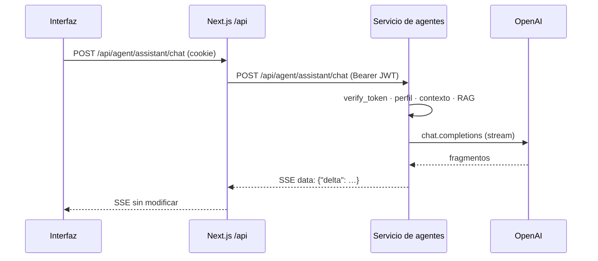

# API interna

Route handlers de `apps/web/app/api/**` que usa la propia interfaz de Fluxion, y los endpoints del
servicio de agentes a los que reenvían. La API para sistemas externos está en
[API de ingesta](api-ingesta.md). Las tareas programadas (`/api/cron/*`) están en [Tareas programadas](tareas-programadas.md).

## Componentes

| Grupo | Ruta Next | Destino | Llamado desde |
|---|---|---|---|
| Asistente | `/api/agent/assistant/*` | Servicio de agentes, `routes/assistant.py` | `components/assistant/AssistantPanel.tsx` |
| Clasificación | `/api/v1/systems/[systemId]/*` | Servicio de agentes, `routes/classification.py` | `inventario/[id]/system-detail-client.tsx`, `components/classification/ReconciliationPanel.tsx` |
| Documentos | `/api/documents/v1/renders/[id]/download` | MinIO/S3 | [Expediente documental](../funcional/expediente-documental.md), [Aprobaciones](../funcional/aprobaciones.md) |
| Ficheros de perfil | `/api/organization/upload-logo`, `/api/user/upload-avatar` | Supabase Storage | [Organización](../funcional/organizacion.md), [Onboarding](../funcional/onboarding.md), [Perfil](../funcional/perfil.md) |



La clasificación inicial de un sistema nuevo no pasa por estas rutas. La server action del
[alta de sistema](../funcional/inventario-alta.md) llama directamente a
`POST /api/v1/systems/{id}/classify` del servicio de agentes.

## Modelo de datos

| Objeto | Tipo | Campos clave | Lo escribe |
|---|---|---|---|
| `fluxion.assistant_conversations` | tabla | `user_id`, `organization_id`, `title`, `messages` (jsonb), `context_page`, `context_system`, `last_message_at` | Asistente |
| `fluxion.classification_events` | tabla | `ai_system_id`, `version`, `method` (`manual_review`, `ai_agent`), `status` (`pending_reconciliation`, `reconciled`, `superseded`), `classification_factors` | Reclasificación |
| `fluxion.classification_diffs` | tabla | `event_id`, obligación, cambio (`added`, `removed`, `unchanged`), `resolution`, `resolution_note` | Reclasificación y reconciliación |
| `fluxion.system_obligations` | tabla | `status`, `exclusion_justification`, `archived_at` | Reconciliación |
| `fluxion.ai_systems` | tabla | `aiact_risk_level`, `current_classification_event_id` | Reconciliación |
| `fluxion.document_renders` | tabla | PDF generados; lectura filtrada por RLS | — |
| `fluxion.organizations.logo_url` | columna | URL pública del logo | Subida del logo |

## API

### Patrones comunes

**Autenticación:**
- Todas las rutas exigen la sesión de la cookie. Sin sesión responden 401 `{"error":"No autenticado"}`.
- Los proxys al servicio de agentes reenvían el `access_token` de la sesión como
  `Authorization: Bearer <JWT>`.
- El servicio de agentes valida el JWT contra GoTrue y obtiene la organización del perfil.
  - Errores 401: «Token no proporcionado», «Token inválido o expirado».
  - Error 404: «Usuario no pertenece a ninguna organización».

**Errores del servicio de agentes:** llegan como `{"detail": "…"}` (formato FastAPI), y el proxy los
reenvía con el mismo código.

**Streaming:** eventos SSE sin campo `event:`, solo líneas `data: <json>`:

| Evento | Cuerpo |
|---|---|
| Fragmento | `{"delta": "<texto>", "conversation_id": "<uuid>"}` |
| Fin | `{"type": "complete", "conversation_id": "<uuid>"}` |
| Error | `{"type": "error", "message": "<texto>"}`. Llega dentro de una respuesta HTTP 200 |

### Asistente SGAI

| Método | Ruta | Descripción |
|---|---|---|
| `POST` | `/api/agent/assistant/chat` | Pregunta al asistente. Respuesta SSE |
| `GET` | `/api/agent/assistant/conversations` | Últimas 20 conversaciones del usuario |
| `GET` / `DELETE` | `/api/agent/assistant/conversations/[id]` | Detalle o borrado de una conversación |

**`POST /api/agent/assistant/chat`:**

| Campo | Tipo | Por defecto | Descripción |
|---|---|---|---|
| `message` | string | — | Pregunta. Obligatorio |
| `conversation_id` | string | — | Conversación existente. Sin él, se crea una con título igual a los primeros 60 caracteres |
| `context_page` | string | `/` | Pantalla actual |
| `context_system_id` | string | — | Sistema abierto |
| `history` | `[{role, content}]` | `[]` | Mensajes previos. Se usan los 18 últimos |

**Errores:**

| Código | Mensaje |
|---|---|
| 404 | «Conversación no encontrada» |
| 502 | «No se pudo conectar con el servidor de agentes: …» |

**Proceso en el servicio de agentes:**
1. Compone el contexto de la organización.
2. Si la pregunta lo requiere, recupera hasta 4 fragmentos del corpus normativo, con un umbral de 0,72.
3. Llama a OpenAI en streaming, con el modelo `FLUXION_ASSISTANT_MODEL` y un máximo de 2.000 tokens.
4. Al terminar, añade el par pregunta-respuesta a `messages`.

Ver [Servicio de agentes](servicio-agentes.md) y [RAG](rag.md).

```http
POST /api/agent/assistant/chat
Content-Type: application/json

{"message":"¿Qué exige el art. 14?","conversation_id":null,"context_page":"/inventario","history":[]}
```

```text
data: {"delta": "El artículo 14", "conversation_id": "0b6c…"}
data: {"delta": " exige supervisión humana…", "conversation_id": "0b6c…"}
data: {"type": "complete", "conversation_id": "0b6c…"}
```

> TODO: confirmar el uso de los endpoints de conversaciones. La interfaz no los llama: no permite listar,
> retomar ni borrar conversaciones.

### Clasificación AI Act

| Método | Ruta Next | Ruta en el servicio de agentes | Descripción |
|---|---|---|---|
| `POST` | `/api/v1/systems/[systemId]/reclassify` | `/api/v1/systems/{id}/reclassify` | Revisión manual con el motor de reglas |
| `POST` | `/api/v1/systems/[systemId]/reclassify-ai` | `/api/v1/systems/{id}/reclassify/ai` | Clasificación con IA |
| `POST` | `/api/v1/systems/[systemId]/reconcile` | `/api/v1/systems/{id}/reconcile` | Aplica las decisiones sobre los cambios |
| `DELETE` | `/api/v1/systems/[systemId]/classification-events/[eventId]` | ídem | Cancela una reclasificación pendiente |

**`reclassify`:**
- **Entrada:** `{factors, review_notes?}`, con `factors`:
  - obligatorios: `domain`, `output_type`, `affects_persons`;
  - opcionales, `false` por defecto: `has_biometric`, `is_gpai`, `manages_critical_infrastructure`,
    `affects_vulnerable_groups`, `involves_minors`;
  - opcional: `intended_use`.
- **Proceso:**
  1. Ejecuta el motor de reglas.
  2. Compara el resultado con la última clasificación reconciliada.
  3. Si hay cambios, crea un evento `pending_reconciliation`, con versión n+1 y una diferencia por
     obligación.
  4. Las diferencias sin cambio se conservan, y las retiradas sin trabajo hecho se archivan.

**`reclassify-ai`:**
- **Entrada:** sin cuerpo.
- **Proceso:**
  1. Ejecuta el motor de reglas como referencia.
  2. Recupera 8 fragmentos del corpus.
  3. Llama a OpenAI.
  4. Valida el nivel de riesgo (`prohibited`, `high`, `limited`, `minimal`, `gpai`) y las obligaciones.
  5. Si el nivel difiere del del motor de reglas, marca `divergence`.
  6. El cálculo de las diferencias es el mismo que en `reclassify`.

**Respuesta de las dos:**
- `{"data":{"has_changes":true,"event_id","version","risk_level","risk_label"}}`, más `confidence` y
  `divergence` en la de IA;
- o `{"data":{"has_changes":false}}`.

**`reconcile`:**
- **Entrada:** `{event_id, decisions:[{diff_id, resolution, resolution_note?}]}`.
- **Proceso:**
  - Una obligación añadida y aceptada se crea como pendiente; si se excluye, se crea como excluida con su
    justificación.
  - Las retiradas que se archivan quedan marcadas.
  - El evento pasa a `reconciled`, los anteriores a `superseded`, y se actualiza el nivel de riesgo del
    sistema.
- **Respuesta:** `{"data":{"event_id","version","message":"Clasificación actualizada a versión N."}}`.

**`DELETE classification-events`:** borra un evento en `pending_reconciliation` y responde
`{"data":{"cancelled":true}}`.

**Errores:**

| Código | Mensaje |
|---|---|
| 404 | «Sistema no encontrado o sin acceso» |
| 409 | «Hay una reclasificación pendiente de reconciliación. Resuelve los cambios antes de iniciar una nueva clasificación.» |
| 404 | «Evento de clasificación no encontrado o ya reconciliado.» |
| 422 | «Falta decisión para la obligación '{label}'.» / «La obligación '{label}' requiere una nota para ser {resolución}.» |
| 502 | «Error del agente IA: …» / «El agente devolvió una respuesta sin formato JSON válido.» |
| 503 | «Cliente OpenAI no disponible»; en el proxy, «No se pudo conectar con el agente de clasificación…» |

```http
POST /api/v1/systems/7d1e…/reclassify
{"factors":{"domain":"rrhh","output_type":"decision","affects_persons":true},"review_notes":"Cambio de uso"}

200 {"data":{"has_changes":true,"event_id":"e2a9…","version":2,"risk_level":"high","risk_label":"Alto Riesgo"}}
```

> TODO: confirmar varios comportamientos de la clasificación.
> - **Sistemas prohibidos:** la clasificación con IA pierde su obligación del Art. 5, porque no figura
>   entre las obligaciones admitidas.
> - **Reconciliación:** no es atómica, y no se comprueba que la resolución elegida sea válida para el tipo
>   de cambio.
> - **Proxys:** varios no controlan que el servicio de agentes esté caído o responda algo que no es JSON,
>   y devuelven un error 500.

### Documentos

**`GET /api/documents/v1/renders/[id]/download`:**
- Lee el render con el cliente de sesión, así que la RLS limita a los de la organización.
- Responde 302 a una URL presignada de MinIO/S3 válida 5 minutos, con
  `Content-Disposition: attachment; filename="<título> <AAAA-MM-DD>.pdf"`.
- Errores: 404 «Render no encontrado», 500 «No se pudo generar el enlace».

### Ficheros de perfil

| Ruta | Permiso | Entrada | Almacén | Respuesta |
|---|---|---|---|---|
| `POST /api/organization/upload-logo` | `org_admin` (403 «Sin permisos de administrador») | multipart, campo `file`, hasta 2 MB | Bucket público `organization-logos`, `<org_id>/logo.<ext>`. Actualiza `organizations.logo_url` | `{"url": "…"}` |
| `POST /api/user/upload-avatar` | Usuario | ídem | Bucket público `user-avatars`, `<user_id>/avatar.<ext>`. No guarda la URL: la guarda el formulario de perfil | `{"url": "…"}` |

**Errores:** 400 «No se recibió archivo», 400 «El archivo supera el límite de 2 MB» y 500 con el mensaje
del almacenamiento.

## Dependencias

| Dependencia | Uso | Si no está disponible |
|---|---|---|
| Servicio de agentes (`AGENT_SERVER_URL`) | Asistente y clasificación | 502 o 503 en los proxys |
| OpenAI | Asistente y clasificación con IA | Error del agente (502 o evento `error`) |
| Voyage AI | Búsqueda en el corpus | Sin fragmentos recuperados |
| MinIO/S3 | Descarga de PDF | 500 «No se pudo generar el enlace» |
| Supabase Storage | Logos y avatares | 500 |

## Seguridad

- **Autenticación:** todas las rutas usan la sesión del usuario.
- **Servicio de agentes:**
  - valida el JWT y filtra cada consulta por la organización del perfil;
  - opera con service role, así que no aplica la RLS.
- **Descarga de PDF:** se apoya en la RLS de `document_renders`.
- **Logo:** solo lo sube el Administrador.

Ver [Seguridad](seguridad.md).

## Configuración

| Variable | Obligatoria | Valor por defecto | Descripción |
|---|---|---|---|
| `AGENT_SERVER_URL` | Sí | `http://localhost:8001` | URL del servicio de agentes |
| `FLUXION_ASSISTANT_MODEL` | No (agents) | Ver [Servicio de agentes](servicio-agentes.md) | Modelo del asistente |
| `S3_*` | Para descargas | — | Ver [Almacenamiento de ficheros](almacenamiento-ficheros.md) |
