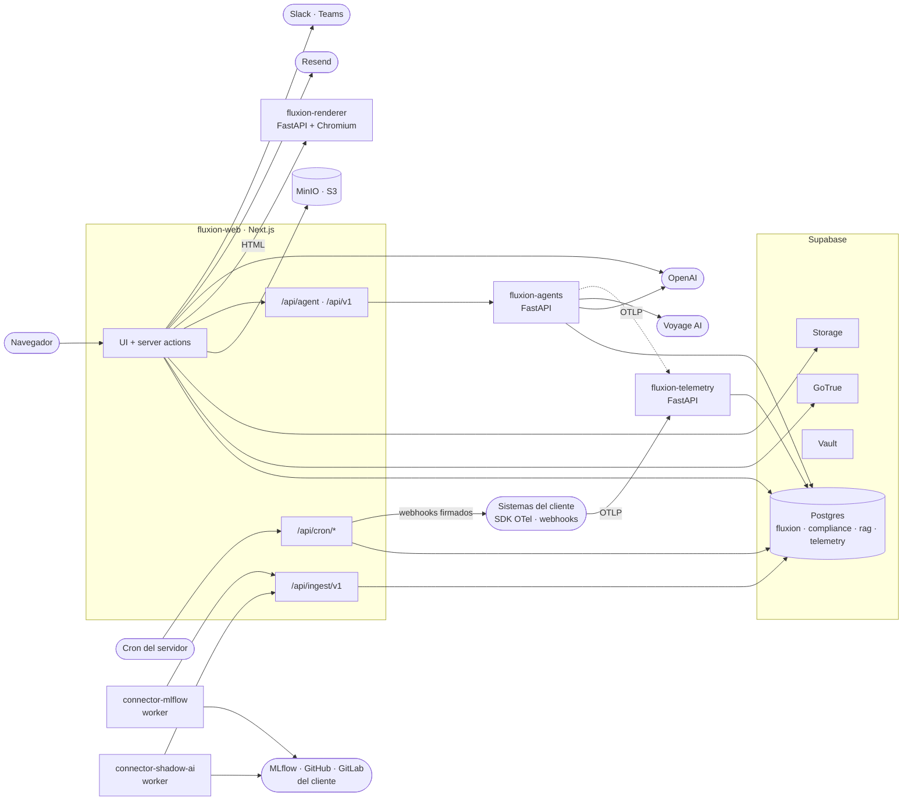

# Arquitectura de Fluxion

Visión general de las piezas que forman Fluxion, cómo se comunican, dónde se despliegan y con qué
servicios externos se integran.

Fluxion es una aplicación web multi-tenant construida sobre Next.js y Supabase. La lógica de negocio
vive casi entera en la aplicación web, en server actions y route handlers. Alrededor hay cinco
servicios Python especializados:
- **agents:** IA de clasificación y Asistente SGAI.
- **renderer:** generación de PDF.
- **telemetry:** ingesta de trazas de modelos.
- **connector-mlflow** y **connector-shadow-ai:** conectores de descubrimiento.

Todos los datos persistentes están en Postgres (Supabase) y en almacenamiento de objetos S3 (MinIO).

## Componentes

<!-- Despliegue: subsección al final de esta sección. -->

| Componente | Ubicación | Tecnología | Responsabilidad |
|---|---|---|---|
| `fluxion-web` | `apps/web` | Next.js 14 (App Router), TypeScript, Tailwind, Node 20 | Interfaz, lógica de negocio (server actions), API de ingesta para módulos, tareas programadas (`/api/cron/*`), proxy hacia el servicio de agentes |
| `fluxion-agents` | `services/agents` | Python 3.11, FastAPI, cliente `AsyncOpenAI` | [Asistente de clasificación AI Act](../glosario.md#asistente-de-clasificación-ai-act) y [Asistente SGAI](../glosario.md#asistente-sgai), con recuperación sobre el [corpus normativo](../glosario.md#corpus-normativo) |
| `fluxion-renderer` | `services/renderer` | Python 3.11, FastAPI, Playwright + Chromium | Convierte HTML en PDF. Recibe el documento ya construido, con CSS e imágenes embebidos; no tiene acceso a la aplicación |
| `fluxion-telemetry` | `services/telemetry` | Python 3.11, FastAPI, `asyncpg` | Recibe trazas OTLP, conserva solo los tramos `gen_ai.*`, descarta los atributos de contenido (prompts y respuestas), calcula el coste y escribe en `telemetry.llm_spans` |
| `connector-mlflow` | `services/connector-mlflow` | Worker Python (`httpx`) | Lee el registro de modelos de MLflow y publica [señales de riesgo](../glosario.md#señal-de-riesgo) o [sistemas detectados](../glosario.md#sistema-detectado-pendiente-de-alta) |
| `connector-shadow-ai` | `services/connector-shadow-ai` | Worker Python (`httpx`) | Escanea repositorios de GitHub o GitLab y publica sistemas detectados y [hallazgos de IA no declarada](../glosario.md#hallazgo-de-ia-no-declarada) |
| `fluxion_common` | `packages/py-common` | Librería Python | Configuración, logging, cliente de la API de ingesta (señales, conectores) y telemetría OTLP. Se copia dentro de cada imagen; no se publica |
| Supabase | `infra/supabase` | Postgres 15.8, PostgREST, GoTrue, Kong, Storage, Vault, pg_cron, pgvector | Base de datos, autenticación, secretos y almacenamiento de imágenes y adjuntos |
| MinIO | Proyecto propio en Dokploy | S3 | Evidencias (`fluxion-evidences`) y documentos generados (`fluxion-documents`) |
| Cron del servidor | `infra/schedules` | `crontab` + `app-cron.sh` | Dispara las rutas `/api/cron/*` |

### Patrones de comunicación

| Origen → destino | Mecanismo | Autenticación |
|---|---|---|
| Navegador → web | HTTPS, server actions | Sesión de Supabase (cookie) |
| Web → Supabase | PostgREST con el cliente de sesión (RLS) o con service role (procesos de sistema) | JWT del usuario o clave de servicio |
| Web → agents | HTTP; la web reenvía el JWT del usuario. Clasificación y chat por SSE | JWT de Supabase |
| Web → renderer | HTTP `POST /render/v1/pdf` | `Bearer RENDERER_SECRET` |
| Web → MinIO | SDK S3; las descargas y subidas del navegador usan URLs prefirmadas de 5 minutos | Credenciales S3 del servidor |
| Conectores → web | `POST /api/ingest/v1/*` | Clave API `flx_…` con scopes |
| SDK OTel del cliente y agents → telemetry | OTLP/HTTP `POST /v1/traces` | Clave API `flx_…` con scope `telemetry:write` |
| Cron → web | HTTP `GET /api/cron/*` | `Bearer CRON_SECRET` |
| Web → sistemas del cliente | Webhooks salientes firmados con HMAC-SHA256 | Secreto por webhook |

Los módulos no escriben directamente en la base de datos: publican por la API de ingesta. El contrato
está en [api-ingesta.md](api-ingesta.md).

### Despliegue

- **Plataforma:** un servidor virtual con Dokploy, que orquesta contenedores sobre Docker Swarm y usa
  Traefik como proxy inverso con TLS. Cada componente es un proyecto de Dokploy con su propio dominio.
- **Imágenes:** todos los Dockerfiles se construyen con contexto en la **raíz del monorepo**, para poder
  copiar `packages/py-common`.

| Servicio | Dockerfile | Imagen base | Puerto | Forma |
|---|---|---|---|---|
| `fluxion-web` | `apps/web/Dockerfile` | `node:20-alpine` (multietapa, `output: 'standalone'`) | 3001 | Aplicación |
| `fluxion-agents` | `services/agents/Dockerfile` | `python:3.11-slim` | 8001 | Aplicación |
| `fluxion-renderer` | `services/renderer/Dockerfile` | `python:3.11-slim-bookworm` (con Chromium) | 8000 | Aplicación |
| `fluxion-telemetry` | `services/telemetry/Dockerfile` | `python:3.11-slim-bookworm` | 8000 | Compose (`services/telemetry/docker-compose.yml`), conectado a la red de Dokploy y a la de Supabase |
| `connector-mlflow` | `services/connector-mlflow/Dockerfile` | `python:3.11-slim` | — | Worker en bucle |
| `connector-shadow-ai` | `services/connector-shadow-ai/Dockerfile` | `python:3.11-slim-bookworm` | — | Worker en bucle |

- **Base de datos:** Supabase autoalojado en un stack propio de Fluxion
  (`infra/supabase/docker-compose.propio.yaml`), sin los servicios que Fluxion no usa: analytics,
  vector, realtime, imgproxy y functions.
- **Migraciones:** `infra/db/migrate.sh` en el servidor. Hace `git pull` y aplica, cada una en su
  transacción, las migraciones de `supabase/migrations/` que no figuran en
  `supabase_migrations.schema_migrations`. Ver [modelo-datos.md](modelo-datos.md).
- **Tareas programadas:** dos mecanismos. pg_cron dentro de Postgres (recurrencias de tareas, rollup y
  particiones de telemetría) y el `crontab` del servidor, que llama a seis rutas `/api/cron/*`:
  caducidad de evidencias, recordatorios de revisión, plazos de incidentes, presupuestos, discordancia
  en supervisión humana y entrega de webhooks. Ver [tareas-programadas.md](tareas-programadas.md).
- **Copias de seguridad:** ver [copias-de-seguridad.md](copias-de-seguridad.md).

## Modelo de datos

Una sola base de datos Postgres con cuatro esquemas propios:

| Esquema | Contenido |
|---|---|
| `fluxion` | Datos de cada [organización](../glosario.md#organización): inventario, riesgo, tratamiento, evidencias, tareas, aprobaciones, integración |
| `compliance` | [Catálogo de tablas básicas](../glosario.md#catálogo-de-tablas-básicas): modos de fallo, obligaciones, controles, grafo causal |
| `rag` | Corpus normativo con embeddings (pgvector, 1024 dimensiones) |
| `telemetry` | Trazas de llamadas a modelos, agregados diarios, tarifas y presupuestos |

El detalle, con diagramas entidad-relación, está en [modelo-datos.md](modelo-datos.md).

## API

| Superficie | Ruta | Consumidor | Autenticación | Documento |
|---|---|---|---|---|
| Server actions | `apps/web/app/**/actions.ts` | La propia interfaz | Sesión | Documentos de `funcional/` |
| API de ingesta | `/api/ingest/v1/*` | Conectores y sistemas del cliente | Clave API con scopes | [api-ingesta.md](api-ingesta.md) |
| API interna | `/api/agent/*`, `/api/v1/systems/*`, `/api/documents/*`, subida de logo y avatar | La propia interfaz | Sesión | [api-interna.md](api-interna.md) |
| Tareas programadas | `/api/cron/*` | Cron del servidor | `CRON_SECRET` | [tareas-programadas.md](tareas-programadas.md) |
| Servicio de agentes | `/api/agent/*`, `/api/v1/systems/*` en `fluxion-agents` | La web, como proxy | JWT de Supabase | [servicio-agentes.md](servicio-agentes.md) |
| Renderer | `POST /render/v1/pdf` | La web | `RENDERER_SECRET` | [generacion-pdf.md](generacion-pdf.md) |
| Telemetría | `POST /v1/traces` (OTLP) | SDK OTel del cliente, agents | Clave API `telemetry:write` | [telemetria.md](telemetria.md) |
| Webhooks salientes | URL del cliente | Sistemas del cliente | Firma HMAC-SHA256 | [webhooks-salientes.md](webhooks-salientes.md) |

Todos los servicios FastAPI exponen `GET /health`.

## Dependencias

### Integraciones externas

| Servicio | Uso | Desde |
|---|---|---|
| OpenAI (GPT) | Clasificación AI Act, Asistente SGAI y sugerencias de la [Declaración de Aplicabilidad](../glosario.md#declaración-de-aplicabilidad-iso-42001) | agents; web (sugerencias de la SoA) |
| Voyage AI (`voyage-law-2`) | Embeddings de las consultas al corpus normativo | agents |
| Resend | Correo transaccional | web |
| Servidor SMTP | Correos de autenticación (invitación, confirmación) que envía GoTrue | Supabase |
| Slack y Microsoft Teams | [Avisos a Slack/Teams](../glosario.md#aviso-a-slackteams) mediante webhooks entrantes | web |
| MLflow del cliente | Registro de modelos | connector-mlflow |
| GitHub y GitLab del cliente | Repositorios de código, con un token de solo lectura | connector-shadow-ai |
| Backblaze B2 | Copia de seguridad cifrada fuera del servidor | Scripts de `infra/backups` |

> **Pendiente de implementar.** Modelo LLM configurable por organización. Hoy el modelo se fija por
> variable de entorno en agents, y en el código para las sugerencias de la SoA.

### Librerías principales

| Componente | Librerías |
|---|---|
| web | `next` 14.2, `@supabase/supabase-js`, `@supabase/ssr`, `@aws-sdk/client-s3`, `@aws-sdk/s3-request-presigner`, `resend` |
| agents | `fastapi`, `openai`, `supabase`, `voyageai`, `opentelemetry-sdk` |
| renderer | `fastapi`, `playwright` |
| telemetry | `fastapi`, `asyncpg`, `opentelemetry-proto` |
| conectores | `httpx` |

El inventario completo de componentes de terceros y sus licencias está en
[`docs/legal/componentes-de-terceros.md`](../legal/componentes-de-terceros.md).

## Seguridad

- **Aislamiento por organización:**
  - Las tablas con datos de cliente llevan `organization_id`.
  - Las consultas con la sesión del usuario pasan por políticas RLS.
  - Los procesos de sistema (ingesta, cron, entrega de webhooks) usan la service role y filtran por
    organización en el código.
  - En MinIO no hay RLS: el control de acceso lo hace el servidor al firmar las URLs.
- **Autenticación de personas:** Supabase Auth (email y contraseña, TOTP opcional). El middleware de
  Next.js refresca la sesión y redirige al login o al onboarding.
- **Autenticación entre máquinas:**
  - **Claves API `flx_…`:** se guardan como hash SHA-256, con scopes, revocación y caducidad.
  - **Secretos compartidos:** `CRON_SECRET` y `RENDERER_SECRET`. Si no están configurados, los
    servicios rechazan todas las peticiones.
- **Secretos de integraciones:** las credenciales de conectores y las URLs de Slack y Teams se guardan
  en Supabase Vault y solo se leen desde el servidor.
- **Datos sensibles:**
  - Telemetry descarta prompts y respuestas.
  - Detección de IA no declarada no guarda código ni valores de credenciales.
  - El renderer no recibe credenciales de la aplicación.

Detalle en [seguridad.md](seguridad.md).

## Configuración

Variables principales por componente. La lista completa está en [configuracion.md](configuracion.md).
Las variables se definen en Dokploy; en desarrollo, en `apps/web/.env.local`.

| Variable | Componente | Obligatoria | Valor por defecto | Descripción |
|---|---|---|---|---|
| `NEXT_PUBLIC_SUPABASE_URL`, `NEXT_PUBLIC_SUPABASE_ANON_KEY` | web | Sí | — | Conexión a Supabase. Se fijan en tiempo de build: cambiarlas obliga a reconstruir la imagen |
| `SUPABASE_SERVICE_ROLE_KEY` | web | Sí | — | Cliente de servicio para ingesta, cron y entrega |
| `AGENT_SERVER_URL` | web | Sí | `http://localhost:8001` | URL del servicio de agentes |
| `RENDERER_URL`, `RENDERER_SECRET` | web, renderer | Sí, para generar PDF | — | Servicio de PDF |
| `S3_ENDPOINT`, `S3_ACCESS_KEY_ID`, `S3_SECRET_ACCESS_KEY`, `S3_BUCKET_EVIDENCES`, `S3_BUCKET_DOCUMENTS` | web | Sí | Buckets: `fluxion-evidences`, `fluxion-documents` | Almacenamiento S3 |
| `RESEND_API_KEY`, `RESEND_FROM_EMAIL` | web | No | — | Correo. Sin clave no se envía correo |
| `NEXT_PUBLIC_APP_URL` | web | Recomendada | — | URL base para los enlaces de los avisos |
| `CRON_SECRET` | web, cron | Sí | — | Autenticación de `/api/cron/*` |
| `OPENAI_API_KEY` | web, agents | Sí | — | OpenAI |
| `SUPABASE_URL`, `SUPABASE_SERVICE_KEY`, `VOYAGE_API_KEY`, `FRONTEND_URL` | agents | Sí | `FRONTEND_URL`: `http://localhost:3000` | Base de datos, embeddings y CORS |
| `FLUXION_CLASSIFICATION_MODEL`, `FLUXION_ASSISTANT_MODEL` | agents | No | Modelo GPT por defecto en `models.py` | Modelo de cada función |
| `DATABASE_URL` | telemetry | Sí | — | Conexión directa a Postgres |
| `FLUXION_API_URL`, `FLUXION_API_KEY`, `POLL_INTERVAL_SECONDS` | conectores | Sí (el intervalo no) | Intervalo: 900 s (MLflow), 86 400 s (Shadow AI) | API de ingesta y frecuencia de sondeo |
| `OTEL_EXPORTER_OTLP_ENDPOINT` | servicios Python | No | — | Si se define, los servicios envían sus trazas a telemetry |
