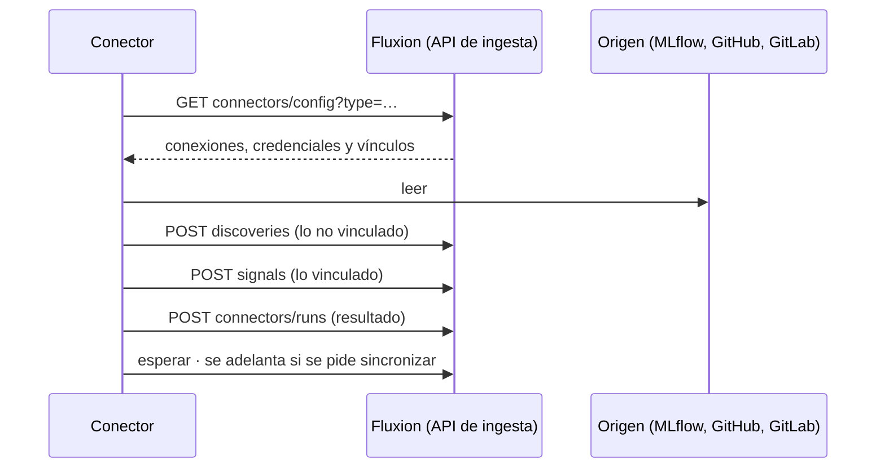

# Conectores

Servicios que leen sistemas externos de la organización y publican en Fluxion, por la
[API de ingesta](api-ingesta.md), lo que encuentran:
- sistemas detectados pendientes de alta;
- [señales de riesgo](../glosario.md#señal-de-riesgo);
- hallazgos.

Hay dos conectores:
- **MLflow:** registro de modelos;
- **Detección de IA no declarada:** repositorios de GitHub y GitLab.

## Componentes

| Componente | Ubicación | Responsabilidad |
|---|---|---|
| Librería común | `packages/py-common/fluxion_common` | Cliente de la API, configuración, conexiones y espera |
| Conector MLflow | `services/connector-mlflow` | Inventario de modelos registrados y sus promociones |
| Conector Shadow AI | `services/connector-shadow-ai` | Uso de IA, ficheros de modelo y credenciales en repositorios |
| Conexiones | **Ajustes › Conectores** | Alta de conexiones, credenciales en Vault, sincronización manual e historial |



### Librería común

| Clase | Uso |
|---|---|
| `CoreApiClient` | Transporte, con reintentos de red, 429 y 5xx. Ver [API de ingesta](api-ingesta.md#cliente-python-fluxion_common) |
| `ConnectorClient` | `fetch_config(tipo)` devuelve las conexiones y el mapa `links` (identificador externo → sistema). Además: `publish_discoveries`, `publish_findings`, `report_run` (nunca propaga errores) y `esperar(segundos, tipos)`, que consulta cada 30 s si se ha pedido una sincronización |
| `SignalsClient` | `publish` en lotes de 100 |
| `Connection` | `id`, `name`, `base_url`, `auth_type`, `username`, `password`, `poll_interval_seconds`, `sync_requested_at`. `.credentials` (básica) y `.token` |

### Conector MLflow

**Origen:** solo el Registro de Modelos de MLflow, no los experimentos. Usa la API REST
`/api/2.0/mlflow`:
- `registered-models/search`;
- `model-versions/search`, paginado de 100 en 100.

**Ciclo:**
1. `ping`.
2. En bucle:
   - lee la configuración;
   - sincroniza cada conexión;
   - espera el intervalo de la primera conexión.

Si Fluxion no devuelve conexiones, usa las variables de entorno de respaldo.

**Vínculo con un sistema:** se busca en este orden:
1. la etiqueta `fluxion.system_id` en una versión;
2. la misma etiqueta en el modelo;
3. el mapa `links`.

**Qué publica de cada modelo:**

| Caso | Publica |
|---|---|
| Modelo sin vincular | Un descubrimiento: `asset_type = model`, `external_id` = nombre, `metadata` con versiones, versión en producción y etiquetas |
| Modelo vinculado, cada versión | Señal `inventory.model_registered`, `info`, `dedupe_key = mlflow:<modelo>:v<n>` |
| Modelo vinculado, versión en producción | Señal `inventory.model_promoted`, `medium`, `dedupe_key = mlflow:<modelo>:v<n>:production` |

Una versión está en producción si tiene el alias `production`, `prod` o `champion`, o la etapa
`Production`.

**Resultado:**
- Al final, `report_run` con el número de modelos vistos.
- El estado es `partial` si hubo rechazos.
- Ante un error de MLflow o de Fluxion, registra la pasada como `error` y sigue.

### Conector Shadow AI (detección de IA no declarada)

**Origen:** los repositorios de una organización de GitHub o de un grupo de GitLab, con un token de solo
lectura. El campo «usuario» de la conexión indica la organización o el grupo.

**Qué analiza:**

| Qué | Cómo | Hallazgo |
|---|---|---|
| Manifiestos (`requirements.txt`, `pyproject.toml`, `package.json`, `go.mod`, `pom.xml`…) | Busca librerías de LLM, ML y bases vectoriales | `library` |
| Ficheros de modelo (`.pt`, `.onnx`, `.pkl`, `.safetensors`, `.gguf`…) | Por extensión, sin abrirlos | `model_file`, `medium` |
| Código, de los ficheros más pequeños a los más grandes, hasta `MAX_FICHEROS_CODIGO` | URLs de proveedores de IA (OpenAI, Anthropic, Google, Mistral, Cohere, Hugging Face, Azure OpenAI, Bedrock, Groq, DeepSeek) | `endpoint`, `high`. Con 4 o más proveedores en un fichero, un único hallazgo `info` |
| Código | Patrones de credenciales (OpenAI, Anthropic, Hugging Face, Google, AWS, Cohere) | `credential`, `critical`. Baja a `medium` en rutas de ejemplo o test |

Nunca se guarda código ni el valor de una credencial: solo el patrón, la ruta y la línea.

**Qué publica:**
- **Descubrimiento:** si el repositorio usa IA, con `asset_type = repository` y `external_id` igual a
  `github:<org>/<repo>` o `gitlab:<ruta>`.
- **Hallazgos:** sus hallazgos, como foto completa de la pasada.
- **Señal:** si hay credenciales, `security.exposed_credential`, crítica o media, una por repositorio y
  día.

**Presupuesto:** reserva `RESERVA_PETICIONES` de la cuota de la API de GitHub. Si se agota, la pasada
termina como `partial`.

> TODO: confirmar varios comportamientos de los conectores.
> - **Señal de credenciales expuestas:** no incluye `source_module`, que es obligatorio, así que la API
>   siempre la rechaza. El aviso crítico nunca llega.
> - **Lotes de descubrimientos:** `publish_discoveries` no trocea en lotes de 100. Con más de 100 modelos
>   o repositorios sin vincular, la pasada falla y, en MLflow, tampoco se publican las señales.
> - **Intervalo de Shadow AI:** ignora el intervalo de la conexión y usa siempre `POLL_INTERVAL_SECONDS`.
> - **Repositorios sin revisar:** al agotar el presupuesto, la siguiente pasada empieza otra vez por los
>   mismos repositorios.
> - **Hallazgos que no se cierran:** los hallazgos de un repositorio que deja de usar IA nunca se marcan
>   como resueltos.
> - **Hallazgos sin línea:** se duplican en cada pasada.
> - **GitLab:**
>   - solo admite grupos, no usuarios;
>   - no controla la cuota de peticiones;
>   - no aplica el límite de tamaño de fichero.
> - **Espera:** consulta la configuración cada 30 s, y con ella descifra los secretos de Vault.

### Escribir un conector nuevo

1. **Servidor:**
   - añade el tipo al CHECK de `connector_connections.connector_type` con una migración nueva;
   - añádelo también a `SUPPORTED_TYPES` en `api/ingest/v1/connectors/config/route.ts` y a
     `CONNECTOR_TYPES` en `ajustes/tabs/conectores.tsx`.
2. **Clave API** con `signals:write`, `inventory:write` y `connectors:sync`.
3. **Bucle:** `fetch_config` y, por cada conexión:
   - leer el origen;
   - `publish_discoveries` para lo no vinculado;
   - `signals.publish` para lo vinculado;
   - `report_run`, siempre, también en error.

   Después, `esperar`.
4. **Reglas:**
   - sin estado local: la idempotencia está en Fluxion (`dedupe_key` y `external_id` estables);
   - nunca crear sistemas en el inventario;
   - como máximo 100 elementos por petición.
5. **Dockerfile:** con contexto en la raíz del monorepo, copiando `packages/py-common/fluxion_common`.

```python
from datetime import datetime, timezone
from fluxion_common import ConnectorClient, SignalsClient, CoreApiError, require_env

url, clave = require_env("FLUXION_API_URL"), require_env("FLUXION_API_KEY")
core, senales = ConnectorClient(url, clave), SignalsClient(url, clave)
senales.ping()
while True:
    conexiones, links = core.fetch_config("ejemplo")
    for c in conexiones:
        inicio = datetime.now(timezone.utc)
        try:
            core.publish_discoveries([...])  # external_id estable
            t = senales.publish([...])       # system_id = links[external_id], dedupe_key estable
            core.report_run(connector_type="ejemplo", connection_id=c.id, started_at=inicio,
                            status="partial" if t["rejected"] else "ok", objects_seen=0)
        except CoreApiError as e:
            core.report_run(connector_type="ejemplo", connection_id=c.id, started_at=inicio,
                            status="error", error_message=str(e)[:2000])
    core.esperar(900, ["ejemplo"])
```

## Modelo de datos

| Objeto | Tipo | Campos clave | Migración |
|---|---|---|---|
| `fluxion.connector_connections` | tabla | `connector_type` (`mlflow`, `github`, `gitlab`), `name`, `base_url`, `auth_type` (`none`, `basic`, `token`), `username`, `secret_id` (Vault), `poll_interval_seconds` (≥ 60, por defecto 900), `is_active`, `last_sync_at`, `last_sync_status`, `sync_requested_at` | `20260818100000_connectors_connections.sql`, `20260827090000_shadow_ai.sql`, `20260830090000_connector_sync_requests.sql` |
| `fluxion.connector_sync_runs` | tabla | Pasadas con estado, recuentos y error | `20260818100000_connectors_connections.sql` |
| `fluxion.discovered_assets` | tabla | Ver [API de ingesta](api-ingesta.md#modelo-de-datos) | `20260818140000_connectors_discovered_assets.sql` |
| `fluxion.shadow_ai_findings`, `v_shadow_ai_summary` | tabla, vista | Hallazgos por repositorio | `20260827090000_shadow_ai.sql` |

## API

Los conectores usan:
- `connectors/config`, `connectors/runs`, `discoveries`, `signals` y `shadow-ai/findings`;
- `ping`, en el caso de MLflow.

Ver [API de ingesta](api-ingesta.md).

**Gestión en Ajustes › Conectores** (Administrador y Responsable del SGAI):
- alta y edición de la conexión: tipo, nombre, URL, autenticación y credencial, que se guarda en Vault;
- intervalo: 5 minutos, 15 minutos, 1 hora, 6 horas o 1 día;
- **sincronizar ahora**, que marca `sync_requested_at`;
- borrado de la conexión;
- historial de las últimas 10 pasadas.

## Dependencias

| Dependencia | Uso |
|---|---|
| API de ingesta de Fluxion | Configuración y publicación |
| MLflow (API REST 2.0) | Origen del conector MLflow |
| API de GitHub (`2022-11-28`) / API v4 de GitLab | Origen del conector Shadow AI |
| `httpx` | Cliente HTTP |

## Seguridad

- **Credenciales del origen:** están en Vault y solo se entregan a claves con `connectors:sync`.
- **Tokens:** los de los repositorios deben ser de solo lectura.
- **Datos:** el conector Shadow AI no guarda código ni valores de credenciales.

Ver [Seguridad](seguridad.md).

## Configuración

| Variable | Conector | Obligatoria | Valor por defecto | Descripción |
|---|---|---|---|---|
| `FLUXION_API_URL`, `FLUXION_API_KEY` | Ambos | Sí | — | URL de Fluxion y clave `flx_` |
| `POLL_INTERVAL_SECONDS` | Ambos | No | 900 (MLflow) · 86400 (Shadow AI) | Intervalo entre pasadas |
| `RUN_ONCE` | Ambos | No | `false` | Una sola pasada y salir |
| `MLFLOW_TRACKING_URI`, `MLFLOW_USERNAME`, `MLFLOW_PASSWORD` | MLflow | No | — | Respaldo si no hay conexiones en Fluxion |
| `MAX_FICHEROS_CODIGO` | Shadow AI | No | 120 | Ficheros de código por repositorio |
| `MAX_BYTES_FICHERO` | Shadow AI | No | 200000 | Tamaño máximo de fichero |
| `RESERVA_PETICIONES` | Shadow AI | No | 500 | Cuota de GitHub que no se consume |
| `UMBRAL_CATALOGO` | Shadow AI | No | 4 | Proveedores a partir de los cuales un fichero se trata como catálogo |

Los conectores se despliegan como servicios sin puerto ni dominio. Ver [Despliegue](despliegue.md).
