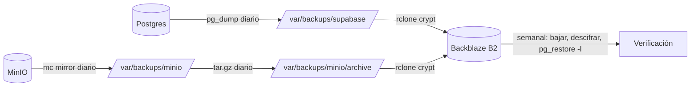

# Copias de seguridad

Copias de la base de datos y de los ficheros de Fluxion: copias locales diarias en el servidor, copia
externa cifrada en Backblaze B2 y prueba de restauración semanal.

## Componentes

| Copia | Script | Frecuencia | Destino local | Retención local |
|---|---|---|---|---|
| Postgres | `/etc/cron.daily/supabase-backup` | Diaria | `/var/backups/supabase/` | 14 días |
| MinIO | `infra/backups/minio-backup.sh` (`/etc/cron.daily/minio-backup`) | Diaria | `/var/backups/minio/<bucket>/` (espejo) y `/var/backups/minio/archive/` (archivo comprimido diario) | Espejo permanente; archivos 14 días |
| Copia externa | `infra/backups/offsite-backup.sh` (`/etc/cron.daily/zz-offsite-backup`) | Diaria, después de las locales | Backblaze B2, cifrado | Ciclo de vida de 180 días |
| Prueba de restauración | `infra/backups/offsite-verify.sh` (`/etc/cron.weekly/offsite-verify`) | Semanal | `/tmp/fluxion-restore` (temporal) | — |



### Postgres

El script vive en el servidor (`/etc/cron.daily/supabase-backup`). Según `docs/infra/README.md` genera:

| Fichero | Contenido |
|---|---|
| `full_<fecha>.dump` | Base de datos completa, en formato personalizado de `pg_dump` |
| `globals_<fecha>.sql` | Roles y contraseñas |
| `env_supabase_<fecha>.bak` | `.env` del stack de Supabase |
| `env_containers_<fecha>.txt` | Variables efectivas de los contenedores |
| `dokploy_config_<fecha>.tar.gz`, `dokploy_db_<fecha>.sql` | Configuración y base de datos de Dokploy |

Sin el `.env` y los roles, la base de datos restaurada no sirve: los tokens no validan.

Comprobación local: `pg_restore -l /var/backups/supabase/full_$(date +%Y%m%d).dump`.

> TODO: confirmar el script de copia de Postgres. No está en el repositorio: su contenido, sus permisos
> y sus avisos solo constan en la documentación.

### MinIO

`minio-backup.sh` hace lo siguiente:
1. Copia `fluxion-evidences` y `fluxion-documents` con `mc mirror --overwrite`, sin `--remove`, para no
   propagar borrados.
2. Usa el usuario `fluxion-backup`, con la política `fluxion-ro` (listar y leer objetos y versiones).
3. Cada día empaqueta el espejo en `minio_<AAAAMMDD>.tar.gz`.

Registra en `/var/log/fluxion-minio-backup.log`.

**Comprobación:** el número de ficheros del espejo debe ser igual o mayor que:

```sql
SELECT count(*) FROM fluxion.system_evidences
WHERE storage_path IS NOT NULL AND storage_backend = 's3';
```

### Copia externa (Backblaze B2)

**Qué se sube:** `offsite-backup.sh` sube con `rclone copy` (no `sync`, para no propagar la rotación
local):
- los volcados de Postgres, a `<remoto>:supabase`;
- los archivos de MinIO, a `<remoto>:minio`.

**Cifrado:**
- El remoto es un `crypt` de rclone sobre B2: el contenido, los nombres de fichero y los nombres de
  carpeta se cifran en el cliente.
- Si se pierde la contraseña de cifrado, las copias son irrecuperables. Debe guardarse en el gestor de
  contraseñas y en un soporte físico.

**Configuración de B2** (manual, en la consola):
- clave de aplicación limitada al bucket, sin permiso de borrado;
- ciclo de vida de 180 días;
- Object Lock en modo governance, con 30 días de retención.

**Comprobación tras subir:** confirma que el volcado del día está en B2 y anota el tamaño.

**Avisos:** solo cuando falla, a Slack. Registra en `/var/log/fluxion-offsite.log`.

### Prueba de restauración semanal

`offsite-verify.sh`:
1. Baja de B2 el volcado más reciente de Postgres y lo descifra.
2. Comprueba que tiene un tamaño razonable.
3. Lista su contenido con `pg_restore -l`.

Escribe `VERIFICACION OK` o `VERIFICACION FALLIDA`, y en este último caso avisa a Slack. La única prueba
de que hay copia válida es un `VERIFICACION OK` de la última semana.

> TODO: confirmar varios aspectos de las copias.
> - **Ficheros de Supabase Storage:** el volumen con logos, avatares, adjuntos de tareas y evidencias
>   históricas no tiene copia de seguridad.
> - **Verificación de MinIO:** ni la comprobación diaria ni la semanal revisan los archivos de MinIO en
>   B2.
> - **Avisos de la copia de MinIO:** `minio-backup.sh` no avisa a Slack si falla.
> - **Volcados descifrados:** `offsite-verify.sh` los deja en `/tmp` si la verificación falla.
> - **Secretos de Vault:** se restauran ilegibles en otra instancia, y no consta que se copie su clave.
>   Hay que volver a introducirlos.
> - **Configuración de los scripts:** los ficheros de `/etc/fluxion` no se copian.
> - **README de copias de seguridad:** dice que no hay copia fuera del servidor, aunque la copia a B2 está
>   documentada.

## Modelo de datos

No aplica. Las copias contienen la base de datos completa. Ver [Modelo de datos](modelo-datos.md).

## API

No aplica.

## Dependencias

| Dependencia | Uso |
|---|---|
| `minio/mc` (Docker) | Espejo de MinIO |
| `rclone/rclone` (Docker) | Copia externa cifrada y descarga para la verificación |
| `postgres:15-alpine` (Docker) | `pg_restore -l` en la verificación |
| Backblaze B2 | Almacén externo |
| Slack (webhook) | Avisos de fallo |

### Restauración

1. **Postgres:** bajar el volcado desde B2 (`rclone copy <remoto>:supabase/full_<fecha>.dump /restore`;
   rclone lo descifra). Restaurarlo junto con los roles (`globals`) y el `.env` del stack.
2. **MinIO:** restaurar con `mc cp --recursive` desde el espejo, o desde el archivo comprimido bajado de
   B2.
   - Hacen falta credenciales con escritura, porque las de copia son de solo lectura.
   - En `fluxion-documents`, los objetos existentes no se pueden sustituir mientras dure la retención.
3. **Coherencia:** restaurar Postgres y MinIO de la misma fecha. Una base de datos sin sus ficheros apunta
   a objetos inexistentes.
4. **Vault:** volver a introducir los secretos de conectores y canales con `connector_secret_set` y
   `channel_secret_set`.

> **Pendiente de definir.**
> - Objetivos de punto y tiempo de recuperación (RPO/RTO). Con copias diarias, la pérdida máxima es de
>   un día.
> - Ensayo documentado de recuperación ante desastre.

> TODO: confirmar el procedimiento de restauración.
> - **Restaurar Postgres:** el README remite a `recursos/db/README.md`, que no contiene ese procedimiento.
> - **Restaurar desde el espejo:** el espejo no propaga borrados, así que restaurarlo recupera también
>   objetos que se habían borrado.

## Seguridad

- **Permisos mínimos:** el usuario de copia de MinIO es de solo lectura, y la clave de B2 no puede borrar.
- **Cifrado:** la copia externa se cifra en el cliente, nombres incluidos.
- **Configuración:** los ficheros de configuración están en `/etc/fluxion` con permisos 600.

Ver [Seguridad](seguridad.md).

## Configuración

| Fichero | Variables o contenido |
|---|---|
| `/etc/fluxion/minio-backup.env` | `MINIO_HOST`, `MINIO_BACKUP_KEY`, `MINIO_BACKUP_SECRET` |
| `/etc/fluxion/offsite.env` | `REMOTO`, `ORIGEN_PG`, `ORIGEN_MINIO`, `SLACK_WEBHOOK_INFRA` (opcional) |
| `/etc/fluxion/rclone.conf` | Remotos `b2` y `crypt` |

**Instalación:**
- copiar los scripts a `/etc/cron.daily` y `/etc/cron.weekly`, sin extensión, porque `run-parts` ignora
  los nombres con punto;
- darles permiso de ejecución.

El prefijo `zz-` hace que la copia externa se ejecute la última. Ver `infra/backups/README.md`.
