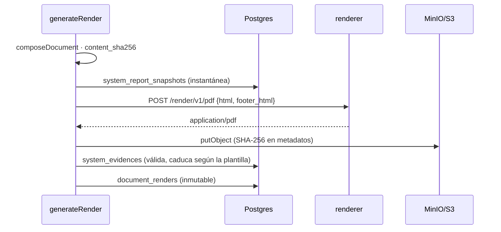

# Generación de PDF

Cómo produce Fluxion los PDF de los documentos regulatorios del
[expediente documental](../funcional/expediente-documental.md) y de las [actas](../glosario.md#acta) de
aprobación.

- **PDF inmutables:** la web compone el HTML y el servicio `renderer` lo convierte a PDF con Chromium. El
  fichero se guarda en MinIO/S3 con su huella y queda registrado como inmutable.
- **Resto de informes:** el dossier técnico, la ficha para el registro UE, el informe de brechas, la
  Declaración de Aplicabilidad o el plan de tratamiento se imprimen desde el navegador
  (`window.print()`), no con este servicio.

## Componentes

| Componente | Ubicación | Responsabilidad |
|---|---|---|
| Servicio `renderer` | `services/renderer` (FastAPI y Playwright) | HTML → PDF. No recibe URLs ni credenciales de la aplicación |
| Composición | `lib/documents/compose.ts` | Plantilla, texto redactado y datos derivados. Ver [Expediente documental](../funcional/expediente-documental.md#campos) |
| HTML | `lib/documents/render-html.ts` | Portada, cuerpo, pie y estilos embebidos |
| Orquestación | `lib/documents/render.ts` (`generateRender`) | Instantánea, PDF, almacenamiento, evidencia y registro |
| Llamadores | `expediente/[key]/actions.ts` (`generateDocumentRender`), `lib/approvals/minutes.ts` | Botón **Generar PDF** y actas de los comités |
| Descarga | `GET /api/documents/v1/renders/[id]/download` | Redirección a una URL firmada |

### Pasos de `generateRender`

1. Comprueba que el almacenamiento está configurado.
2. Compone el documento y lee el documento, la organización y la vigencia de la plantilla.
3. Genera el `renderId`, que se imprime en el PDF, y calcula `content_sha256`, el SHA-256 del documento
   compuesto.
4. Guarda la instantánea en `system_report_snapshots`.
5. Genera el HTML y el pie y llama al renderer, con un tiempo máximo de 60 s.
6. Sube el PDF a `S3_BUCKET_DOCUMENTS` con la clave `org/{org}/documents/{documento}/{ts}-<nombre>.pdf`.
   El SHA-256 de los bytes va en los metadatos. El bucket debe tener retención de 10 años.
7. Crea una evidencia del sistema:
   - tipo `regulatory_document`;
   - estado `valid`;
   - caducidad según la vigencia de la plantilla, 12 meses por defecto.
8. Inserta `document_renders`, con las dos huellas, los huecos y el estado del documento en ese momento.

### HTML

- **Escapado:** todo texto pasa por `esc()`, que escapa `& < > "`, y cada línea se convierte en un
  párrafo.
- **Estilos:** CSS embebido, sin recursos externos. Los títulos no se separan de su contenido y los
  apartados no se parten entre páginas.
- **Portada:**
  - organización, sistema, estado, plantilla y versión;
  - cobertura;
  - fecha de generación;
  - referencia (`renderId`) y huella del contenido;
  - nota de verificación.
- **Aviso:** si hay huecos, indica cuántos apartados obligatorios faltan.
- **Cuerpo:**
  - cada epígrafe es un `h2` y cada apartado un `h3` con su guía;
  - luego, «Datos del registro» (derivado) y «Descripción» (redactado);
  - si está vacío, «Apartado obligatorio sin cubrir.» o «No aplica a este sistema…».
- **Pie:** «{título} · … · {8 caracteres del renderId}» y «Página X de Y», con las clases `pageNumber` y
  `totalPages` de Chromium.

### Actas

`generateApprovalMinutes` se ejecuta al cerrar una solicitud de aprobación con algún paso de comité:
1. Crea un documento `approval_minutes`, ya aprobado, titulado «Acta de aprobación · dd/mm/aaaa».
2. Llama a `generateRender`.

Si el acta ya existe para la solicitud, no hace nada. Nunca lanza errores: devuelve un aviso.

> TODO: confirmar varios aspectos de la generación.
> - **Rótulo «Anexo IV»:** aparece en todas las plantillas (portada, aviso, pie, nombre del fichero,
>   tipo de instantánea, descripción y etiquetas de la evidencia), también en la FRIA, la DPIA, la ficha
>   del modelo y las actas.
> - **Actas sin PDF:** si falla el PDF de un acta, no se vuelve a intentar, porque el documento ya existe.
> - **Pasos que fallan en silencio:** los errores al guardar la instantánea y la evidencia se ignoran, y
>   el render queda sin ellas.
> - **Ficheros huérfanos:** si falla el registro del render, el PDF y la evidencia quedan sin registro.
>   Por la retención del bucket, el PDF no se puede borrar.
> - **Fuentes:** el CSS pide fuentes que no están en la imagen del renderer.

## Modelo de datos

| Objeto | Tipo | Campos clave | Migración |
|---|---|---|---|
| `fluxion.document_renders` | tabla | `document_id`, `format` (`pdf`, `html`), `template_key`, `template_version`, `snapshot_id`, `storage_backend` (`supabase`, `s3`), `storage_bucket`, `storage_path`, `checksum_sha256` (fichero), `content_sha256` (datos), `byte_size`, `gaps`, `document_status`, `evidence_id`, `rendered_by`, `rendered_at` | `20260819230000_document_renders.sql`, `20260820090000_document_renders_content_hash.sql` |
| `fluxion.system_report_snapshots` | tabla | Instantánea del documento compuesto | — |
| `fluxion.system_evidences` | tabla | Evidencia del PDF | — |

**Reglas de `document_renders`:**
- Un trigger impide modificarla: «document_renders es inmutable: genera un render nuevo».
- La organización solo puede leer e insertar sus filas.

## API

### `POST /render/v1/pdf` (renderer)

| Campo | Tipo | Por defecto |
|---|---|---|
| `html` | string, obligatorio | — |
| `format` | string | `A4` |
| `margin_top`, `margin_bottom` | string | `18mm` |
| `margin_left`, `margin_right` | string | `16mm` |
| `header_html`, `footer_html` | string | — |

**Funcionamiento:**
- Autenticación: `Authorization: Bearer <RENDERER_SECRET>`.
- Respuesta: `application/pdf`, con los fondos incluidos.
- Cada petición usa un contexto nuevo de Chromium y espera al evento `load`, no a `networkidle`.
- La web solo envía `html` y `footer_html`.

| Código | Mensaje |
|---|---|
| 503 | «renderer sin configurar» (falta `RENDERER_SECRET`) · «navegador no disponible» |
| 401 | «no autorizado» |
| 413 | «html de N bytes excede el máximo» |
| 422 | Validación del cuerpo |

### `GET /health` (renderer)

Responde `{"status":"ok","browser":true}`. No requiere autenticación.

### Descarga

`GET /api/documents/v1/renders/{id}/download`:
- lee el render con la RLS del usuario;
- redirige con 302 a una URL presignada de 5 minutos con
  `Content-Disposition: attachment; filename="<título> AAAA-MM-DD.pdf"`.

Ver [API interna](api-interna.md#documentos).

### Errores de la web

| Situación | Mensaje |
|---|---|
| Renderer sin configurar | «El servicio de renderizado no está configurado (RENDERER_URL / RENDERER_SECRET).» |
| Renderer con error | «el renderizador respondió {status}: …» |
| Almacenamiento sin configurar | «El almacenamiento de documentos no está configurado.» |
| Composición fallida | «No se pudo componer el expediente.» |
| PDF no guardado | «El PDF se generó pero no se pudo guardar.» |
| Render no registrado | «El PDF se guardó pero no se pudo registrar el render.» |

## Dependencias

| Dependencia | Uso | Si no está disponible |
|---|---|---|
| `renderer` (`RENDERER_URL`) | HTML → PDF | Error; no se genera nada salvo la instantánea |
| MinIO/S3 (`S3_BUCKET_DOCUMENTS`) | Almacenamiento con retención | Error antes de llamar al renderer |
| `playwright` 1.49.1 con Chromium, `fastapi` 0.115.6, `uvicorn` 0.34.0, `pydantic` 2.10.4 | Renderer | — |

**Imagen del renderer:**
- base `python:3.11-slim-bookworm`, fijada porque Playwright 1.49 falla con trixie;
- `playwright install --with-deps chromium`;
- Chromium arranca con `--no-sandbox` y `--disable-dev-shm-usage`;
- puerto 8000.

## Seguridad

- **Entrada del renderer:**
  - solo recibe HTML, nunca URLs ni credenciales de la aplicación;
  - todo el texto llega escapado.
- **Red:** el despliegue debe dejar el renderer sin acceso a internet ni puerto publicado, en una red
  Docker compartida solo con la web.
- **Integridad de los PDF:**
  - huella del fichero y de los datos;
  - registro inmutable;
  - retención del bucket.

Ver [Seguridad](seguridad.md).

## Configuración

| Variable | Servicio | Obligatoria | Valor por defecto | Descripción |
|---|---|---|---|---|
| `RENDERER_SECRET` | renderer y web | Sí | — | Secreto compartido |
| `RENDERER_URL` | web | Sí | — | URL interna del renderer |
| `MAX_HTML_BYTES` | renderer | No | 20 MiB | Tamaño máximo del HTML |
| `LOG_LEVEL` | renderer | No | `INFO` | Nivel de log |
| `S3_BUCKET_DOCUMENTS` | web | No | `fluxion-documents` | Bucket de los PDF |

Ver [Almacenamiento de ficheros](almacenamiento-ficheros.md) y [Despliegue](despliegue.md).
