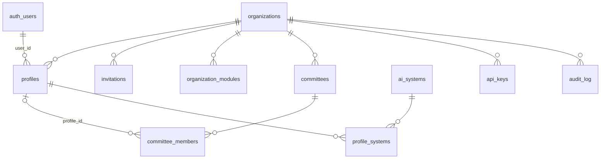
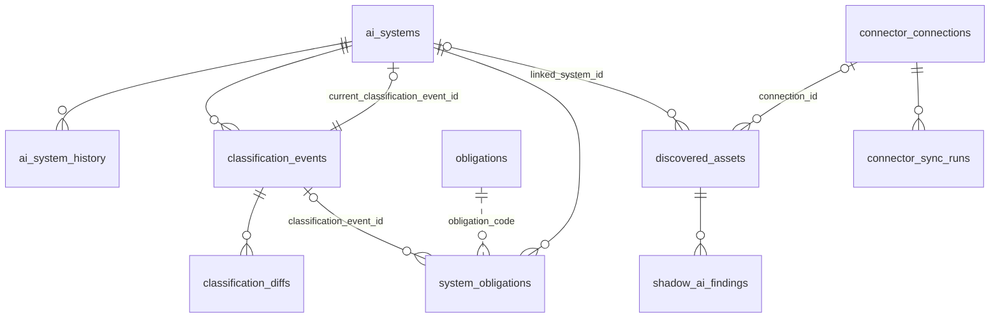
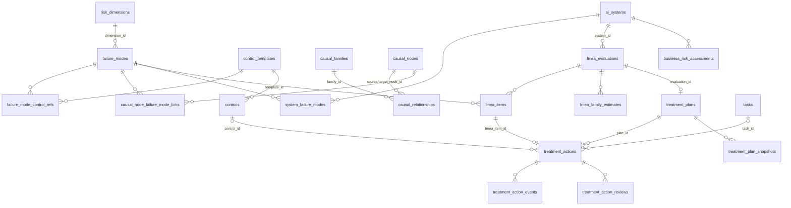
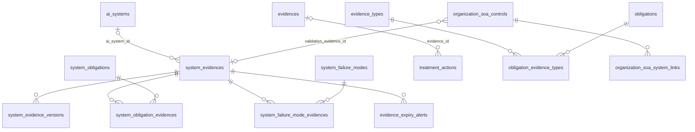
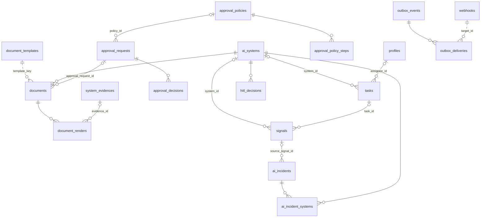

# Modelo de datos

Entidades principales de Fluxion, cómo se relacionan y cómo se aíslan los datos de cada
organización. La fuente de verdad es `supabase/migrations/`. Este documento describe el esquema vigente
y omite las tablas legacy o sin uso.

## Componentes

| Esquema | Ámbito | Contenido |
|---|---|---|
| `fluxion` | Por organización (`organization_id`) | Organizaciones y miembros, inventario, clasificación, obligaciones, análisis de modos de fallo, tratamiento, evidencias, Declaración de Aplicabilidad, AISIA, documentos, incidentes, tareas, aprobaciones, avisos, integración |
| `compliance` | Global | [Catálogo de tablas básicas](../glosario.md#catálogo-de-tablas-básicas): dimensiones, modos de fallo, controles, obligaciones, tipos de evidencia, grafo causal |
| `rag` | Global | [Corpus normativo](../glosario.md#corpus-normativo): documentos y fragmentos con embeddings |
| `telemetry` | Por organización | Trazas de llamadas a modelos, agregados, tarifas y presupuestos |
| `public` | — | Solo el envoltorio `public.search_chunks` y el event trigger `ensure_rls` |

> **Pendiente de implementar.** El esquema `compliance` pasará a tener una copia del catálogo por
> organización, que mantendrá su administrador (`_inventario.md` §14.1). Hoy es único y lo comparten
> todas las organizaciones.

Extensiones (`00000000000000_extensions.sql`): `uuid-ossp`, `pgcrypto`, `pgjwt`, `pg_net`,
`pg_graphql`, `pg_stat_statements`, `supabase_vault`, `vector` y `pg_cron`.

## Modelo de datos

**Convenciones**
- La clave primaria es `id uuid`, salvo que se indique otra cosa.
- Las tablas por organización llevan `organization_id` con FK a `fluxion.organizations` y
  `ON DELETE CASCADE`.
- Muchos estados son `text` con `CHECK` en lugar de enums.
- Las referencias a personas apuntan unas veces a `fluxion.profiles` y otras a `auth.users`; se indica
  en cada caso.

En los diagramas se omite `organizations`, salvo en el primero, porque casi todas las tablas cuelgan de
ella.

### Organización y acceso

| Tabla | Término | Campos clave | Migración |
|---|---|---|---|
| `fluxion.organizations` | [Organización](../glosario.md#organización) | `slug` único, `plan`, `normative_modules` | `00000000000001` |
| `fluxion.profiles` | [Miembro](../glosario.md#miembro) | `user_id` → `auth.users`, `roles` (`org_role[]`, todos los roles), `role` (principal, = `roles[1]`), `is_active`. Único por (`user_id`, `organization_id`): un usuario puede pertenecer a varias organizaciones | `00000000000001` |
| `fluxion.invitations` | — | `email`, `role`, `token` único, `status`, `expires_at` | `00000000000001` |
| `fluxion.organization_modules` | [Módulo](../glosario.md#módulo) | PK (`organization_id`, `module_key`), `status` ∈ `enabled`, `disabled`, `trial`, `licensed_until` | `20260811000306` |
| `fluxion.committees`, `committee_members` | [Comité](../glosario.md#comité) | `type` único por organización (también `technical_committee`); `quorum` (NULL = mayoría de los que votan) y `tie_break` (`chair`, `escalate`); un miembro es un perfil o una persona externa; `committee_role = 'advisor'` tiene voz sin voto | `00000000000001`, `20261020130000` |
| `fluxion.governance_designations` | — | Funciones de gobierno de DP-01 (`ciso`, `legal`, `corporate_risk`, `data_controller`, `quality`): una persona (`profile_id`) por función y organización. Escriben Administrador y Responsable del SGAI | `20261020130000` |
| `fluxion.profile_systems` | — | Asignación de miembros a sistemas, con `is_lead` | `00000000000001` |
| `fluxion.api_keys` | [Clave API](../glosario.md#clave-api) | `key_prefix`, `key_hash` (SHA-256, índice único), `scopes text[]`, `revoked_at`, `expires_at` | `00000000000001`, `20260811150000` |
| `fluxion.audit_log` | — | `actor_id` → `profiles`, `action`, `target_type`, `target_id` | `00000000000001` |

### Inventario, clasificación y obligaciones

| Tabla | Término | Campos clave | Migración |
|---|---|---|---|
| `fluxion.ai_systems` | [Sistema de IA](../glosario.md#sistema-de-ia) | `internal_id` único por organización, `aiact_risk_level` (sin `gpai`: CHECK `chk_ai_systems_aiact_risk_level_sin_gpai`, B13d), columnas del motor único de clasificación (B13a, ver abajo), `value_chain_roles`, `owner_profile_id`, `human_oversight_owner_id`, `human_oversight_backup_id` (B23b), `status`, `domain`, más de 100 columnas descriptivas | `00000000000001`, `20260911090000`, `20261022090000`, `20261026090000` |
| `fluxion.ai_system_history` | [Historial del sistema](../glosario.md#historial-del-sistema) | `event_type`, `payload`, `actor_user_id` → `auth.users` | `00000000000001` |
| `fluxion.classification_events` | [Clasificación AI Act](../glosario.md#clasificación-ai-act) | `version`, `method`, `risk_level` (admite nulo y `pending`; `gpai` solo para el histórico), `obligations_set` (códigos del catálogo), `status`. Solo un `pending_reconciliation` por sistema | `00000000000001`, `20261022090000` |
| `fluxion.classification_diffs` | [Reclasificación](../glosario.md#reclasificación) | `diff_type` ∈ `added`, `removed`, `unchanged`; `resolution` | `00000000000001` |
| `compliance.obligations` | [Obligación](../glosario.md#obligación) (catálogo) | `code` único, `framework`, `article`, `scope` (`all`, `high_risk`, `transparency`, `gpai` o nulo), `applies_to_roles`, `retired_at` (B13d: obligación retirada, no se sugiere y se conserva para las ya registradas), `applies_from` (B17a: fecha de exigibilidad, nula hasta la revisión jurídica). El Art. 26 se divide en `AI-ACT-ART26-1` a `-12` (B17a, RN-O08) | `00000000000005`, `20260904090000`, `20260911090000`, `20261026090000`, `20261027160000` |
| `fluxion.system_obligations` | [Obligación](../glosario.md#obligación) (por sistema) | `obligation_code`, `status`, `priority`, `owner_user_id` → `auth.users` | `00000000000001` |
| `fluxion.discovered_assets` | [Sistema detectado pendiente de alta](../glosario.md#sistema-detectado-pendiente-de-alta) | `source_module`, `external_id` (único por organización y fuente), `status`, `linked_system_id` | `20260818140000` |
| `fluxion.shadow_ai_findings` | [Hallazgo de IA no declarada](../glosario.md#hallazgo-de-ia-no-declarada) | `finding_type`, `category`, `file_path`, `severity`, `resolved_at` | `20260827090000` |
| `fluxion.connector_connections`, `connector_sync_runs` | — | `connector_type` ∈ `mlflow`, `github`, `gitlab`; `secret_id` (Vault); estado de la última sincronización | `20260818100000` |

`system_obligations` no tiene FK al catálogo: se relaciona por `obligation_code` (línea discontinua).
Desde B13a, `obligation_code` y `obligation_key` guardan el código del catálogo (`AI-ACT-ART9`…).

**Columnas del motor único de clasificación en `ai_systems`** (migración `20261022090000`):

| Columna | Tipo | Descripción |
|---|---|---|
| `aiact_inputs` | jsonb | Supuestos AI Act del sistema (exclusiones del Art. 2, prácticas del Art. 5, Anexo I, Anexo III, Art. 6.3, Art. 50, GPAI). Nulo: sin supuestos, clasificación de respaldo |
| `aiact_scope` | text, por defecto `in_scope` | Ámbito del AI Act, aparte del nivel (DP-10): `in_scope`, `out_of_scope`, `not_ai_system` o `pending` |
| `aiact_scope_reason` | text | Artículo y motivo si está fuera del ámbito |
| `aiact_result` | jsonb | Resultado completo del motor: fundamento, avisos, vía del alto riesgo, Art. 6.3, Art. 50, GPAI y roles |
| `aiact_rules_version` | text | Versión de las reglas con que se calculó (`AIACT_RULES_VERSION`) |
| `is_gpai` | boolean | Redefinida (D3): la organización es proveedora de un modelo GPAI. Ya no es un nivel |
| `gpai_systemic_risk` | text | `yes`, `no` o `unknown`; nulo si no aplica |
| `gpai_third_party_based` | boolean, por defecto `false` | Sistema basado en un modelo GPAI de terceros (informativo) |
| `aiact_review_pending` | boolean, por defecto `false` | Clasificado antes del motor único: «Pendiente de revisar con el motor nuevo» hasta que se concilia una reclasificación |

**Tipos de output** (migración `20261026100000`, TODO 78):

| Columna | Tipo | Descripción |
|---|---|---|
| `output_types` | `ai_output_type[]`, por defecto `{}` | Todos los tipos de output, en el orden en que se marcaron |
| `output_type` | `ai_output_type` | Tipo principal: el primero de `output_types`. Lo mantiene el trigger `trg_ai_systems_output_types`: si cambia la lista, fija el principal; si solo cambia el principal (escritores que solo conocen un tipo, ventana **Revisar clasificación**), sustituye al anterior en la lista y conserva el resto. La vista de diagnóstico del FMEA y `calculate_failure_mode_priority` siguen leyendo el principal |

**GPAI fuera del nivel de riesgo** (migración `20261026090000`, B13d):
- los sistemas que tenían `aiact_risk_level = 'gpai'` pasan a `is_gpai = true`, `aiact_risk_level =
  'pending'` y `aiact_review_pending = true`;
- el CHECK `chk_ai_systems_aiact_risk_level_sin_gpai` (`aiact_risk_level IS DISTINCT FROM 'gpai'`) impide
  volver a usar el valor;
- el valor `gpai` sigue en el enum `fluxion.aiact_risk_level`, en desuso (quitarlo obliga a recrear las
  vistas que dependen de la columna), y en `classification_events.risk_level` para el histórico.

**Catálogo de obligaciones del AI Act** (migración `20261026090000`):
- `AI-ACT-ART50` se divide en `AI-ACT-ART50-1` y `-2` (rol `provider`) y `AI-ACT-ART50-3` y `-4` (rol
  `deployer`), todas con `scope = 'transparency'` y los tipos de evidencia del Art. 50
  (`obligation_evidence_types`) copiados; `AI-ACT-ART50` queda con `retired_at` y el título «… (dividida
  en 50.1 a 50.4)»;
- obligación nueva `AI-ACT-ART6-4` (documentar la excepción del Art. 6.3 y registrar el sistema, Art.
  49.2), `scope = 'high_risk'` y rol `provider`;
- nueva descripción de `AI-ACT-ART27`: solo en los supuestos del Art. 27.1.

`loadAiActCatalog` (`lib/ai-act/server.ts`) no pasa al motor las obligaciones retiradas, pero conserva su
etiqueta para mostrar las ya registradas.

**Vista `compliance.v_system_obligations`** (reescrita en `20261026090000`, `security_invoker`). Una fila
por sistema y obligación aplicable, con `ai_system_id`, `organization_id`, `code`, `framework`, `article`,
`title`, `scope`, `applies_to_roles`, `motivo` y `condicional`. Aplica las reglas RN-O01 a RN-O07 de la
[especificación del cuestionario](../producto/cuestionario-preliminar-reglas.md) a partir de
`aiact_result`, con la misma lógica que `suggestObligations` (`lib/ai-act/obligations.ts`); un cambio en
una debe llevar el cambio en la otra:
- excluye las obligaciones retiradas; las de marcos distintos del AI Act (ISO/IEC 42001) se incluyen para
  todos los sistemas;
- las del AI Act, solo con `aiact_scope = 'in_scope'` y si la obligación no tiene roles o comparte alguno
  con `value_chain_roles` (el Art. 5, aunque no haya rol);
- práctica prohibida: solo `AI-ACT-ART5` (RN-O05);
- `transparency`: el apartado del Art. 50 que figura en `aiact_result.transparency` con el rol obligado
  (RN-O03); `all`: siempre (RN-O01); `high_risk`: nivel `high`, salvo Anexo I Sección B (RN-O02 y RN-H04);
  `gpai`: proveedor de modelo GPAI, y `AI-ACT-ART55` solo con riesgo sistémico `yes` (RN-O04);
- `AI-ACT-ART27`: nivel `high`, rol `deployer`, algún punto del Anexo III distinto del 2, y organismo
  público (`aiact_inputs.publicBody`) o puntos 5.b o 5.c (RN-O06); `AI-ACT-ART6-4`: `aiact_result.art63 =
  'valid'` y rol `provider` (RN-O07).

Para los sistemas sin `aiact_result` (sin reclasificar desde B13a), la transparencia se aproxima por nivel
(`limited` o `high`) y el Art. 27 por nivel y rol, y esas filas llevan `condicional = true`; el Art. 6.4 no
se incluye. Ningún código de la aplicación usa hoy la vista: las obligaciones sugeridas las calcula el
motor.

Una obligación del AI Act sin ámbito (`scope` nulo, «Universal» en el catálogo) no se sugiere ni en el
motor ni en la vista. El catálogo estándar no tiene ninguna.

**Datos que transforma la migración `20261022090000`:**
- traduce las claves antiguas de obligación (`art_9`, `art_53_doc`, `art_53_copyright`,
  `art_53_training`, textos «Art. N») al código del catálogo en `system_obligations`,
  `classification_events.obligations_set` y `classification_diffs.obligation_key`; el `Art. 71` pasa a
  `AI-ACT-ART49`. La función `fluxion.aiact_obligation_code(text)` hace la traducción;
- archiva las obligaciones que quedan duplicadas en un mismo sistema (por ejemplo, las tres del
  Art. 53), conservando la más avanzada;
- marca `aiact_review_pending = true` en los sistemas sin resultado del motor. No reclasifica en bloque.

### Riesgo y tratamiento

| Tabla | Término | Campos clave | Migración |
|---|---|---|---|
| `compliance.risk_dimensions` | [Dimensión de riesgo](../glosario.md#dimensión-de-riesgo) | PK `text` (`tecnica`, `seguridad`, `etica`, `gobernanza`, `roi`, `legal_b`) | `00000000000005` |
| `compliance.failure_modes` | [Modo de fallo](../glosario.md#modo-de-fallo) | `code` único, `r_value`, `i_value`, `d_value`, `e_value` ([criterios R.I.D.E.](../glosario.md#criterios-ride)), `s_default` ([severidad por defecto](../glosario.md#severidad-por-defecto-s_default)), `origin` | `00000000000005`, `20260905090000` |
| `compliance.causal_families`, `causal_nodes`, `causal_relationships`, `causal_node_failure_mode_links` | [Familia causal](../glosario.md#familia-causal), [relación causal](../glosario.md#relación-causal), [grafo causal](../glosario.md#grafo-causal) | Familias A-H; cada relación une dos nodos dentro de una familia, con `type` ∈ `causes`, `amplifies`, `enables`, `correlates`; los nodos se vinculan a modos de fallo | `00000000000005` |
| `compliance.control_templates`, `failure_mode_control_refs` | [Plantilla de control](../glosario.md#plantilla-de-control) | CTL-001 a CTL-059; vínculo entre modo de fallo y control | `00000000000005` |
| `compliance.control_template_soa_controls` | — | Controles del Anexo A de la ISO/IEC 42001 que cubre cada plantilla (`template_id`, `soa_control_code` con CHECK de los 38 códigos, `confidence` ∈ `alta`, `media`). Lectura para `authenticated`; escribe la administración de la plataforma con service role. Alimenta las propuestas de la Declaración (B17e2) | `20261027200000` |
| `fluxion.system_failure_modes` | [Activación](../glosario.md#activación-de-modos-de-fallo) y [priorización](../glosario.md#priorización) | Único por (sistema, modo); `activation_source`, `priority_status`, `priority_score` | `00000000000001` |
| `fluxion.fmea_evaluations` | [Análisis de modos de fallo (FMEA)](../glosario.md#análisis-de-modos-de-fallo-fmea) | `state`, `version`, `cached_zone` ([zona de riesgo](../glosario.md#zona-de-riesgo)), `approver_id`, `approved_at`, `next_review_at`, `deferred_items_count` (modos para la segunda ronda de un plan parcial; 0 = envío completo), `second_round_due_date` (fecha límite de la segunda ronda; la próxima revisión no la supera). `approved` = vigente; las versiones anteriores pasan a `superseded` al aprobarse una nueva | `00000000000001`, `20261020100000`, `20261027100000`, `20261027110000` |
| `fluxion.fmea_items` | — | `o_value` ([O](../glosario.md#ocurrencia-o)), `d_real_value` ([D_real](../glosario.md#detectabilidad-real-d_real)), `s_default_frozen`, `s_actual`, `s_residual`, `second_review_status`, `estimate_source` (`family` o `manual`: el ajuste manual no lo sobrescribe la familia) y `estimate_families`. Sin `organization_id`: hereda la organización de la evaluación | `00000000000001`, `20260908090000` |
| `fluxion.fmea_item_history` | — | Historial por ítem: valores anteriores y nuevos de O, D, S y estado. `event_type` ∈ `evaluated`, `skipped`, `second_review_approved`, `second_review_rejected`, `family_estimated`, `family_withdrawn`, `family_exception` | `00000000000001`, `20261027090000` |
| `fluxion.fmea_family_estimates` | [Estimación por familia](../glosario.md#estimación-por-familia) | Único por (`evaluation_id`, `family_label`); justificación de al menos 50 caracteres | `20260908090000` |
| `fluxion.treatment_plans` | [Plan de tratamiento](../glosario.md#plan-de-tratamiento) | Uno por evaluación, también sin acciones; `status`, `zone_at_creation`, `zone_target`, `ai_act_floor`, `approval_level`, `deadline`. `in_progress` y `closed` los mantiene `trg_treatment_action_plan_status` | `00000000000001`, `20261020100000` |
| `fluxion.treatment_actions` | [Acción de tratamiento](../glosario.md#acción-de-tratamiento) | Única por (plan, ítem); `option` ([opción de tratamiento](../glosario.md#opción-de-tratamiento)), `status`. CHECK: aceptar exige 100 caracteres de justificación y no se admite con severidad 9 | `00000000000001` |
| `fluxion.treatment_action_events`, `treatment_action_reviews`, `treatment_plan_snapshots` | [Revisión periódica](../glosario.md#revisión-periódica), [instantánea](../glosario.md#instantánea) | Eventos de solo inserción; revisiones de acciones aceptadas o pospuestas; instantáneas en cada transición | `00000000000001` |
| `fluxion.system_oversight_documentation` | [Responsable de supervisión humana](../glosario.md#responsable-de-supervisión-humana) | Por sistema y persona: `competence`, `authority_confirmed` (Art. 14.4), `authority_notes`. Escriben Administrador, Responsable del SGAI y Responsable del sistema. B24 | `20261028090000` |
| `fluxion.system_use_suspensions` | — | Suspensiones del uso por el responsable del despliegue (Art. 26.5): `suspended_at`, `reason`, `incident_id` opcional, `resumed_at` y `resume_notes`. Activa mientras `resumed_at` es nulo; una sola activa por sistema (índice único parcial). Escriben Administrador, Responsable del SGAI y Responsable del sistema. B25a | `20261028100000` |
| `fluxion.system_log_retention` | — | Registro de logs declarativo, uno por sistema (Art. 26.6): `controlled_by` ∈ `organization`, `provider`, `shared`; `storage_location`, `retention_months` (> 0; menos de 6 avisa), `evidence_id` → `system_evidences`, `verified_at`, `notes`. Escriben Administrador, Responsable del SGAI y Responsable del sistema. B25c | `20261028110000` |
| `fluxion.external_notices` | — | Avisos al proveedor, importador, distribuidor o autoridad (`recipient`) de una suspensión (`suspension_id`) o de un incidente (`incident_id`), exactamente uno de los dos; fecha, canal, referencia y `evidence_id` → `system_evidences`. Escriben los de la suspensión quienes la gestionan y los de un incidente los roles que lo actualizan. B25a | `20261028100000` |
| `fluxion.member_trainings` | — | Formación por miembro: `kind` ∈ `ai_literacy` (Art. 4), `system_oversight` (con `ai_system_id`), fechas de realización y caducidad, `evidence_id` → `system_evidences` (registro de formación). Escribe la propia persona, el Administrador o el Responsable del SGAI. B24 | `20261028090000` |
| `fluxion.controls` | [Control](../glosario.md#control) | `template_id` → `control_templates` (nulo en los controles propios, que llevan `title` y `description`), `system_id`, `status` | `00000000000001`, `20261019090000` |
| `fluxion.business_risk_assessments` | [Riesgo de negocio](../glosario.md#riesgo-de-negocio) | `probability` y `impact` (1-5), `exposure` (columna calculada), único por (sistema, modo) | `20260913090000` |

Los triggers de `treatment_actions` crean y sincronizan la tarea asociada y recalculan la zona objetivo
del plan (`recalculate_plan_zone_target`).

### Evidencias, brechas y cumplimiento ISO

| Tabla | Término | Campos clave | Migración |
|---|---|---|---|
| `fluxion.system_evidences` | [Evidencia](../glosario.md#evidencia) | `evidence_type_id` (tipo de `compliance.evidence_types`, B17e1: decide qué obligaciones cubre), `scope` (sistema u organización), `status` ([estado de la evidencia](../glosario.md#estado-de-la-evidencia)), `expires_at`, `storage_backend` ∈ `supabase`, `s3`, `checksum_sha256` | `00000000000001`, `20260819090000` |
| `fluxion.system_evidence_versions` | — | Historial de cambios y revisiones: estado anterior a cada cambio, `change_type` (también `expired`), `storage_path` y `changed_by` (perfil). Solo escribe el trigger `trg_evidence_versions` (sin política de inserción) | `00000000000001`, `20261020110000` |
| `fluxion.evidences` | Histórico (B12): adjuntos de acciones anteriores a la biblioteca única, copiados a `system_evidences` con el mismo id. Sin escrituras desde la aplicación (`INSERT`/`UPDATE` revocados a `authenticated`) | `type`, `verification_status`, `storage_backend` | `00000000000001`, `20260819170000`, `20261021120000` |
| `compliance.evidence_types`, `obligation_evidence_types` | [Tipo de evidencia](../glosario.md#tipo-de-evidencia) | EVT-*; `requirement_level` por obligación | `00000000000005` |
| `fluxion.evidence_expiry_alerts` | — | `alert_type` ∈ `expiry_30d`, `expiry_7d`, `expired` | `00000000000001` |
| `fluxion.gap_dispositions` | [Disposición de la brecha](../glosario.md#disposición-de-la-brecha) | `gap_key` único por organización, `gap_layer` ([tipo de brecha](../glosario.md#tipo-de-brecha)), `disposition`, `rationale`, `status` (`active`, o `pending` mientras espera aprobación) | `00000000000001`, `20261020170100` |
| `fluxion.task_gap_links` | — | Vínculo entre tarea y `gap_key` | `00000000000001` |
| `fluxion.organization_soa_controls`, `organization_soa_metadata`, `organization_soa_system_links`, `soa_lifecycle_log` | [Declaración de Aplicabilidad ISO 42001](../glosario.md#declaración-de-aplicabilidad-iso-42001) | `control_code` único por organización (el catálogo de 38 controles está en `apps/web/lib/templates/iso42001-catalog.ts`), `is_applicable`, `lifecycle_status` | `00000000000001` |
| `fluxion.preliminary_questionnaires` | [Cuestionario preliminar](../glosario.md#cuestionario-preliminar) | `status` ∈ `borrador`, `completado`; `answers jsonb`; `classification jsonb` (B13b): copia de la clasificación preliminar al completar, con `result` (resultado del motor único, con fundamento, avisos y `rulesVersion`), `obligations` (`[{code, label}]`) y `computed_at`. Es `null` en los borradores y en los cuestionarios completados antes de B13b. `ai_system_id` → `ai_systems` (`ON DELETE SET NULL`): sistema registrado desde el cuestionario (B13c), con índice único parcial `uq_preliminary_questionnaires_ai_system` (un cuestionario de origen por sistema). Mientras está vinculado, el trigger `trg_preliminary_questionnaire_locked` rechaza cambios de `answers` y `status` | `20260915090000`, `20261022100000`, `20261022110000` |

Las [brechas](../glosario.md#brecha) no se guardan: se calculan en `apps/web/lib/gaps/data.ts`. Solo
se persisten las disposiciones y los vínculos con tareas.

Biblioteca de evidencias única (B12): `treatment_actions.evidence_id` referencia `system_evidences`
(`ON DELETE SET NULL`). `fluxion.evidences` queda como histórico.

### Documentos, incidentes, operación y aprobaciones

| Tabla | Término | Campos clave | Migración |
|---|---|---|---|
| `fluxion.document_templates` | [Documentación del sistema](../glosario.md#documentación-del-sistema) | `key` ∈ `annex_iv`, `fria`, `dpia`, `model_card`, `approval_minutes`, `eu_registry` (B16b, Anexo VIII), `aisia` (B15; la AISIA es este documento desde que se retiraron las tablas `aisia_*`, `20261027140000`); `organization_id` nulo significa plantilla de Fluxion | `20260819200000`, `20261027120000`, `20261027150000` |
| `fluxion.document_notifications` | — | Notificación de un documento aprobado a una autoridad o presentación en un registro (FRIA, Art. 27.3; ficha para el registro UE, Art. 49): `authority`, `notified_at`, `reference`, `notes`. Solo inserción, y solo de documentos aprobados de la organización (RLS) | `20261027170000` |
| `fluxion.documents` | — | `template_key`, `template_version`, `status` ∈ `draft`, `in_review`, `approved`, `superseded`, `content jsonb` (con `author_id` por apartado), `version`, `previous_id`. Un solo documento no sustituido por sistema y plantilla | `20260819210000`, `20261020120000` |
| `fluxion.document_renders` | — | PDF generado, inmutable (trigger); `storage_*`, `checksum_sha256`, `content_sha256` | `20260819230000` |
| `fluxion.system_report_snapshots` | [Instantánea](../glosario.md#instantánea) de [informes del sistema](../glosario.md#informes-del-sistema) | `report_type`, `payload jsonb` | `00000000000001` |
| `fluxion.ai_incidents`, `ai_incident_systems`, `incident_deadline_alerts` | [Incidente](../glosario.md#incidente), [incidente grave](../glosario.md#incidente-grave) | `reference` INC-AAAA-NNN y `notification_deadline`, ambos por trigger ([plazo de notificación](../glosario.md#plazo-de-notificación)); `category`, `status`, `is_serious` | `20260818170000` |
| `fluxion.signals` | [Señal de riesgo](../glosario.md#señal-de-riesgo) | `source_module`, `signal_type`, `severity`, `status`, `dedupe_key` (único por organización) | `20260812090000` |
| `fluxion.tasks` (+ `task_*`) | [Tarea](../glosario.md#tarea) | `status`, `priority`, `assignee_id` → `profiles`, `source_type` y `source_id` polimórficos | `00000000000001`, `20260812090000` |
| `fluxion.hitl_decisions`, `hitl_reason_codes` | [Supervisión humana](../glosario.md#supervisión-humana) | `case_ref`, `decision`, `agreement` (por trigger), `reason_code` | `20260825090000` |
| `fluxion.approval_policies`, `approval_policy_steps`, `approval_requests`, `approval_decisions`, `approval_delegations` | [Flujos de aprobación](../glosario.md#flujos-de-aprobación) | `object_type` + `object_id` polimórficos (incluye `gap_disposition`); `policy_snapshot` congelado; pasos con `kind` (`approval` o `consultation`) y `condition`; `approval_requests.context`; decisiones inmutables | `20260831090000`, `20261020170100` |
| `fluxion.notifications` | [Aviso en la app](../glosario.md#aviso-en-la-app) | `recipient_id` → `profiles`, `type`, `read_at` | `00000000000001` |
| `fluxion.notification_channels`, `channel_deliveries` | [Aviso a Slack/Teams](../glosario.md#aviso-a-slackteams) | `channel_type` ∈ `slack`, `teams`; `secret_id` (Vault); entregas con reintentos | `20260818190000` |
| `fluxion.webhooks`, `outbox_events`, `outbox_deliveries` | [Integración saliente (webhook)](../glosario.md#integración-saliente-webhook) | Eventos inmutables; entregas con `status` y `next_attempt_at` | `00000000000001`, `20260914090000` |

### Telemetría y corpus normativo

| Tabla | Término | Campos clave | Migración |
|---|---|---|---|
| `telemetry.llm_spans` | [Coste y uso de IA](../glosario.md#coste-y-uso-de-ia-finops) | Particionada por mes en `started_at`; PK (`organization_id`, `started_at`, `trace_id`, `span_id`); `cost_*` fijado al ingerir, `cost_status` | `20260821090000` |
| `telemetry.rollup_daily`, `rollup_runs` | — | Agregado diario con p50 y p95 de duración y de tiempo hasta el primer token | `20260822090000`, `20260822120000` |
| `telemetry.model_prices` | [Tarifa de modelo](../glosario.md#tarifa-de-modelo) | Vigencia por fechas; `organization_id` nulo significa tarifa de catálogo | `20260821090000`, `20260824090000` |
| `telemetry.cost_budgets`, `cost_budget_alerts` | [Presupuesto de IA](../glosario.md#presupuesto-de-ia) | `scope` (organización o sistema), `alert_at_pct` | `20260823090000` |
| `rag.documents`, `rag.chunks` | [Corpus normativo](../glosario.md#corpus-normativo) | `source_type`, `short_name`; `embedding vector(1024)` (`voyage-law-2`, índice HNSW) | `00000000000001` |

El contenido del corpus no está en las migraciones: se restaura desde un volcado descrito en
`recursos/baseline/rag_corpus.manifest.json`.

## API

Funciones SQL que usa la aplicación como RPC o mediante triggers:

| Función | Uso |
|---|---|
| `fluxion.handle_new_user()` | Trigger sobre `auth.users`. Con invitación pendiente, crea el perfil en esa organización. Sin ella, crea una organización nueva y un perfil `org_admin` |
| `fluxion.grant_trial_modules()` | Trigger al crear una organización: concede 30 días de prueba de cinco módulos (todos los disponibles salvo Flujos de aprobación) |
| `fluxion.auth_user_org_id()` | Devuelve la organización del usuario autenticado. Se usa en políticas RLS |
| `fluxion.calculate_failure_mode_priority(...)` | Puntuación de priorización de un modo de fallo |
| `fluxion.recalculate_plan_zone_target(uuid)` | Zona objetivo de un plan a partir de las severidades residuales |
| `fluxion.fmea_aplicar_aprobacion_plan(plan, aprobador)` | Aprobación de la evaluación de riesgos (B07): aceptaciones aprobadas, evaluación `approved` con `next_review_at`, versiones anteriores y sus planes abiertos `superseded` (acciones abiertas canceladas) y plan `in_progress` o `closed`. Solo `service_role` |
| `fluxion.plan_estado_por_acciones(uuid)` | `in_progress` o `closed` de un plan aprobado según sus acciones. La llaman el trigger `trg_treatment_action_plan_status` y la función anterior |
| `fluxion.trg_evidence_review_rules()` | Trigger BEFORE en `system_evidences` (B10, revisado en B11g): con usuario autenticado, alta en `draft` o `pending_review` y solo las transiciones del ciclo; pasar a `valid` o `rejected` solo sin usuario (efecto de Flujos de aprobación). Las escrituras sin usuario (cron, expediente) no pasan por él |
| `fluxion.trg_evidence_versions()` | Trigger AFTER en `system_evidences`: registra la versión en `system_evidence_versions` |
| `fluxion.trg_soa_lifecycle_rules()` | B11g: con usuario autenticado, la Declaración (`organization_soa_metadata.lifecycle_status`) no pasa a `approved`; lo hace el efecto de Flujos de aprobación. (`trg_aisia_lifecycle_rules()` se retiró con las tablas de la AISIA en B15c) |
| `fluxion.trigger_evidence_closes_action()` (revisada en B12), `trg_evidence_valid_completes_actions()` | Al completar una mitigación con severidad residual medida, solo la traslada a `fmea_items.s_actual` si su evidencia está `valid`; si no, la acción queda `evidence_pending`. Al validarse la evidencia, el trigger AFTER de `system_evidences` completa esas acciones y la severidad se traslada |
| `fluxion.trg_document_lifecycle_rules()` | Trigger BEFORE en `documents` (B09, revisado en B11f): con usuario autenticado, alta en `draft`, contenido editable solo en `draft`, transiciones `draft` ⇄ `in_review` y `approved` → `superseded`; pasar a `approved` solo sin usuario (el efecto de Flujos de aprobación y las actas) |
| `fluxion.document_reopen(uuid)` | Reabre un expediente aprobado: lo pasa a `superseded` y crea la versión siguiente en borrador (`version`, `previous_id`) con su contenido |
| `fluxion.trg_governance_designation_rules()`, `trg_profiles_dpo_data_controller()` | B23b: la persona designada es de la organización; el DPO no puede ser Responsable del tratamiento, ni al designar ni al dar el rol |
| `fluxion.approval_can_decide`, `approval_step_candidates` (revisadas en `20261020130000` y `20261020170100`) | Los asesores (`committee_role = 'advisor'`) de un comité y quien tiene el rol `auditor` no son candidatos ni pueden decidir |
| `fluxion.approval_is_preparer(request, profile)` | B11f: si el perfil pidió la solicitud o figura en `context.prepared_by`, y la política no deja aprobar a quien solicita. Lo usan `approval_can_decide` (también para el titular de una delegación) y `approval_step_candidates` |
| `fluxion.approval_resolve_snapshot(org, snapshot, context)` | B11d: descarta los pasos cuya `condition` no cumple el contexto, resuelve comités y funciones (versión de dos argumentos) y omite las consultas sin nadie a quien consultar (ni quien solicita, salvo que la política le deje aprobar, ni el Auditor). Lo omitido queda en `policy_snapshot.omitted_steps` con `omitted_reason` (`condition`, `no_consultee`) |
| `fluxion.approval_decide` (revisada en `20261020170100`) | En un paso `consultation` exige texto, no admite abstención y avanza con cualquier dictamen; un dictamen desfavorable no cierra la solicitud |
| `fluxion.add_default_consultations(uuid)` | Añade a una política por defecto sin editar (un paso) la consulta de DP-01: DPO en AISIA, FRIA y DPIA; función `ciso` con `has_security_controls` en los planes de nivel 1 y 2 |
| `fluxion.trg_gap_disposition_rules()` | Trigger BEFORE en `gap_dispositions` (B11d): con usuario autenticado, no se puede crear ni rehacer activa una exclusión que gobierna una política, ni modificar una pendiente |
| `fluxion.trg_task_done_propagate_action()` | Trigger AFTER en `tasks`: al completar la tarea de una acción, completa la acción (antes era BEFORE y abortaba la actualización) |
| `fluxion.process_task_recurrences()` | Genera las tareas recurrentes (pg_cron) |
| `fluxion.incident_notification_days(...)`, `set_incident_deadline()` | Plazo del AI Act, Art. 73 |
| `fluxion.approval_policy_for`, `approval_open`, `approval_decide`, `approval_cancel`, `approval_can_decide`, `approval_step_candidates` | Motor de flujos de aprobación |
| `fluxion.hitl_overview(p_days)`, `hitl_discordance_spikes(...)` | Indicadores de supervisión humana |
| `fluxion.connector_secret_set/get/cleanup`, `channel_secret_set/get/cleanup` | Acceso a Vault; solo desde el backend |
| `telemetry.price_at(...)`, `compute_rollup(...)`, `ensure_partitions(n)` | Coste, agregados y particiones de telemetría |
| `public.search_chunks(...)` → `rag.search_chunks(...)` | Búsqueda semántica en el corpus normativo |

Vistas destacadas: `fluxion.v_approval_requests`, `fluxion.v_business_risks`,
`fluxion.v_fmea_item_families`, `fluxion.v_shadow_ai_summary`, `compliance.v_system_obligations`,
`telemetry.v_budget_status` y `telemetry.v_models_without_price`. Todas con `security_invoker`.

## Dependencias

- **Supabase:** Postgres 15.8, PostgREST (expone `public`, `storage`, `graphql_public`, `fluxion`,
  `compliance`, `rag` y `telemetry`), GoTrue (`auth.users`), Vault y Storage.
- **pg_cron:** recurrencias de tareas (`5 * * * *`), rollup de telemetría (`25 * * * *`) y creación de
  particiones (`0 3 1 * *`).
- **pgvector:** embeddings del corpus normativo.
- **Storage:** buckets `organization-logos`, `user-avatars` y `task-attachments`. Las evidencias y los
  documentos generados van a MinIO (`storage_backend = 's3'`). Ver
  [almacenamiento-ficheros.md](almacenamiento-ficheros.md).

## Seguridad

- **RLS:** está activa en las tablas de `fluxion` y `telemetry`. Conviven dos patrones de política:
  - `organization_id IN (SELECT organization_id FROM fluxion.profiles WHERE user_id = auth.uid())`.
    Admite usuarios en varias organizaciones.
  - `organization_id = fluxion.auth_user_org_id()`. Devuelve una sola organización por usuario.
- **Tablas hijas sin `organization_id`** (`fmea_items`, `task_*`, `approval_decisions`): la pertenencia
  se comprueba con `EXISTS` sobre la tabla padre.
- **Escrituras por rol:** las de gobierno exigen además un `profiles.role` concreto en la política.
- **Escrituras solo con service role:** señales, sistemas detectados, decisiones de supervisión humana,
  trazas, outbox y avisos no tienen política de inserción para `authenticated`. Entran por la API de
  ingesta o por procesos del servidor.
- **Catálogos compartidos** (`compliance`, plantillas de documento, códigos de supervisión humana,
  tarifas de catálogo): se leen por cualquier usuario autenticado.
- **Inmutabilidad por trigger:** `document_renders`, `approval_decisions` y `outbox_events`.
- **Secretos:** las credenciales de conectores y las URLs de canales se guardan en Vault. Las tablas
  solo guardan su `secret_id`.

Detalle en [seguridad.md](seguridad.md).

## Configuración

| Elemento | Valor | Descripción |
|---|---|---|
| Nombre de migración | `<timestamp>_<modulo>_<descripcion>.sql` | En `supabase/migrations/`. Una migración aplicada no se edita: se corrige con otra |
| Registro de migraciones | `supabase_migrations.schema_migrations` | Lo mantiene `infra/db/migrate.sh` |
| Esquemas expuestos | `PGRST_DB_SCHEMAS` | Debe incluir `fluxion`, `compliance`, `rag` y `telemetry` |
| Catálogo inicial | `00000000000005_seed_compliance.sql` | [Catálogo estándar de Fluxion](../glosario.md#catálogo-estándar-de-fluxion): 418 modos de fallo, 59 plantillas de control, 19 obligaciones y 20 tipos de evidencia, ampliados por migraciones posteriores |
| Histórico | `recursos/db/_legacy/` | Solo documental; no se aplica |
