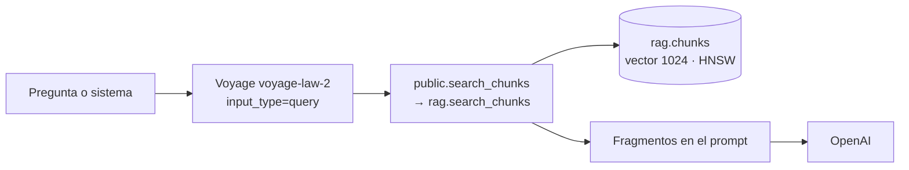

# RAG y corpus normativo

Recuperación de fragmentos normativos para el [Asistente SGAI](../glosario.md#asistente-sgai) y el
[Asistente de clasificación AI Act](../glosario.md#asistente-de-clasificación-ai-act). El corpus está en
el esquema `rag` de Postgres, con embeddings `voyage-law-2` de 1024 dimensiones y búsqueda por similitud
de coseno con pgvector.

## Componentes

| Componente | Ubicación | Responsabilidad |
|---|---|---|
| Recuperador | `services/agents/fluxion_agents/rag/retriever.py` | Embedding de la consulta y llamada a `search_chunks` |
| Consultas de clasificación | `build_rag_queries`, `retrieve_for_classification` | Consultas fijas según los atributos del sistema |
| Recuperación del asistente | `routes/assistant.py` (`needs_rag`, `retrieve_for_assistant`) | Decide si buscar y recupera |
| Búsqueda | `rag.search_chunks`, `public.search_chunks` | Similitud de coseno con filtros |
| Corpus | `recursos/baseline/rag_corpus.manifest.json` | Descripción e integridad del volcado del corpus |



## Modelo de datos

| Objeto | Tipo | Campos clave | Migración |
|---|---|---|---|
| `rag.documents` | tabla | `source_type`, `title`, `short_name`, `language` (`es`), `version`, `url`, `jurisdiction` (`EU`), `total_chunks`, `total_tokens`, `last_ingested_at`, `checksum` | `00000000000001_schema.sql` |
| `rag.chunks` | tabla | `document_id`, `source_type`, `chunk_type`, `chunk_index`, `section_ref`, `parent_section`, `content`, `content_tokens`, `summary`, `metadata`, `embedding vector(1024)`, `short_name`, `language`, `is_active` | ídem |
| `rag.ingestion_jobs` | tabla | Cargas del corpus: estado, recuentos y coste | ídem |
| `rag.corpus_status` | vista | Estado por documento: `needs_refresh` si tiene más de 90 días | ídem |
| `rag.organization_documents`, `organization_chunks`, `org_ingestion_jobs`, `org_corpus_status` | tablas y vista | Documentos propios de cada organización. Vacías | ídem |

**Tipos de fuente (`rag.source_type`):** `eu_regulation`, `eu_directive`, `iso_standard`,
`authority_guide`, `harmonized_std`, `national_law`, `case_reference`, `tenant_doc`.

**Tipos de fragmento (`rag.chunk_type`):** `article`, `paragraph`, `recital`, `annex_item`, `definition`,
`full_doc`.

**Índices:**
- HNSW sobre `embedding` (`vector_cosine_ops`, m = 16, ef_construction = 64, solo fragmentos activos);
- GIN de texto completo en español e inglés;
- GIN sobre `metadata`.

> TODO: confirmar los índices HNSW de `rag.chunks`. Hay dos idénticos.

### Corpus

El corpus es un volcado (`pg_dump --data-only --schema=rag`) guardado en el bucket de artefactos de
MinIO. El manifiesto describe su tamaño, su `sha256` y su contenido: 22 documentos y 3.129 fragmentos, con
embeddings `voyage-law-2` de 1024 dimensiones, extraídos el 2026-08-06.

| Documento (`short_name`) | Tipo | Versión | Fragmentos |
|---|---|---|---|
| AI Act | `eu_regulation` | 2024-08-01 | 411 |
| MDR | `eu_regulation` | 2017-04-05 | 416 |
| IVDR | `eu_regulation` | 2017-04-05 | 361 |
| DORA | `eu_regulation` | 2023-01-17 | 281 |
| RGPD | `eu_regulation` | 2016-05-04 | 256 |
| ISO 42001 | `iso_standard` | 2023-12-01 | 255 |
| ENS | `national_law` | 2022-05-04 | 222 |
| AESIA, guías 1 a 15 | `authority_guide` | 2025-12-10 | 927 en total |

Todo el corpus está en español.

**Carga** (según el manifiesto):
1. Aplicar el esquema.
2. Descargar el volcado y verificar su `sha256`.
3. Cargarlo con `psql -v ON_ERROR_STOP=1`.
4. Crear los índices HNSW.

Para comprobarlo, el recuento de `rag.chunks` debe ser 3129 y `vector_dims(embedding)` debe ser 1024. La
carga no se puede repetir: los identificadores son fijos.

> **Pendiente de implementar.**
> - **Ingestor del corpus**, para añadir o actualizar documentos sin reconstruir los existentes y con
>   `input_type="document"`. Hoy no hay troceado ni embedding en el repositorio.
> - **Documentos propios de la organización** (`tenant_doc`): las tablas existen, pero no hay subida ni
>   indexación, y el recuperador nunca busca en ellas.

> TODO: confirmar varios datos del corpus.
> - **AI Act:** solo incluye los artículos 1 a 113, sin anexos ni considerandos. Las preguntas sobre el
>   Anexo III no recuperan su texto.
> - **Referencias de sección:** muchas tienen una letra de más tras el número de artículo (por ejemplo,
>   «Art. 5P(1)»), y así llegan a las citas.
> - **Tamaño de los fragmentos:** algunos superan con mucho el tamaño previsto de 400 a 800 tokens; los
>   glosarios de AESIA llegan a 19.000.
> - **Resúmenes:** `summary` está vacío en todos los fragmentos.

## API

### `rag.search_chunks` y `public.search_chunks`

```sql
rag.search_chunks(
  query_embedding  vector,
  source_types     rag.source_type[],
  match_count      int     DEFAULT 4,
  match_threshold  float8  DEFAULT 0.50,
  org_id           uuid    DEFAULT NULL,
  filter_metadata  jsonb   DEFAULT NULL,
  filter_short_name text   DEFAULT NULL
) RETURNS (id, section_ref, short_name, content, content_tokens, similarity, metadata, source_type)
```

- **Similitud:** `1 - (embedding <=> query_embedding)`.
- **Filtros:** fragmentos activos, tipo de fuente, `short_name`, `metadata` y umbral.
- **Orden:** de mayor a menor similitud.
- **Documentos de organización:** con `org_id`, añade sus fragmentos.
- **`public.search_chunks`:** recibe el embedding como texto, lo convierte a `vector` y delega. Es la
  función que llama el recuperador por PostgREST.

> TODO: confirmar la búsqueda híbrida. `rag.search_chunks_hybrid` (semántica más texto completo) no se
> usa, y fallaría porque hace referencia a una columna inexistente en `rag.chunks`.

### Recuperación

| Uso | Fuentes | Fragmentos | Umbral | Inyección en el prompt |
|---|---|---|---|---|
| Asistente | `eu_regulation`, `iso_standard`, `authority_guide`, `tenant_doc` | 4 | 0,72 | «Referencias normativas relevantes», cada fragmento como `**[short_name — section_ref]**` y recortado a 500 caracteres |
| Clasificación inicial | AI Act y guías de AESIA | Hasta 12 (3 por consulta) | 0,50 | «Contexto normativo relevante», cada fragmento como `### [short_name — section_ref]`, completo |
| Clasificación con IA | ídem | Hasta 8 | 0,50 | ídem |

**Embedding de la consulta:** `voyage-law-2` con `input_type="query"`, una llamada por consulta.

**Cuándo busca el asistente:** decide con `needs_rag`. No busca si la pregunta trata del estado de la
organización («cuántos», «qué falta») o del uso de la plataforma («dónde», «botón»). En el resto de los
casos, sí.

**Consultas de la clasificación** (`build_rag_queries`):
- siempre lanza la de los Art. 3 y 6 y la de las guías de AESIA;
- añade otras según el dominio y los atributos del sistema: prácticas prohibidas, empleo,
  infraestructura crítica, GPAI, transparencia.

**Si falla Voyage o la base de datos:** se registra en el log y la respuesta sigue sin fragmentos. La
clasificación indica entonces al modelo que use su conocimiento del AI Act.

> TODO: confirmar varias reglas de la recuperación.
> - **Consultas condicionadas de la clasificación:** muchas nunca se lanzan, porque leen campos o valores
>   que no existen en la ficha del sistema. Por ejemplo, `critical_infra` en lugar de
>   `manages_critical_infra`, `biometric` en lugar de `uses_biometric_data`, o el dominio
>   `recursos_humanos` en lugar de `rrhh`.
> - **Normas que no se consultan:**
>   - la clasificación nunca consulta ISO 42001, RGPD, DORA, MDR, IVDR ni ENS;
>   - el asistente nunca consulta el ENS (`national_law`).
> - **Palabra «dónde»:** las preguntas que la contienen no activan la búsqueda, aunque sean normativas
>   («¿dónde dice el Art. 5…?»).
> - **Fragmentos sin recortar:** la clasificación inyecta los fragmentos completos, algunos de miles de
>   tokens.
> - **Fallo silencioso:** si falla la recuperación, el usuario no recibe ningún aviso.
> - **Llamadas síncronas:** el embedding y la búsqueda bloquean el servicio mientras se ejecutan.

## Dependencias

| Dependencia | Uso | Si no está disponible |
|---|---|---|
| Voyage AI (`voyageai` 0.3.7) | Embedding de la consulta | Respuesta sin fragmentos |
| Postgres con pgvector | Búsqueda | Respuesta sin fragmentos |
| MinIO (bucket de artefactos) | Volcado del corpus para cargarlo | Solo afecta a la carga |

## Seguridad

- **Datos enviados a Voyage:** solo el texto de la consulta.
- **Acceso a los fragmentos:** se leen a través de las funciones de búsqueda; la tabla no tiene políticas
  de lectura directa.
- **Acceso desde el servicio de agentes:** usa service role.

Ver [Seguridad](seguridad.md).

## Configuración

| Variable | Obligatoria | Valor por defecto | Descripción |
|---|---|---|---|
| `VOYAGE_API_KEY` | Sí | — | Clave de Voyage AI |
| `SUPABASE_URL`, `SUPABASE_SERVICE_KEY` | Sí | — | Acceso a la base de datos desde el servicio de agentes |

Ver [Servicio de agentes](servicio-agentes.md).
