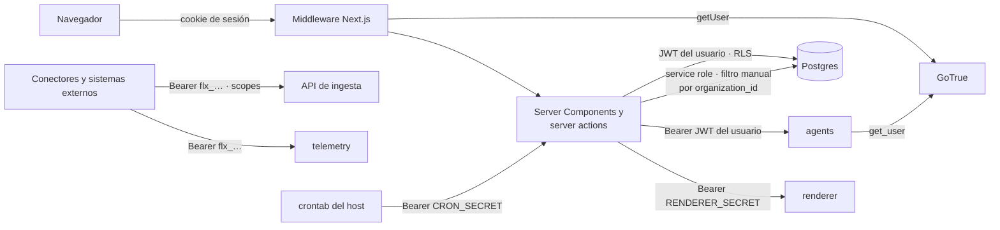

# Seguridad

Mecanismos de seguridad de Fluxion: autenticación, autorización, aislamiento entre organizaciones,
credenciales de máquina, secretos, ficheros, trazabilidad y minimización de datos.

Este documento describe lo que está implementado. Los permisos de cada vista están en los documentos
funcionales.

> **Pendiente de definir.** Revisión de seguridad de la plataforma. Está prevista para una fase
> posterior y no se recoge en este documento.



## Componentes

| Componente | Ubicación | Responsabilidad |
|---|---|---|
| Autenticación de usuarios | `app/(auth)/actions.ts`, Supabase GoTrue | Login y registro con email y contraseña |
| Middleware | `middleware.ts`, `lib/supabase/middleware.ts` | Refresca la sesión, valida el usuario y redirige a `/login` u `/onboarding` |
| Estado de autenticación | `lib/auth/app-state.ts` | Perfil, organización y rol del usuario actual |
| Clientes de Supabase | `lib/supabase/*` | Acceso con el JWT del usuario (RLS) o con service role |
| Comprobaciones de rol | Server actions de cada módulo | Listas de roles permitidos por operación |
| Activación de módulos | `lib/modules/entitlements.ts` | Módulos contratados por la organización |
| Claves API | `lib/auth/api-key.ts`, `lib/auth/scopes.ts` | Autenticación de máquinas en la API de ingesta |
| Secreto de tareas programadas | `lib/cron/auth.ts` | Autenticación de `/api/cron/*` |
| Vault | Funciones `*_secret_set/get/cleanup` | Credenciales de conectores y canales |
| Firma de webhooks | `lib/outbox/dispatch.ts` | HMAC de los eventos salientes |
| Almacenamiento | `lib/storage/objects.ts`, Supabase Storage | Claves por organización y URLs firmadas |
| Auditoría | `lib/audit.ts` | Registro de acciones administrativas |

### Autenticación de usuarios

- **Método:** email y contraseña con Supabase GoTrue (`signInWithPassword`, `signUp`). El registro exige
  confirmar el email (`ENABLE_EMAIL_AUTOCONFIRM=false`). OAuth, magic link y usuarios anónimos están
  desactivados en la configuración de infraestructura.
- **Sesión:**
  - vive en cookies, gestionadas con `@supabase/ssr`;
  - el middleware llama a `supabase.auth.getUser()`, que valida el token contra GoTrue, y reescribe las
    cookies para refrescarlo;
  - el JWT caduca a la hora (`JWT_EXPIRY`).
- **Redirecciones del middleware:**
  - una ruta de `PROTECTED_PREFIXES` sin usuario va a `/login`;
  - con el onboarding pendiente, va a `/onboarding`;
  - `/login` y `/register` con sesión van a `/dashboard`.
- **MFA:** TOTP opcional por usuario desde **Perfil › Seguridad** (`mfa.enroll`, `challenge`, `verify`).
- **Cuenta:**
  - el cambio de contraseña exige la actual y al menos 8 caracteres;
  - se pueden cerrar las demás sesiones desde el perfil o desde Ajustes.
- **Alta:** el trigger `on_auth_user_created` ejecuta `fluxion.handle_new_user()`.
  - Si hay una invitación pendiente para el email, crea el perfil en esa organización con el rol de la
    invitación.
  - Si no, crea una organización nueva con el usuario como `org_admin`.

> **Pendiente de implementar.** Recuperación de contraseña desde la aplicación.

### Clientes de Supabase

| Factoría | Clave | Esquema | Uso |
|---|---|---|---|
| `lib/supabase/server.ts` `createClient()` | anon + cookies | `public` | Sesión y `auth.getUser()` en el servidor |
| `lib/supabase/client.ts` | anon | `public` / `fluxion` | Componentes de cliente |
| `lib/supabase/fluxion.ts` `createFluxionClient()` | anon + cookies | `fluxion` | Consultas normales, sujetas a RLS |
| `lib/supabase/fluxion.ts` `createTelemetryClient()` | anon + cookies | `telemetry` | Lectura de telemetría con RLS |
| `lib/supabase/compliance.ts` `createComplianceClient()` | anon + cookies | `compliance` | Lectura del catálogo |
| `lib/supabase/fluxion.ts` `createAdminFluxionClient()` | service role | `fluxion` | Escrituras que la RLS no permite: auditoría, instantáneas, módulos |
| `lib/supabase/ingest.ts` `createNoCacheAdminClient()` | service role, `cache: 'no-store'` | `fluxion` | Todo lo que decide permisos: claves API, módulos, outbox, ingesta |

**Reglas del service role:**
- Solo se usa en el servidor: los módulos que lo usan importan `server-only`.
- Antes de usarlo, el código comprueba el perfil y el rol, y filtra a mano por `organization_id`.
- Lo que decide permisos usa siempre el cliente sin caché: la caché de `fetch` de Next llegó a mantener
  válida una clave revocada.

### Autorización

**Roles.** `fluxion.org_role`, en `profiles.role` (por defecto `viewer`):

| Rol | Valor |
|---|---|
| Administrador | `org_admin` |
| Responsable del SGAI | `sgai_manager` |
| CAIO | `caio` |
| DPO | `dpo` |
| Responsable del sistema | `system_owner` |
| Analista de riesgos | `risk_analyst` |
| Analista de cumplimiento | `compliance_analyst` |
| Directivo | `executive` |
| Auditor | `auditor` |
| Lector | `viewer` |

`profiles.platform_role` (`platform_admin`, `partner`) existe, pero no lo usa ninguna lógica.

> **Pendiente de definir.** Funciones de los roles de plataforma `platform_admin` y `partner`.

**Comprobaciones:**
- `getAppAuthState()` obtiene el perfil por `profiles.user_id = auth.uid()` y expone `membership.role`.
- Cada server action comprueba el rol con un helper local (`getCurrentUserProfile`, `ctx`, `getCtx`) y una
  lista de roles. Ejemplos:
  - claves API, webhooks, seguridad y auditoría: `org_admin`;
  - conectores y canales: `org_admin` y `sgai_manager`;
  - políticas de aprobación: `org_admin`, `sgai_manager` y `caio`.
- `lib/auth/permissions.ts` define una matriz de permisos que hoy no se usa.

**Módulos:** un módulo está activo si `organization_modules.status` es `enabled` o `trial` y
`licensed_until` no ha vencido. Si falla la lectura, no se concede ninguno. `requireModule()` devuelve 402
`module_not_enabled`. Hoy la activación se usa para mostrar u ocultar entradas del menú. Solo el
Administrador concede módulos, y queda auditado.

### Credenciales de máquina

**Claves API (`flx_…`):**
- **Emisión:** solo el Administrador, desde **Ajustes › API y desarrolladores**.
  - La clave es `flx_` seguida de 32 bytes aleatorios en hexadecimal.
  - Se muestra una sola vez.
  - Se guardan su hash SHA-256 y su prefijo, nunca la clave.
  - Puede tener fecha de caducidad y se puede revocar. Ambas acciones quedan auditadas.
- **Validación** (`requireApiKey`):
  - cabecera `Authorization: Bearer flx_…`;
  - se busca el hash con el cliente sin caché;
  - se rechazan las claves revocadas o caducadas con el mismo 401, para no revelar la causa;
  - 403 `insufficient_scope` si falta el permiso;
  - límite de 300 peticiones por minuto por clave, en memoria (429 con `Retry-After`);
  - `last_used_at` se actualiza como mucho cada 5 minutos.

**Scopes:**

| Scope | Etiqueta |
|---|---|
| `signals:write` | Publicar señales |
| `signals:read` | Leer señales |
| `telemetry:write` | Enviar telemetría |
| `hitl:write` | Registrar decisiones humanas |
| `inventory:read` | Leer sistemas de IA |
| `inventory:write` | Escribir en inventario |
| `connectors:sync` | Sincronizar conectores |

Siguen admitidos los scopes heredados:
- `read` cubre cualquier `*:read`;
- `write` cubre cualquier `*:write` y `*:read`;
- `admin` cubre todo.

Ver [API de ingesta](api-ingesta.md).

**Servicio de telemetría:** valida la misma clave directamente en `fluxion.api_keys` (SHA-256, revocación,
caducidad y scope `telemetry:write`). Limita el cuerpo con `MAX_BODY_BYTES`.

**Tareas programadas:** los endpoints `/api/cron/*` exigen `Authorization: Bearer <CRON_SECRET>`.
- Sin la variable responden 503 `cron_secret_missing`;
- con un valor incorrecto, 401.

El crontab del host los llama con `infra/schedules/app-cron.sh`. Las tareas de pg_cron se ejecutan dentro
de la base de datos.

**Servicios internos:**

| Llamada | Autenticación |
|---|---|
| web → agents | `Authorization: Bearer <JWT del usuario>`. El agente lo valida con `auth.get_user`, obtiene organización y rol, y filtra cada consulta por organización. CORS limitado a `FRONTEND_URL` |
| web → renderer | `Authorization: Bearer <RENDERER_SECRET>`. Sin secreto configurado responde 503; si no coincide, 401 |
| conectores → ingesta | `Authorization: Bearer <FLUXION_API_KEY>` (clave `flx_`) |

**Aislamiento del renderer:**
- solo recibe HTML, nunca URLs ni credenciales de la aplicación;
- se ejecuta sin acceso a red, así que no carga recursos externos;
- crea un contexto de Chromium nuevo para cada documento;
- el HTML está limitado por `MAX_HTML_BYTES`.

## Modelo de datos

| Objeto | Tipo | Campos clave | Migración |
|---|---|---|---|
| `fluxion.profiles` | tabla | `user_id` (→ `auth.users`), `organization_id`, `role`, `platform_role`, `onboarding_completed`, `is_active` | `00000000000001_schema.sql` |
| `fluxion.auth_user_org_id()` | función, SECURITY DEFINER | Organización del usuario actual | `00000000000001_schema.sql` |
| `fluxion.handle_new_user()` | trigger en `auth.users` | Alta de perfil u organización | `00000000000003_auth_storage.sql` |
| `fluxion.api_keys` | tabla | `key_prefix`, `key_hash`, `scopes`, `expires_at`, `revoked_at`, `last_used_at` | `00000000000001_schema.sql` |
| `fluxion.organization_modules` | tabla | `module_key`, `status`, `licensed_until` | `20260811000306_core_organization_modules.sql` |
| `fluxion.audit_log` | tabla | `actor_id`, `action`, `target_type`, `target_id`, `metadata`, `ip_address` | `00000000000001_schema.sql` |
| `connector_secret_set/get/cleanup` | funciones, Vault | Credencial por conexión | `20260818100000_connectors_connections.sql` |
| `channel_secret_set/get/cleanup` | funciones, Vault | URL del canal Slack/Teams | `20260818190000_incidents_alerts_channels.sql` |
| `fluxion.webhooks` | tabla | `url`, `secret` (`whsec_…`), `events`, `is_active` | `00000000000001_schema.sql` |

### Aislamiento entre organizaciones

**Pertenencia:** `fluxion.profiles` asocia cada usuario de `auth.users` a una organización y un rol.

**Patrón de las políticas RLS en `fluxion.*`:**

```sql
organization_id IN (
  SELECT p.organization_id FROM fluxion.profiles p
  WHERE p.user_id = auth.uid()
  -- AND p.role = ANY (ARRAY['org_admin', …])  cuando la operación depende del rol
)
```

- La comparación siempre es con `profiles.user_id`, nunca con `profiles.id`. La regla la fijó la
  migración `20260811103000_core_fix_rls_profiles_uid.sql`.
- Algunas políticas usan el helper `fluxion.auth_user_org_id()`.

**Ejemplos de políticas por rol:**

| Tabla | Lectura | Escritura |
|---|---|---|
| `tasks` | Miembros | Alta y edición: todos salvo `executive`, `auditor`, `viewer`. Borrado: `org_admin`, `sgai_manager`, `caio` |
| `ai_incidents` | Miembros | Alta: miembros. Edición: roles de gobierno |
| `api_keys`, `webhooks` | `org_admin` | `org_admin` |
| `audit_log` | `org_admin` | Solo service role |
| `organizations` | Miembros | `org_admin` |

**Escrituras con service role:** filtran por `organization_id` en el código. Ejemplos:
- la ingesta de supervisión humana comprueba que el sistema es de la organización de la clave;
- el servicio de agentes filtra cada consulta por la organización del usuario.

**Catálogo `compliance.*`:** solo tiene políticas de lectura para usuarios autenticados. Las escrituras
llegan con service role desde las vistas del [catálogo](../funcional/catalogo.md).

**Vistas:** las vistas nuevas se crean con `security_invoker = true`, para aplicar la RLS de quien
consulta.

**Esquemas:**
- PostgREST expone `public`, `storage`, `graphql_public`, `fluxion`, `compliance`, `rag` y `telemetry`;
- el rol `anon` no tiene `USAGE` en `fluxion`, `compliance` ni `rag`.

Ver [Modelo de datos](modelo-datos.md).

## API

| Método | Ruta / función | Autenticación | Descripción |
|---|---|---|---|
| — | Server actions | Cookie de sesión | Comprobación de rol en cada acción |
| `POST` | `/api/ingest/v1/*` | `Bearer flx_…` + scope | API de ingesta |
| `POST` | `/v1/traces` (telemetry) | `Bearer flx_…` + `telemetry:write` | Trazas OpenTelemetry |
| `GET` | `/api/cron/*` | `Bearer CRON_SECRET` | Tareas programadas |
| `POST` | `/api/agent/*`, `/api/v1/systems/*` | Cookie; reenvía el JWT al servicio de agentes | Proxys al servicio de agentes |
| `GET` | `/api/documents/v1/renders/[id]/download` | Cookie; el render debe ser visible por RLS | Redirección a URL firmada |

**Firma de los webhooks salientes:**
- `X-Fluxion-Signature: sha256=<hex>`: HMAC-SHA256 del cuerpo JSON exacto con el secreto del webhook;
- además, las cabeceras `X-Fluxion-Event` y `X-Fluxion-Delivery`.

Ejemplo de verificación en el receptor (datos ficticios):

```python
import hmac, hashlib
esperada = "sha256=" + hmac.new(b"whsec_ejemplo", cuerpo_bytes, hashlib.sha256).hexdigest()
valida = hmac.compare_digest(esperada, cabeceras["X-Fluxion-Signature"])
```

Ver [Webhooks salientes](webhooks-salientes.md).

## Dependencias

| Dependencia | Uso |
|---|---|
| Supabase GoTrue | Usuarios, sesiones, JWT y MFA |
| Postgres (RLS, Vault, pg_cron) | Aislamiento, secretos y tareas internas |
| Supabase Storage | Avatares, logos y adjuntos de tareas |
| MinIO/S3 | Evidencias y documentos generados |
| OpenAI, Voyage AI | Reciben datos de la organización (ver abajo) |

## Seguridad

### Secretos

**Vault** guarda:
- las credenciales de los conectores;
- las URLs de los canales de Slack y Teams.

Las funciones de lectura solo admiten `service_role` y leen el secreto de una conexión concreta. Un
trigger lo borra al eliminar la conexión. Las credenciales descifradas solo se entregan a conectores con
scope `connectors:sync`.

Los secretos de despliegue van en variables de entorno, nunca en ficheros versionados. Ver
[Configuración](configuracion.md).

### Ficheros

| Almacén | Contenido | Control |
|---|---|---|
| Supabase Storage `evidence-files` | Evidencias heredadas | Privado, 25 MiB. Políticas por carpeta de organización. URL firmada de 1 hora |
| Supabase Storage `task-attachments` | Adjuntos de tareas | Privado, 25 MiB. Solo service role. Tipos permitidos en lista blanca. URL firmada de 1 hora |
| Supabase Storage `organization-logos`, `user-avatars` | Logos y avatares | Públicos, 5 MiB. Escritura solo en la carpeta propia. La aplicación limita la subida a 2 MB |
| MinIO/S3 `S3_BUCKET_EVIDENCES` | Evidencias | Claves `org/<organization_id>/…` generadas por el servidor. URLs presignadas de 5 minutos |
| MinIO/S3 `S3_BUCKET_DOCUMENTS` | PDF generados | Ídem, con SHA-256 en los metadatos y retención de 10 años |

MinIO no aplica RLS. Antes de firmar una URL, la aplicación comprueba con RLS que el registro es visible
para el usuario.

### Trazabilidad

**Registro de auditoría:** `logAuditEvent()` registra en `audit_log`:
- miembros e invitaciones;
- ajustes de la organización y de seguridad;
- comités y módulos;
- sesiones;
- claves API, webhooks y conectores;
- políticas, decisiones y delegaciones de aprobación;
- adjuntos y comentarios de tareas.

Solo lo consulta el Administrador, en **Ajustes › Auditoría**.

**Registros inmutables** (un trigger impide modificarlos):
- `document_renders`: PDF generados, con huella del fichero y del contenido;
- `approval_decisions`: decisiones de aprobación;
- `outbox_events`: eventos salientes.

**Historiales:** `ai_system_history`, `fmea_item_history`, `soa_lifecycle_log`, `member_role_changes`,
`system_report_snapshots` y los registros de envío de conectores, canales y webhooks.

### Minimización de datos

| Flujo | Qué se guarda o se envía |
|---|---|
| Telemetría | Solo modelo, proveedor, tokens, latencias, errores e identificadores. Se descartan los atributos con nombres como `prompt`, `completion`, `content`, `message`, `gen_ai.input` o `gen_ai.output` |
| Supervisión humana | Referencias seudonimizadas del caso y del revisor. Se rechaza la decisión si los metadatos contienen nombres como `name`, `email`, `dni`, `diagnosis`, `content` o `text` |
| Detección de IA no declarada | Patrón, ruta y línea, sin código |
| OpenAI | Clasificación: datos de la ficha del sistema y fragmentos del corpus normativo. Asistente: resumen del estado de la organización y la conversación. Declaración de Aplicabilidad y AISIA: datos de los sistemas |
| Voyage AI | Solo el texto de la consulta, para calcular su embedding |

### Configuración de seguridad de la organización

En **Ajustes › Seguridad**, el Administrador guarda en `organizations.settings.security`:
- MFA obligatoria (`mfa_required`);
- dominios de email permitidos (`allowed_email_domains`);
- tiempo de sesión (`session_timeout_minutes`).

> **Pendiente de definir.** Aplicación de estos ajustes en el acceso.

## Configuración

| Variable | Obligatoria | Valor por defecto | Descripción |
|---|---|---|---|
| `NEXT_PUBLIC_SUPABASE_URL`, `NEXT_PUBLIC_SUPABASE_ANON_KEY` | Sí | — | Cliente de Supabase con la sesión del usuario |
| `SUPABASE_SERVICE_ROLE_KEY` | Sí | — | Service role de la web. Solo en el servidor |
| `CRON_SECRET` | Sí | — | Secreto de `/api/cron/*` |
| `RENDERER_URL`, `RENDERER_SECRET` | Para PDF | — | Servicio de renderizado |
| `AGENT_SERVER_URL` | Para IA | `http://localhost:8001` | Servicio de agentes |
| `S3_ENDPOINT`, `S3_ACCESS_KEY_ID`, `S3_SECRET_ACCESS_KEY`, `S3_BUCKET_EVIDENCES`, `S3_BUCKET_DOCUMENTS` | Para ficheros | — | MinIO/S3 |
| `SUPABASE_SERVICE_KEY`, `FRONTEND_URL` | Sí (agents) | — | Service role del agente y origen permitido por CORS |
| `DATABASE_URL`, `MAX_BODY_BYTES` | Sí (telemetry) | `MAX_BODY_BYTES` 8 MB | Conexión directa y tamaño máximo |
| `MAX_HTML_BYTES` | No (renderer) | 20 MB | Tamaño máximo del HTML |
| `FLUXION_API_KEY` | Sí (conectores) | — | Clave `flx_` del conector |
| `JWT_EXPIRY`, `ENABLE_EMAIL_AUTOCONFIRM`, `DISABLE_SIGNUP` | Infra | `3600`, `false`, `false` | Parámetros de GoTrue (`infra/supabase/env.propio.example`) |
| `PGRST_DB_SCHEMAS` | Infra | — | Esquemas expuestos por PostgREST |

Las variables se definen en Dokploy para cada servicio. Ver [Configuración](configuracion.md) y
[Despliegue](despliegue.md).
