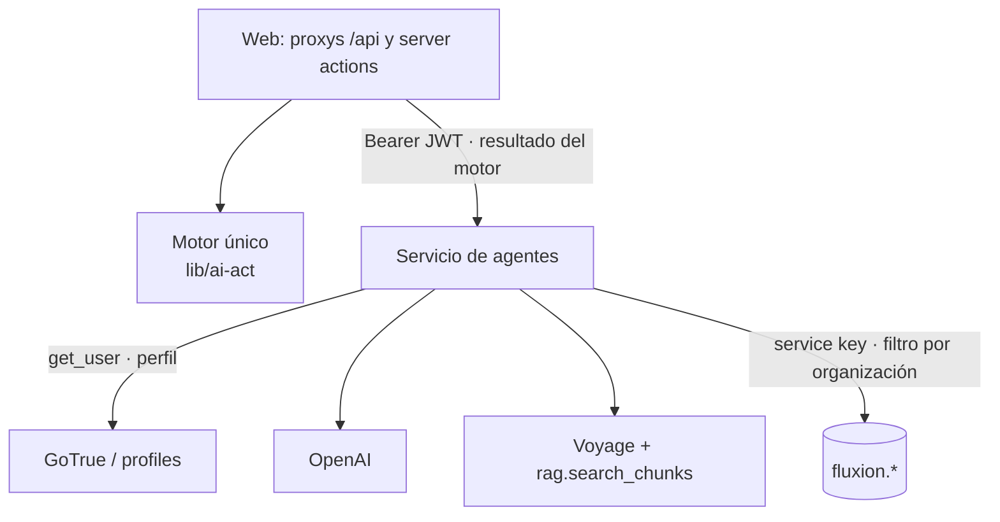
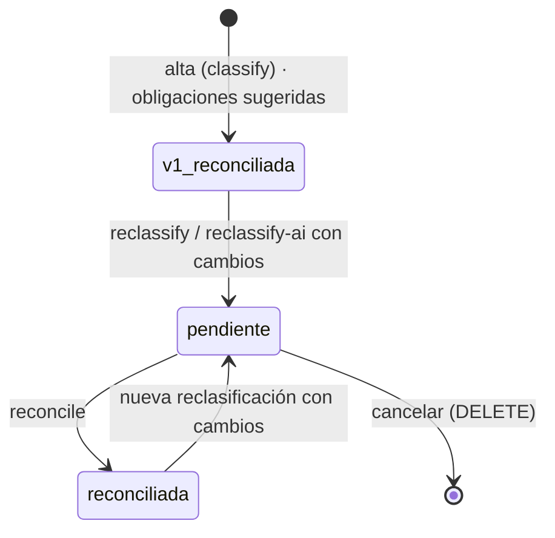

# Servicio de agentes

Servicio FastAPI (`services/agents`) con las funciones de IA de Fluxion:
- la [clasificación AI Act](../glosario.md#clasificación-ai-act): versiones de la clasificación,
  diferencias de obligaciones, conciliación y clasificación con un agente de IA;
- el [Asistente SGAI](../glosario.md#asistente-sgai).

Usa OpenAI (GPT) para generar y el corpus normativo para fundamentar. Ver [RAG y corpus normativo](rag.md).

Desde B13a el servicio **no clasifica por reglas**. La clasificación la calcula en la web el motor único
de clasificación AI Act (`apps/web/lib/ai-act`, ver [Motor único de clasificación](#motor-único-de-clasificación))
y el servicio recibe su resultado (`EngineClassification`).

## Componentes

| Componente | Ubicación | Responsabilidad |
|---|---|---|
| Aplicación | `fluxion_agents/main.py` | FastAPI, CORS, clientes de Supabase y OpenAI, autenticación y telemetría |
| Modelos | `fluxion_agents/models.py` | `ASSISTANT_MODEL`, `CLASSIFICATION_MODEL` |
| Clasificación | `fluxion_agents/routes/classification.py` | Eventos de clasificación con el resultado del motor único, clasificación con IA, diferencias y reconciliación |
| Asistente | `fluxion_agents/routes/assistant.py` | Chat SSE y conversaciones |
| Prompts | `fluxion_agents/prompts/*` | Prompts de sistema y de usuario |
| Recuperación | `fluxion_agents/rag/retriever.py` | Ver [RAG y corpus normativo](rag.md) |

### Ciclo de clasificación

1. **Alta:** la server action del alta clasifica con el motor único y envía el resultado a `classify`, que
   crea la versión 1 (`method = initial`, `reconciled`) y las obligaciones como sugeridas, con los códigos
   del catálogo.
2. **Revisión:** la web clasifica con el motor único y llama a:
   - `reclassify`, con el resultado del motor, desde **✏ Revisar clasificación** y desde la edición de la
     ficha (`method = manual_review`);
   - `reclassify/ai`, con el resultado del motor como referencia, para que clasifique el agente de IA
     (`method = ai_agent`).

   Si cambian el nivel de riesgo o el conjunto de obligaciones, las dos crean un evento pendiente con las
   diferencias por obligación; si no, devuelven `has_changes: false` sin crear nada. Con una
   reclasificación ya pendiente, devuelven 409.
3. **Reconciliación:** `reconcile` aplica las decisiones y actualiza la cabecera de la clasificación en
   `ai_systems`. La ruta web registra después el evento «Clasificación AI Act conciliada» en el historial
   del sistema.

Ver [Ficha del sistema](../funcional/ficha-sistema.md) y [API interna](api-interna.md#clasificación-ai-act).

### Motor único de clasificación

El motor vive en la web (`apps/web/lib/ai-act`), es puro (sin Supabase ni Next) e implementa las reglas
`RN-…` de la especificación [Cuestionario preliminar: reglas de clasificación](../producto/cuestionario-preliminar-reglas.md).
Cada resultado lleva la versión de las reglas (`AIACT_RULES_VERSION`).

| Fichero | Contenido |
|---|---|
| `types.ts` | Supuestos (`AiActInputs`), resultado (`AiActResult`) y `AIACT_RULES_VERSION` |
| `rules.ts` | `classifyAiAct`: reglas con supuestos AI Act |
| `fallback.ts` | `classifyByFallback`: vía de respaldo por dominio y tipo de output |
| `obligations.ts` | `suggestObligations` (cruce con el catálogo por alcance y rol) y `catalogCodeFromRef` |
| `catalog.ts` | Anexo I, Anexo III, prácticas prohibidas y etiquetas de nivel |
| `index.ts` | `classifySystem`: supuestos si los hay; si no, respaldo |
| `server.ts` | Puente con la base de datos: `loadAiActCatalog`, `classifyWithCatalog`, `classificationColumns`, `enginePayload`, `callClassificationService` |

**Dos métodos** (`AiActResult.method`):
- `supuestos`: con los supuestos guardados en `ai_systems.aiact_inputs`;
- `respaldo`: sin supuestos. Aproxima con el dominio, el tipo de output y los indicadores del alta, y
  añade el aviso `RN-F00` «Clasificación aproximada por dominio y tipo de output: faltan los supuestos del
  AI Act.».

> **Pendiente de implementar.** La interfaz para introducir los supuestos AI Act (cuestionario
> preliminar, B13b, y bloque «Supuestos AI Act» del alta, B13c). Hasta entonces todos los sistemas se
> clasifican por la vía de respaldo.

**Resultado (`AiActResult`):** ámbito (`in_scope`, `out_of_scope`, `not_ai_system`, `pending`) y su
motivo; nivel (`prohibited`, `high`, `limited`, `minimal`, `pending`, o `null` fuera del ámbito); vía del
alto riesgo (Anexo I o III); Art. 6.3; supuestos del Art. 50; categoría GPAI (proveedor de modelo, riesgo
sistémico, basado en un modelo de terceros); roles declarados y sugeridos; fundamento (`basis`) y avisos
(`warnings`) con la regla que los origina; y los textos de cabecera (`display`).

GPAI no es un nivel de riesgo (decisión D3): `is_gpai` indica que la organización es proveedora de un
modelo GPAI.

> **Pendiente de implementar.** Migración de los sistemas existentes con nivel `gpai` a `is_gpai` y
> «Pendiente de clasificar», y división del Art. 50 en el catálogo (B13d). El motor ya trata los códigos
> `AI-ACT-ART50-1` a `-4` y `AI-ACT-ART6-4` si el catálogo los tiene.

**Obligaciones:** `suggestObligations` cruza el resultado con `compliance.obligations` (alcance y
`applies_to_roles`). Una práctica prohibida solo lleva `AI-ACT-ART5`; fuera del ámbito no hay
obligaciones. Las obligaciones se identifican siempre por el código del catálogo (`AI-ACT-ART9`…).
`catalogCodeFromRef` traduce a código los textos de la cabecera («Art. 9 — …») y las claves antiguas
(`art_9`; el `Art. 71` pasa a `AI-ACT-ART49`).

**Lo que recibe el servicio (`EngineClassification`):** `scope`, `risk_level`, `risk_label`, `basis`,
`reason`, `obligations` (código y etiqueta), `result` (el `AiActResult` completo) e `inputs`. El evento
guarda en `classification_factors` el resultado (`engine_result`), los supuestos (`inputs`) y los campos
del formulario de revisión (`form`).

**Diferencias** (`compute_diff`):
- cada obligación se marca como añadida, retirada o sin cambio;
- las que no cambian se conservan solas;
- las retiradas sin trabajo en curso o resuelto se archivan solas;
- las añadidas requieren decisión.

**Reconciliación** (`reconcile`): además de aplicar las decisiones sobre `system_obligations`, actualiza
en `ai_systems`:
- `aiact_risk_level`, `aiact_risk_basis`, `aiact_risk_reason`, `aiact_classified_at` y
  `current_classification_event_id`;
- `aiact_obligations`, con las etiquetas del catálogo;
- `prohibited_practice` (si el nivel es `prohibited`) y `aiact_review_pending = false`;
- si el evento trae el resultado del motor: `aiact_result`, `aiact_scope`, `aiact_scope_reason`,
  `aiact_rules_version`, `is_gpai`, `gpai_systemic_risk`, `gpai_third_party_based` y, si los hay,
  `aiact_inputs`;
- los campos editados en **✏ Revisar clasificación** (`FORM_COLUMNS`): dominio, uso previsto, tipo de
  output, interacción con personas, es IA, afecta a personas, grupos vulnerables, menores, biometría e
  infraestructura crítica.

> TODO: confirmar el alcance de la reconciliación de una clasificación con IA. El evento de
> `reclassify/ai` no guarda `engine_result`, así que al conciliarlo no se actualizan el ámbito, el
> resultado del motor ni la categoría GPAI, y se conservan los avisos del resultado anterior.

> TODO: confirmar la respuesta de `classify` en el alta. La server action no comprueba si la llamada ha
> ido bien: si falla, el sistema queda sin versión de clasificación ni obligaciones sugeridas.

### Clasificación con IA

**Prompt de sistema** (`prompts/classification.py`):
- árbol de decisión del motor único: prácticas prohibidas (Art. 5.1, letras a a h) → alto riesgo (Art. 6.1
  y Anexo I, Art. 6.2 y Anexo III, excepción del Art. 6.3) → riesgo limitado (Art. 50.1 a 50.4) → mínimo;
- GPAI como categoría aparte, no como nivel: si la organización es proveedora de un modelo GPAI, se
  añaden las obligaciones del Art. 53 (y del 55 con riesgo sistémico);
- obligaciones solo con los códigos del catálogo que llegan en el prompt de usuario; prohibido →
  solo `AI-ACT-ART5`;
- respuesta solo en JSON.

**Campos de la respuesta JSON:**
- `aiact_risk_level`, `confidence`, `obligations_set` y `classification_factors`;
- prohibición: `is_prohibited`, `prohibited_practice`;
- alto riesgo: `is_high_risk`, `annexiii_items`, `annexii_applies`;
- rol: `is_provider`, `is_deployer`, `role_justification`;
- GPAI: `is_gpai`, `gpai_systemic_risk`;
- además: `transparency_obligations`, `flags`, `clarification_questions`, `classification_note` y
  `normative_refs`.

**Prompt de usuario** (`build_classification_user_prompt`): atributos del sistema, clasificación
actual, resultado del motor único como referencia (ámbito, nivel, obligaciones y fundamento), catálogo de
obligaciones (código y etiqueta) y fragmentos del corpus.

**Validación:**
1. Se quitan las marcas de markdown y se interpreta el JSON. Si falla, devuelve 502.
2. El nivel debe ser `prohibited`, `high`, `limited` o `minimal`; si no, devuelve 502.
3. Se descartan las obligaciones cuyo código no está en el catálogo AI Act (`compliance.obligations`).
4. Si el nivel difiere del del motor único, se antepone «[Divergencia con motor de reglas: motor=X,
   agente=Y]» a la justificación.
5. El evento guarda en `classification_factors` la salida del agente y la referencia del motor
   (`engine_reference`).

**Parámetros:**
- `max_completion_tokens = 4000`, sin temperatura ni modo JSON forzado;
- hasta 8 fragmentos del corpus.

> TODO: confirmar varios puntos de la clasificación con IA.
> - **Nombre de cliente:** las reglas de comportamiento del prompt contienen un nombre de cliente fijo,
>   inadecuado en un servicio para varias organizaciones, y llevan los sistemas financieros al
>   «Anexo III §4», cuando el árbol de decisión los sitúa en el punto 5.
> - **Vocabulario de los factores:** el que pide el prompt no coincide con los valores de la base de
>   datos.

### Asistente

**Contexto que recibe:**
- resumen de la organización (`build_tenant_context`);
- fragmentos del corpus: 4, con umbral 0,72, recortados a 500 caracteres;
- los 18 últimos mensajes que envía el cliente.

**Generación:** OpenAI en streaming, con `max_completion_tokens = 2000`.

**Prompt de sistema:** copiloto del Responsable del SGAI.
- Conoce el AI Act, ISO/IEC 42001, el RGPD, DORA, la metodología de Fluxion y las guías de AESIA.
- Cita la fuente.
- Distingue hechos de orientación.
- No toma decisiones.

Ver [API interna](api-interna.md#asistente-sgai) y [Asistente SGAI](../funcional/asistente-sgai.md).

> **Pendiente de implementar.** Partes de la especificación del asistente
> (`recursos/agent4_assistant_spec.md`):
> - **Avisos:** alertas proactivas.
> - **Conversación:**
>   - compresión del historial largo;
>   - historial de conversaciones en la interfaz;
>   - respuesta en el idioma del usuario.
> - **Búsqueda:**
>   - búsqueda híbrida;
>   - consulta de los documentos de la organización.
> - **Métricas:** de calidad por respuesta.

## Modelo de datos

| Objeto | Tipo | Uso |
|---|---|---|
| `fluxion.classification_events` | tabla | Una versión por clasificación: `method` (`initial`, `manual_review`, `ai_agent`), `status` (`pending_reconciliation`, `reconciled`, `superseded`), nivel (admite `pending` y nulo fuera del ámbito; `gpai` se conserva para el histórico), base, justificación, `obligations_set` con códigos del catálogo y `classification_factors` (resultado del motor, supuestos y formulario, o salida del agente y referencia del motor) |
| `fluxion.classification_diffs` | tabla | Diferencias por obligación y su resolución. Se borran en cascada con el evento |
| `fluxion.system_obligations` | tabla | Obligaciones resultantes, con `obligation_code` y `obligation_key` iguales al código del catálogo: `suggested` al alta y `pending` o `excluded` al reconciliar |
| `fluxion.ai_systems` | tabla | Cabecera de la clasificación (`aiact_*`, `prohibited_practice`, GPAI) y `current_classification_event_id`. Ver [Modelo de datos](modelo-datos.md) |
| `compliance.obligations` | tabla | Catálogo: códigos y etiquetas válidos de las obligaciones AI Act |
| `fluxion.assistant_conversations` | tabla | Conversaciones del asistente |
| `fmea_evaluations`, `gaps`, `treatment_plans`, `evidences` | tablas | Lectura para el contexto del asistente |

Todas están en `00000000000001_schema.sql`. La migración `20261022090000_ai_act_motor_unico.sql` añade
las columnas del motor único y traduce las claves antiguas de obligación (ver [Modelo de datos](modelo-datos.md)).

> TODO: confirmar la reconciliación. No es atómica: si falla a mitad, la clasificación queda aplicada en
> parte.

## API

| Método | Ruta | Llamado desde | Respuesta |
|---|---|---|---|
| `POST` | `/api/v1/systems/{id}/classify` | Server action del [alta de sistema](../funcional/inventario-alta.md), con `{classification}` | `{data:{event_id, version, risk_level, risk_label, obligations_set}}`. 409 si ya está clasificado |
| `POST` | `/api/v1/systems/{id}/reclassify` | Ruta web `/api/v1/systems/[systemId]/reclassify` y server action de la [edición](../funcional/ficha-sistema-edicion.md), con `{classification, factors, review_notes}` | Ver [API interna](api-interna.md#clasificación-ai-act) |
| `POST` | `/api/v1/systems/{id}/reclassify/ai` | Ruta web `/api/v1/systems/[systemId]/reclassify-ai`, con `{reference}` | ídem |
| `POST` | `/api/v1/systems/{id}/reconcile` | Proxy | ídem |
| `DELETE` | `/api/v1/systems/{id}/classification-events/{event_id}` | Proxy | ídem |
| `POST` | `/api/agent/assistant/chat` | Proxy | SSE |
| `GET` | `/api/v1/systems/{id}/classification-events` | Sin uso desde la web: la ficha lee el historial de la base de datos | JSON |
| `GET` / `DELETE` | `/api/agent/assistant/conversations[/{id}]` | Proxys sin uso en la interfaz | JSON |
| `GET` | `/health` | — | `{"status":"ok","agent":"classification","version":"1.0.0"}`, sin comprobar dependencias |

**Autenticación:** todas las rutas salvo `/health` exigen `Authorization: Bearer <JWT de Supabase>`.
Ver [Seguridad](seguridad.md).

## Dependencias

| Dependencia | Versión | Uso | Si no está disponible |
|---|---|---|---|
| OpenAI (`openai`) | 1.51.0 | Clasificación con IA y asistente | 503 «Cliente OpenAI no disponible» o evento `error` |
| Supabase (`supabase`) | 2.10.0 | Datos y validación del JWT | El servicio no arranca |
| Voyage AI (`voyageai`) | 0.3.7 | Embeddings | Respuesta sin fragmentos |
| `fastapi` / `uvicorn` | 0.115.0 / 0.30.6 | Servicio | — |
| `opentelemetry-sdk`, `-exporter-otlp-proto-http` | 1.29.0 | Telemetría de las llamadas a OpenAI | Sin telemetría |

**Imagen:**
- base `python:3.11-slim`;
- contexto de build en la raíz del monorepo, copiando `packages/py-common`;
- puerto 8001;
- sin `HEALTHCHECK`.

## Seguridad

- **Autenticación:** el JWT del usuario se valida contra GoTrue y del perfil se obtiene la organización.
- **Aislamiento:** el servicio usa la service key, sin RLS. Cada consulta filtra por la organización.
- **CORS:** limitado a `FRONTEND_URL`.
- **Datos que se envían a OpenAI:** ver [Seguridad](seguridad.md#minimización-de-datos).

## Configuración

| Variable | Obligatoria | Valor por defecto | Descripción |
|---|---|---|---|
| `SUPABASE_URL`, `SUPABASE_SERVICE_KEY` | Sí | — | Base de datos y validación del JWT |
| `OPENAI_API_KEY` | Sí | — | OpenAI |
| `VOYAGE_API_KEY` | Sí, para el corpus | — | Voyage AI |
| `FLUXION_CLASSIFICATION_MODEL` | No | `gpt-5.6-terra` | Modelo de clasificación |
| `FLUXION_ASSISTANT_MODEL` | No | `gpt-5.6-terra` | Modelo del asistente |
| `FRONTEND_URL` | No | `http://localhost:3000` | Origen permitido por CORS |
| `OTEL_EXPORTER_OTLP_ENDPOINT`, `FLUXION_SYSTEM_ID`, `FLUXION_ENV` | No | — | Telemetría propia. Ver [Telemetría](telemetria.md) |
| `AGENT_SERVER_URL` (web) | Sí | `http://localhost:8001` | URL del servicio desde la web |

> **Pendiente de implementar.** Elección del modelo de IA por organización.
