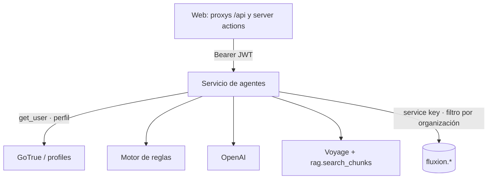
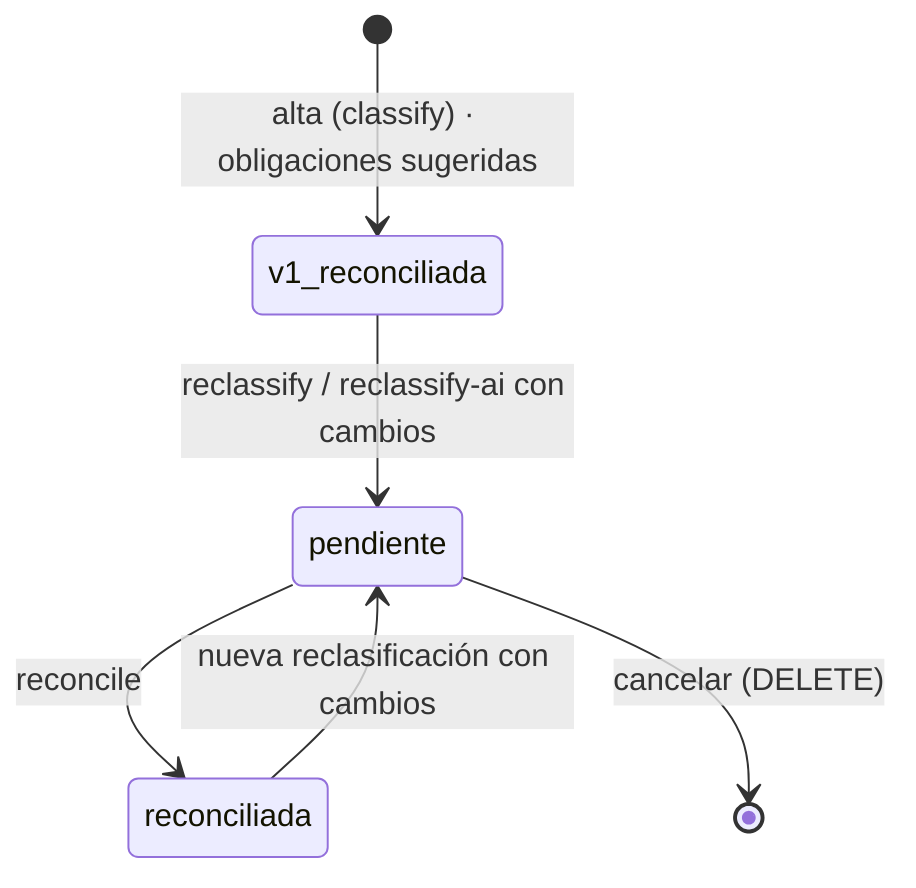

# Servicio de agentes

Servicio FastAPI (`services/agents`) con las funciones de IA de Fluxion:
- la [clasificación AI Act](../glosario.md#clasificación-ai-act), con un motor de reglas y un agente de
  IA;
- el [Asistente SGAI](../glosario.md#asistente-sgai).

Usa OpenAI (GPT) para generar y el corpus normativo para fundamentar. Ver [RAG y corpus normativo](rag.md).

## Componentes

| Componente | Ubicación | Responsabilidad |
|---|---|---|
| Aplicación | `fluxion_agents/main.py` | FastAPI, CORS, clientes de Supabase y OpenAI, autenticación y telemetría |
| Modelos | `fluxion_agents/models.py` | `ASSISTANT_MODEL`, `CLASSIFICATION_MODEL` |
| Clasificación | `fluxion_agents/routes/classification.py` | Motor de reglas, clasificación con IA, diferencias y reconciliación |
| Asistente | `fluxion_agents/routes/assistant.py` | Chat SSE y conversaciones |
| Prompts | `fluxion_agents/prompts/*` | Prompts de sistema y de usuario |
| Recuperación | `fluxion_agents/rag/retriever.py` | Ver [RAG y corpus normativo](rag.md) |

### Ciclo de clasificación

1. **Alta:** `classify` ejecuta el motor de reglas sobre la ficha del sistema y crea la primera
   clasificación con sus obligaciones como sugeridas.
2. **Revisión:**
   - `reclassify` vuelve a ejecutar el motor con los factores revisados;
   - `reclassify/ai` pide la clasificación al agente de IA.

   Las dos crean un evento pendiente con las diferencias por obligación.
3. **Reconciliación:** `reconcile` aplica las decisiones y actualiza el nivel de riesgo del sistema.

Ver [Ficha del sistema](../funcional/ficha-sistema.md) y [API interna](api-interna.md#clasificación-ai-act).

### Motor de reglas

`run_classification_engine` aplica estas reglas en orden:

| # | Condición | Nivel | Base | Obligaciones |
|---|---|---|---|---|
| 1 | `is_gpai` | `gpai` | Art. 51-53 | `art_53_doc`, `art_53_copyright`, `art_53_training`, `art_55` |
| 2 | `has_biometric` | `high` | Anexo III §1 | Completas de alto riesgo |
| 3 | Dominio de crédito o finanzas con decisión o predicción que afecta a personas | `high` | Anexo III §5(b) | Completas de alto riesgo |
| 4 | Dominio `rrhh` con decisión o clasificación que afecta a personas | `high` | Anexo III §4 | `art_9`, `art_11`, `art_14`, `art_71` |
| 5 | Infraestructura crítica que afecta a personas | `high` | Anexo III §2 | Completas de alto riesgo |
| 6 | Salida de tipo generación | `limited` | Art. 50 | `art_50` |
| 7 | Atención al cliente con clasificación | `limited` | Art. 50.1 | `art_50` |
| 8 | Resto | `minimal` | — | — |

**Obligaciones completas de alto riesgo:** `art_9`, `art_10`, `art_11`, `art_12`, `art_13`, `art_14`,
`art_15`, `art_16`, `art_43`, `art_71`.

**Claves de obligación (`OBLIGATION_LABELS`):**
- de `art_9` a `art_16`;
- `art_43`, `art_50`, `art_71`;
- `art_53_doc`, `art_53_copyright`, `art_53_training`, `art_55`.

Cada clave tiene su etiqueta, por ejemplo «Art. 9 — Sistema de gestión de riesgos».

**Diferencias** (`compute_diff`):
- cada obligación se marca como añadida, retirada o sin cambio;
- las que no cambian se conservan solas;
- las retiradas sin trabajo en curso o resuelto se archivan solas;
- las añadidas requieren decisión.

> TODO: confirmar varias reglas del motor.
> - **Prácticas prohibidas:** no hay regla para ellas, y el motor ignora `prohibited_practice`.
> - **Dominios inexistentes:** las reglas 3 y 7 comparan con `finanzas_banca` y `atencion_cliente`, que no
>   existen. Los dominios reales son `finanzas` y `atencion`, así que esos sistemas acaban en `minimal`.
> - **Factores sin efecto:** `affects_vulnerable_groups`, `involves_minors` e `intended_use` se reciben,
>   pero no influyen.
> - **Divergencias con el motor TypeScript** (`lib/ai-systems/scoring.ts`), que calcula la clasificación
>   del alta y de la edición:
>   - el motor TypeScript tiene regla de prohibido y reglas de alto riesgo para educación, salud,
>     seguridad, justicia y migración;
>   - trata de otra forma la biometría, la infraestructura crítica y el Art. 50;
>   - expresa las obligaciones como texto libre.
> - **Nivel de riesgo tras el alta:** `classify` no actualiza el nivel de riesgo de la ficha, así que la
>   ficha y el evento pueden mostrar niveles distintos.
> - **Respuesta de `classify` no comprobada:** la acción de alta no mira si la llamada ha ido bien.

### Clasificación con IA

**Prompt de sistema** (`prompts/classification.py`):
- árbol de decisión estricto: prohibido (Art. 5) → GPAI → alto riesgo (Anexo III y Anexo II) → limitado
  (Art. 50) → mínimo;
- catálogo de claves de obligación;
- respuesta solo en JSON.

**Campos de la respuesta JSON:**
- `aiact_risk_level`, `confidence`, `obligations_set` y `classification_factors`;
- prohibición: `is_prohibited`, `prohibited_practice`;
- alto riesgo: `is_high_risk`, `annexiii_items`, `annexii_applies`;
- rol: `is_provider`, `is_deployer`, `role_justification`;
- GPAI: `is_gpai`, `gpai_systemic_risk`;
- además: `transparency_obligations`, `flags`, `clarification_questions`, `classification_note` y
  `normative_refs`.

**Prompt de usuario:** atributos del sistema, clasificación actual, resultado del motor de reglas como
referencia y fragmentos del corpus.

**Validación:**
1. Se quitan las marcas de markdown y se interpreta el JSON. Si falla, devuelve 502.
2. El nivel debe ser `prohibited`, `high`, `limited`, `minimal` o `gpai`.
3. Se descartan las obligaciones que no están en `OBLIGATION_LABELS`.
4. Si el nivel difiere del del motor de reglas, se marca `divergence` y se antepone
   «[Divergencia con motor de reglas: motor=X, agente=Y]» a la justificación.

**Parámetros:**
- `max_completion_tokens = 4000`, sin temperatura ni modo JSON forzado;
- hasta 8 fragmentos del corpus.

> TODO: confirmar varios puntos de la clasificación con IA.
> - **Obligación del Art. 5:** el prompt la asigna a los sistemas prohibidos, pero se descarta, así que
>   esos sistemas quedan sin obligaciones.
> - **Numeración del Anexo III:** el prompt usa una numeración propia que no coincide con la del
>   Reglamento.
> - **Nombre de cliente:** el prompt contiene un nombre de cliente fijo, inadecuado en un servicio para
>   varias organizaciones.
> - **Vocabulario de los factores:** el que pide el prompt no coincide con los valores de la base de
>   datos.

### Asistente

**Contexto que recibe:**
- resumen de la organización (`build_tenant_context`);
- fragmentos del corpus: 4, con umbral 0,72, recortados a 500 caracteres;
- los 18 últimos mensajes que envía el cliente.

**Generación:** OpenAI en streaming, con `max_completion_tokens = 2000`.

**Prompt de sistema:** copiloto del Responsable del SGAI.
- Conoce el AI Act, ISO/IEC 42001, el RGPD, DORA, la metodología de Fluxion y las guías de AESIA.
- Cita la fuente.
- Distingue hechos de orientación.
- No toma decisiones.

Ver [API interna](api-interna.md#asistente-sgai) y [Asistente SGAI](../funcional/asistente-sgai.md).

> **Pendiente de implementar.** Partes de la especificación del asistente
> (`recursos/agent4_assistant_spec.md`):
> - **Avisos:** alertas proactivas.
> - **Conversación:**
>   - compresión del historial largo;
>   - historial de conversaciones en la interfaz;
>   - respuesta en el idioma del usuario.
> - **Búsqueda:**
>   - búsqueda híbrida;
>   - consulta de los documentos de la organización.
> - **Métricas:** de calidad por respuesta.

## Modelo de datos

| Objeto | Tipo | Uso |
|---|---|---|
| `fluxion.classification_events` | tabla | Una versión por clasificación: `method` (`manual_review`, `ai_agent`), `status` (`pending_reconciliation`, `reconciled`, `superseded`), nivel, base, justificación y `classification_factors` (incluye la salida del agente y la referencia del motor) |
| `fluxion.classification_diffs` | tabla | Diferencias por obligación y su resolución. Se borran en cascada con el evento |
| `fluxion.system_obligations` | tabla | Obligaciones resultantes: `suggested` al alta y `pending` o `excluded` al reconciliar |
| `fluxion.ai_systems` | tabla | `aiact_risk_level`, `current_classification_event_id` |
| `fluxion.assistant_conversations` | tabla | Conversaciones del asistente |
| `fmea_evaluations`, `gaps`, `treatment_plans`, `evidences` | tablas | Lectura para el contexto del asistente |

Todas están en `00000000000001_schema.sql`.

> TODO: confirmar la reconciliación. No es atómica: si falla a mitad, la clasificación queda aplicada en
> parte.

## API

| Método | Ruta | Llamado desde | Respuesta |
|---|---|---|---|
| `POST` | `/api/v1/systems/{id}/classify` | Server action del [alta de sistema](../funcional/inventario-alta.md) | `{data:{event_id, version, risk_level, risk_label, obligations_set}}`. 409 si ya está clasificado |
| `POST` | `/api/v1/systems/{id}/reclassify` | Proxy `/api/v1/systems/[systemId]/reclassify` | Ver [API interna](api-interna.md#clasificación-ai-act) |
| `POST` | `/api/v1/systems/{id}/reclassify/ai` | Proxy `/api/v1/systems/[systemId]/reclassify-ai` | ídem |
| `POST` | `/api/v1/systems/{id}/reconcile` | Proxy | ídem |
| `DELETE` | `/api/v1/systems/{id}/classification-events/{event_id}` | Proxy | ídem |
| `POST` | `/api/agent/assistant/chat` | Proxy | SSE |
| `GET` / `DELETE` | `/api/agent/assistant/conversations[/{id}]` | Proxys sin uso en la interfaz | JSON |
| `GET` | `/health` | — | `{"status":"ok","agent":"classification","version":"1.0.0"}`, sin comprobar dependencias |

**Autenticación:** todas las rutas salvo `/health` exigen `Authorization: Bearer <JWT de Supabase>`.
Ver [Seguridad](seguridad.md).

## Dependencias

| Dependencia | Versión | Uso | Si no está disponible |
|---|---|---|---|
| OpenAI (`openai`) | 1.51.0 | Clasificación con IA y asistente | 503 «Cliente OpenAI no disponible» o evento `error` |
| Supabase (`supabase`) | 2.10.0 | Datos y validación del JWT | El servicio no arranca |
| Voyage AI (`voyageai`) | 0.3.7 | Embeddings | Respuesta sin fragmentos |
| `fastapi` / `uvicorn` | 0.115.0 / 0.30.6 | Servicio | — |
| `opentelemetry-sdk`, `-exporter-otlp-proto-http` | 1.29.0 | Telemetría de las llamadas a OpenAI | Sin telemetría |

**Imagen:**
- base `python:3.11-slim`;
- contexto de build en la raíz del monorepo, copiando `packages/py-common`;
- puerto 8001;
- sin `HEALTHCHECK`.

## Seguridad

- **Autenticación:** el JWT del usuario se valida contra GoTrue y del perfil se obtiene la organización.
- **Aislamiento:** el servicio usa la service key, sin RLS. Cada consulta filtra por la organización.
- **CORS:** limitado a `FRONTEND_URL`.
- **Datos que se envían a OpenAI:** ver [Seguridad](seguridad.md#minimización-de-datos).

## Configuración

| Variable | Obligatoria | Valor por defecto | Descripción |
|---|---|---|---|
| `SUPABASE_URL`, `SUPABASE_SERVICE_KEY` | Sí | — | Base de datos y validación del JWT |
| `OPENAI_API_KEY` | Sí | — | OpenAI |
| `VOYAGE_API_KEY` | Sí, para el corpus | — | Voyage AI |
| `FLUXION_CLASSIFICATION_MODEL` | No | `gpt-5.6-terra` | Modelo de clasificación |
| `FLUXION_ASSISTANT_MODEL` | No | `gpt-5.6-terra` | Modelo del asistente |
| `FRONTEND_URL` | No | `http://localhost:3000` | Origen permitido por CORS |
| `OTEL_EXPORTER_OTLP_ENDPOINT`, `FLUXION_SYSTEM_ID`, `FLUXION_ENV` | No | — | Telemetría propia. Ver [Telemetría](telemetria.md) |
| `AGENT_SERVER_URL` (web) | Sí | `http://localhost:8001` | URL del servicio desde la web |

> **Pendiente de implementar.** Elección del modelo de IA por organización.
