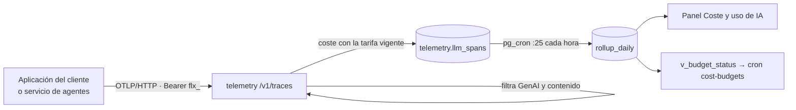

# Telemetría

Servicio que recibe las trazas OpenTelemetry de las llamadas a modelos de IA y calcula su coste. Alimenta
[Coste y uso de IA](../funcional/coste-uso-ia.md) y los [presupuestos](../funcional/presupuestos.md).

## Componentes

| Componente | Ubicación | Responsabilidad |
|---|---|---|
| Servicio `telemetry` | `services/telemetry` (FastAPI y asyncpg) | Recibe OTLP/HTTP, filtra, calcula el coste y escribe directamente en Postgres |
| Instrumentación propia | `packages/py-common/fluxion_common/telemetry.py` | `init_telemetry` y `llm_span`, que usa el servicio de agentes |
| Agregados | `telemetry.compute_rollup()` con pg_cron | Resumen diario por organización, sistema, proveedor, modelo y entorno |
| Panel y presupuestos | `apps/web/app/(app)/observabilidad/**`, `/api/cron/cost-budgets` | Lectura y avisos |



El servicio escribe directamente en la base de datos, y no por la API de ingesta, por el volumen de datos.

## Modelo de datos

| Objeto | Tipo | Campos clave | Migración |
|---|---|---|---|
| `telemetry.llm_spans` | tabla particionada por mes (`started_at`) | `organization_id`, `ai_system_id`, `trace_id`, `span_id`, `operation_name`, `provider_name`, `request_model`, `response_model`, `input_tokens`, `output_tokens`, `cached_tokens`, `reasoning_tokens`, `service_name`, `environment`, `duration_ms`, `ttft_ms`, `error_type`, `cost_input`, `cost_output`, `cost_total`, `currency`, `cost_status` (`exact`, `estimated`, `unknown`), `price_id`, `attributes`. PK `(organization_id, started_at, trace_id, span_id)` | `20260821090000_telemetry_core.sql`, `20260822120000_telemetry_ttft.sql` |
| `telemetry.model_prices` | tabla | `organization_id` (NULL = catálogo de Fluxion), `provider`, `model`, `effective_from`, precios por millón de entrada, salida, caché y razonamiento, `currency` | `20260821090000…`, `20260824090000_model_prices_per_org.sql` |
| `telemetry.price_at(provider, model, fecha, org)` | función | Tarifa vigente; la propia gana al catálogo | ídem |
| `telemetry.rollup_daily` | tabla | Llamadas, errores, tokens, `cost_total`, `calls_costed`, p50/p95 de duración y del primer token. Valores centinela para sistema y modelo nulos | `20260822090000_telemetry_rollups.sql` |
| `telemetry.rollup_runs` | tabla | Registro de cada cálculo | ídem |
| `telemetry.cost_budgets`, `cost_budget_alerts`, `v_budget_status` | tablas y vista | Presupuestos mensuales y avisos | `20260823090000_telemetry_budgets.sql` |
| `telemetry.v_models_without_price` | vista | Modelos con llamadas sin tarifa | `20260824090000…` |

**Funciones de mantenimiento:**
- `ensure_partitions(6)`: crea las particiones mensuales `llm_spans_yYYYYmMM`;
- `drop_partitions_before(fecha)`: borra las particiones anteriores a una fecha.

**Tareas de pg_cron:**
- `telemetry-rollup`, cada hora en el minuto 25: recalcula ayer y hoy;
- `telemetry-partitions`, el día 1 de cada mes.

**Acceso (RLS):**
- La organización lee sus datos y el catálogo de tarifas.
- Las trazas solo las escribe el servicio.

**Configuración de base de datos:** el esquema `telemetry` debe figurar en `PGRST_DB_SCHEMAS` para que la
web lo lea.

## API

### `POST /v1/traces`

| Aspecto | Comportamiento |
|---|---|
| Autenticación | `Authorization: Bearer flx_…` con `telemetry:write`, o los heredados `write` o `admin`. 401 «falta la credencial» o «credencial inválida o sin permiso» |
| Formato | OTLP/HTTP: protobuf si el `Content-Type` contiene `protobuf`; en otro caso, JSON. Sin gRPC |
| Tamaño | Hasta `MAX_BODY_BYTES` (8 MiB). Si se supera, 413 |
| Errores | 400 «lote ilegible». 503 si falla la escritura, para que el exportador reintente |
| Respuesta | `ExportTraceServiceResponse` vacío en protobuf, o `{}` en JSON, con cabeceras de recuento |

**Cabeceras de la respuesta:**
- `x-fluxion-accepted`;
- `x-fluxion-dropped-not-genai`;
- `x-fluxion-dropped-out-of-window`;
- `x-fluxion-dropped-content-attrs`.

### Qué se guarda

- **Tramos admitidos:** solo los de IA generativa, con `gen_ai.operation.name`.
- **Ventana:** se descartan los de hace más de 30 días o más de 48 horas en el futuro.
- **Contenido:** se descartan los atributos cuyo nombre contiene `prompt`, `completion`, `content`,
  `message`, `input.value`, `output.value`, `gen_ai.input`, `gen_ai.output`, `tool.arguments` o
  `tool.result`.
- **Duplicados:** se ignoran por clave primaria.

| Atributo OpenTelemetry | Columna |
|---|---|
| `gen_ai.operation.name` | `operation_name` |
| `gen_ai.provider.name` (alias `gen_ai.system`) | `provider_name`; `unknown` si falta |
| `gen_ai.request.model`, `gen_ai.response.model` | `request_model`, `response_model` |
| `gen_ai.usage.input_tokens`, `output_tokens`, `cached_input_tokens`, `reasoning_tokens` | `input_tokens`, `output_tokens`, `cached_tokens`, `reasoning_tokens` |
| `gen_ai.server.time_to_first_token` (segundos) | `ttft_ms` |
| `error.type` | `error_type` |
| Recurso `fluxion.system_id` | `ai_system_id`. Sin él, la llamada queda «sin adscribir» |
| Recurso `service.name`, `deployment.environment.name` | `service_name`, `environment` |
| Resto | `attributes` (jsonb) |

### Cálculo del coste

**Tarifa:** la más reciente del proveedor y el modelo con `effective_from` anterior a la fecha de la
llamada. La propia de la organización tiene prioridad sobre la del catálogo.

**Coste:** tokens / 1.000.000 × precio, redondeado a 6 decimales.
- Si hay precio de caché, los tokens servidos desde caché se cobran a ese precio. Si no, se cobran como
  entrada normal y el coste queda `estimated`.
- Los tokens de razonamiento se suman a la salida con su precio. Si no lo tienen, el coste queda
  `estimated`.
- Sin tarifa, el coste es `unknown`.

El coste se calcula al recibir la llamada y no se recalcula si cambia la tarifa.

### Configuración de un cliente

```bash
OTEL_EXPORTER_OTLP_PROTOCOL=http/protobuf
OTEL_EXPORTER_OTLP_ENDPOINT=https://otel.example.test
OTEL_EXPORTER_OTLP_HEADERS=authorization=Bearer%20flx_EJEMPLO
OTEL_EXPORTER_OTLP_COMPRESSION=none
OTEL_RESOURCE_ATTRIBUTES=service.name=scoring-api,fluxion.system_id=11111111-2222-3333-4444-555555555555,deployment.environment.name=production
```

Con un OpenTelemetry Collector, el exportador `otlphttp` debe usar `compression: none` y
`encoding: proto`.

### Instrumentación propia

`fluxion_common.telemetry`:
- `init_telemetry(service_name, system_id, environment)` crea el exportador HTTP/protobuf. No hace nada si
  falta `OTEL_EXPORTER_OTLP_ENDPOINT`.
- `llm_span(operation, provider, model, …)` abre un tramo con los atributos `gen_ai.*`.
  - `first_token()` marca el tiempo hasta el primer token.
  - `from_openai(resp)` toma los tokens de la respuesta de OpenAI.
  - No admite contenido.

La usa el servicio de agentes en la clasificación y en el asistente.

> TODO: confirmar varios comportamientos de la ingesta.
> - **Nombres antiguos de tokens** (`gen_ai.usage.prompt_tokens`, `completion_tokens`, `llm.usage.*`):
>   se descartan como si fueran contenido antes de traducirse, así que esas llamadas entran sin tokens ni
>   coste.
> - **Compresión gzip:** no está soportada. Un Collector con su configuración por defecto recibe 400 y
>   pierde los datos.
> - **`fluxion.system_id` no válido:** si no es un identificador válido, falla el lote entero con 503 y
>   el exportador reintenta indefinidamente.
> - **`x-fluxion-accepted`:** cuenta también los duplicados.
> - **`/health`:** responde 200 aunque la base de datos no esté disponible.
> - **Registro de cálculos fallidos:** si falla un cálculo de agregados, no queda registrado en
>   `rollup_runs`.
> - **Llamadas con retraso:** las que llegan con más de dos días de retraso no entran en los agregados.
> - **Conservación:** no hay borrado programado de las particiones antiguas.
> - **Monedas:** los agregados y los presupuestos suman costes de distintas monedas sin convertir.
> - **Atributos técnicos descartados:** el filtro de contenido descarta también atributos técnicos como
>   `error.message`.

### `GET /health`

Responde `{"status":"ok","db":true}` o `{"status":"degraded","db":false}`.

## Dependencias

| Dependencia | Uso |
|---|---|
| Postgres (`DATABASE_URL`) | Escritura de tramos, lectura de claves y tarifas |
| `fluxion.api_keys` | Validación de la clave |
| `fastapi` 0.115.6, `uvicorn` 0.34.0, `asyncpg` 0.30.0, `opentelemetry-proto` 1.29.0 | Servicio |

## Seguridad

- **Clave:** se valida como en la API de ingesta: SHA-256, revocación, caducidad y scope.
- **Organización:** sale de la clave, nunca del cuerpo.
- **Contenido:** no se guarda el de prompts ni respuestas.

Ver [Seguridad](seguridad.md).

## Configuración

| Variable | Obligatoria | Valor por defecto | Descripción |
|---|---|---|---|
| `DATABASE_URL` | Sí | — | Conexión directa a Postgres |
| `MAX_BODY_BYTES` | No | 8388608 | Tamaño máximo del lote |
| `DB_POOL_MAX` | No | 8 | Conexiones máximas |
| `LOG_LEVEL` | No | `INFO` | Nivel de log |
| `OTEL_EXPORTER_OTLP_ENDPOINT` | En los servicios instrumentados | — | Activa la instrumentación propia |
| `FLUXION_ENV` | No | — | Entorno de los tramos propios |

**Despliegue:**
- El servicio escucha en el puerto 8000, con un dominio público para los clientes.
- `docker-compose.yml` lo conecta a la red de Dokploy y a la de Supabase.

Ver [Despliegue](despliegue.md).
