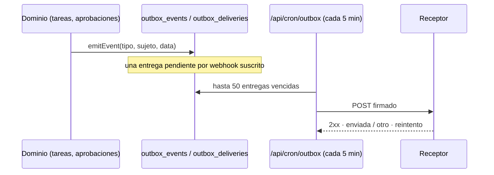

# Webhooks salientes

Envío automático y firmado de eventos de Fluxion a sistemas externos de la organización: las
[integraciones salientes](../glosario.md#integración-saliente-webhook).

Los eventos se guardan primero en un outbox inmutable. Una tarea programada los entrega con firma HMAC y
reintentos.

## Componentes

| Componente | Ubicación | Responsabilidad |
|---|---|---|
| Catálogo de eventos | `lib/outbox/events.ts` | `OUTBOX_EVENTS`: tipo, etiqueta, grupo y si está implementado |
| Emisión | `lib/outbox/emit.ts` | `emitEvent`: guarda el evento y crea una entrega por webhook suscrito. Nunca lanza errores |
| Despacho | `lib/outbox/dispatch.ts` | Envía las entregas pendientes, firma y reintenta |
| Tarea programada | `GET /api/cron/outbox` | Ejecuta el despacho cada 5 minutos |
| Gestión | `ajustes/actions.ts`, `ajustes/tabs/webhooks.tsx` | Alta, borrado y prueba de webhooks |



## Modelo de datos

| Objeto | Tipo | Campos clave | Migración |
|---|---|---|---|
| `fluxion.webhooks` | tabla | `name`, `url`, `secret` (`whsec_` + 32 bytes en hexadecimal), `events` (vacío = todos), `is_active`, `last_triggered_at` | `00000000000001_schema.sql` |
| `fluxion.outbox_events` | tabla | `event_type`, `subject_type`, `subject_id`, `payload`, `occurred_at`. Inmutable: un trigger impide modificarla y borrarla | `20260914090000_outbox.sql` |
| `fluxion.outbox_deliveries` | tabla | `event_id`, `target_kind` (`webhook`, `channel`), `target_id` (sin FK, para conservar el historial), `status` (`pending`, `sent`, `failed`, `abandoned`), `attempts`, `next_attempt_at`, `http_status`, `last_error`, `sent_at`. `UNIQUE (event_id, target_kind, target_id)` | ídem |

**Acceso:**
- La organización solo puede leer las entregas. Escribe el service role.
- Los webhooks solo los gestiona el Administrador.

## API

### Catálogo de eventos

| Evento | Etiqueta | Se emite | Sujeto | `data` |
|---|---|---|---|---|
| `approval.pending` | Aprobación pendiente | Al abrir una solicitud y cada vez que un voto la deja pendiente | `approval_request` | `object_type`, `object_label`, `step`, `total_steps`, `candidates` |
| `approval.approved` | Aprobación concedida | Al aprobarse la solicitud | `approval_request` | `object_label`, `status`, `reason` |
| `approval.rejected` | Aprobación rechazada | Al rechazarse | `approval_request` | ídem |
| `approval.cancelled` | Aprobación cancelada | — | — | — |
| `task.completed` | Tarea completada | Al pasar una tarea a completada desde su ficha o desde la lista | `task` | `title`, `previo`, `completada_por` |

La interfaz muestra también, marcados «aún sin emisor», los eventos:
- `evaluation.completed`, `evaluation.approved`;
- `gap.created`, `gap.closed`;
- `system.created`;
- `member.invited`, `member.role_changed`, `member.deactivated`, `member.removed`.

> TODO: confirmar varios eventos.
> - **`approval.cancelled`:** figura como implementado, pero cancelar una solicitud no lo emite.
> - **`task.completed`:** no se emite al completar desde el Kanban, en bloque o desde el plan de
>   tratamiento.
> - **`approval.pending` repetido:** se emite de nuevo con cada voto que deja la solicitud pendiente.
> - **Datos personales en `task.completed`:** incluye el nombre de quien completa la tarea, aunque la
>   migración indica que los eventos no llevan datos personales.

> **Pendiente de implementar.** Emisores de los eventos de evaluaciones, brechas, sistemas y miembros.

### Entrega

```http
POST https://receptor.example.test/hooks/fluxion
Content-Type: application/json
X-Fluxion-Event: approval.approved
X-Fluxion-Delivery: 7d3f0c2e-1111-4a2b-9c3d-000000000001
X-Fluxion-Signature: sha256=3b1f…a9

{"event":"approval.approved","event_id":"5a6b…","subject_type":"approval_request",
 "subject_id":"9e8d…","occurred_at":"2026-10-15T09:12:03.512Z",
 "data":{"object_label":"Sistema de scoring","status":"approved","reason":null}}
```

| Cabecera | Contenido |
|---|---|
| `X-Fluxion-Event` | Tipo de evento |
| `X-Fluxion-Delivery` | Identificador de la entrega. No cambia entre reintentos: sirve para deduplicar |
| `X-Fluxion-Signature` | `sha256=` + HMAC-SHA256 en hexadecimal del cuerpo exacto, con el secreto `whsec_…` como clave |

**Verificación en el receptor:**
1. Leer el cuerpo sin volver a serializarlo.
2. Calcular el HMAC-SHA256 con el secreto completo.
3. Compararlo en tiempo constante.

```python
import hmac, hashlib

def firma_valida(secreto: str, cuerpo: bytes, cabecera: str) -> bool:
    esperada = "sha256=" + hmac.new(secreto.encode(), cuerpo, hashlib.sha256).hexdigest()
    return hmac.compare_digest(esperada, cabecera)
```

La firma no incluye marca de tiempo. Para evitar repeticiones, el receptor debe deduplicar por
`X-Fluxion-Delivery`.

### Despacho y reintentos

- **Frecuencia:** cada 5 minutos, `/api/cron/outbox` procesa hasta 50 entregas vencidas, en orden y una
  a una. La primera entrega sale en la siguiente pasada.
- **Petición:** `POST` con un tiempo máximo de 10 segundos.
- **Resultado:**
  - una respuesta 2xx marca la entrega como `sent`;
  - cualquier otra respuesta o error de red programa un reintento.
- **Destino no válido:** si el webhook se ha borrado o está inactivo, la entrega pasa a `abandoned`.

| Intento fallido | Siguiente intento |
|---|---|
| 1.º | 5 min |
| 2.º | 15 min |
| 3.º | 60 min |
| 4.º | 6 h |
| 5.º | 24 h |
| 6.º | `abandoned` |

La respuesta de la tarea es `{checkedAt, intentadas, enviadas, fallidas, abandonadas}`.

> TODO: confirmar varios aspectos del despacho.
> - **Primer reintento:** sale a los 5 minutos, aunque el código prevé uno a 1 minuto.
> - **Datos no actualizados:** el estado `failed` y el «Último envío» del webhook no se actualizan nunca.
> - **Envíos dobles:** el despacho no bloquea las entregas que procesa. Si una pasada dura más de
>   5 minutos, otra puede enviar la misma entrega dos veces.
> - **Borrar una organización con eventos:** probablemente falla, porque el trigger de inmutabilidad
>   impide borrar sus eventos.

### Gestión

En **Ajustes › Webhooks**, el Administrador:
- **Crea un webhook:** nombre, URL y eventos, al menos uno. El secreto se muestra una sola vez.
- **Lo borra.**
- **Lo prueba:** envía `{"event":"test","timestamp","organization_id"}` firmado con `X-Fluxion-Event:
  test`, sin pasar por el outbox ni reintentar.

Cada acción queda en el registro de auditoría.

> TODO: confirmar dos aspectos de la gestión.
> - **Edición:** no se puede editar un webhook, cambiar sus eventos ni desactivarlo.
> - **Webhook de prueba:** su cuerpo y sus cabeceras no tienen la forma de una entrega real.

## Dependencias

| Dependencia | Uso | Si falla |
|---|---|---|
| Tarea programada del host | Llama a `/api/cron/outbox` cada 5 minutos | Las entregas se acumulan en `pending` |
| Receptor del cliente | Recibe los eventos | Reintentos hasta abandonar, unas 31 horas |

## Seguridad

- **Firma:** HMAC-SHA256 por webhook, con su propio secreto.
- **Tarea programada:** exige `CRON_SECRET`.
- **Registro:** los eventos son inmutables y cada entrega queda registrada.

Ver [Seguridad](seguridad.md).

## Configuración

| Variable | Obligatoria | Valor por defecto | Descripción |
|---|---|---|---|
| `CRON_SECRET` | Sí | — | Autentica la tarea programada |
| `SUPABASE_SERVICE_ROLE_KEY` | Sí | — | Escrituras del outbox |

Programación en `infra/schedules/crontab`: `*/5 * * * *`. Ver [Tareas programadas](tareas-programadas.md).
